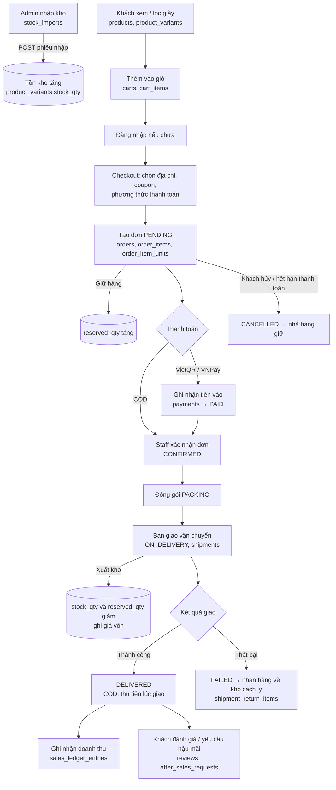
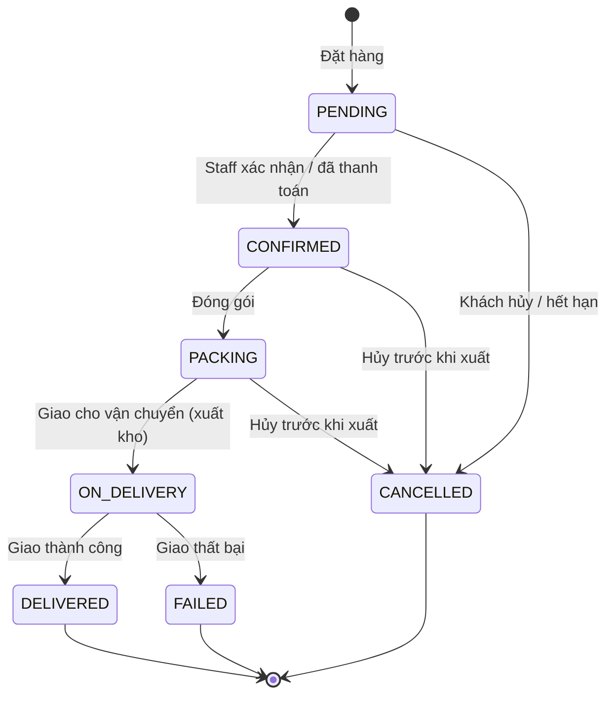
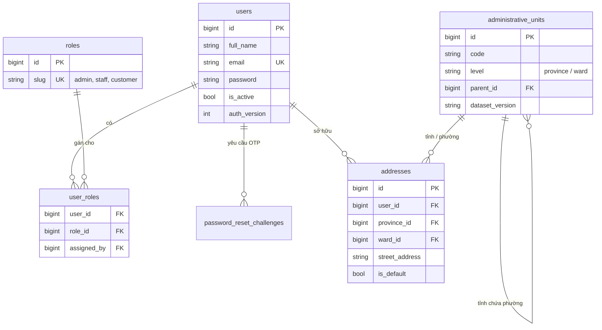
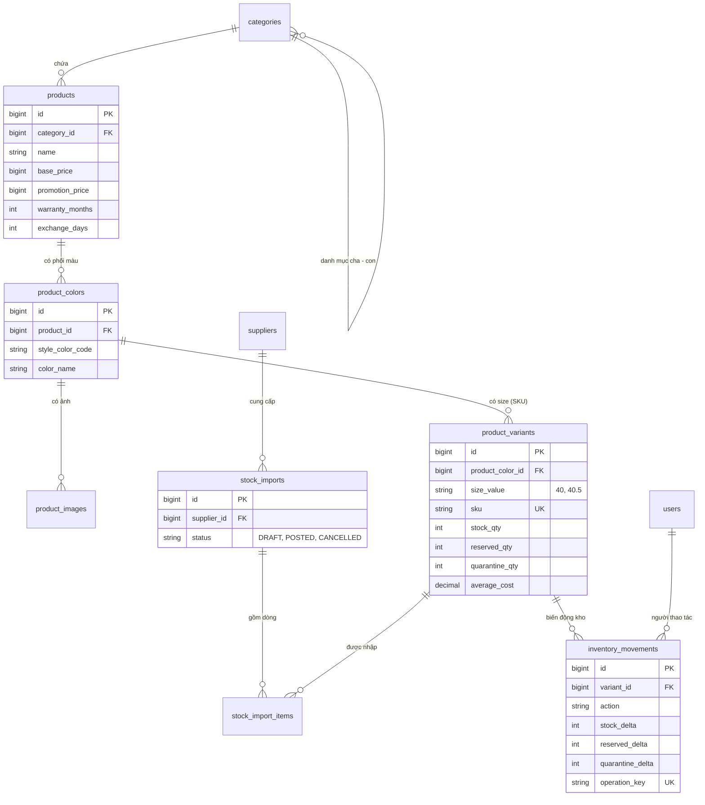
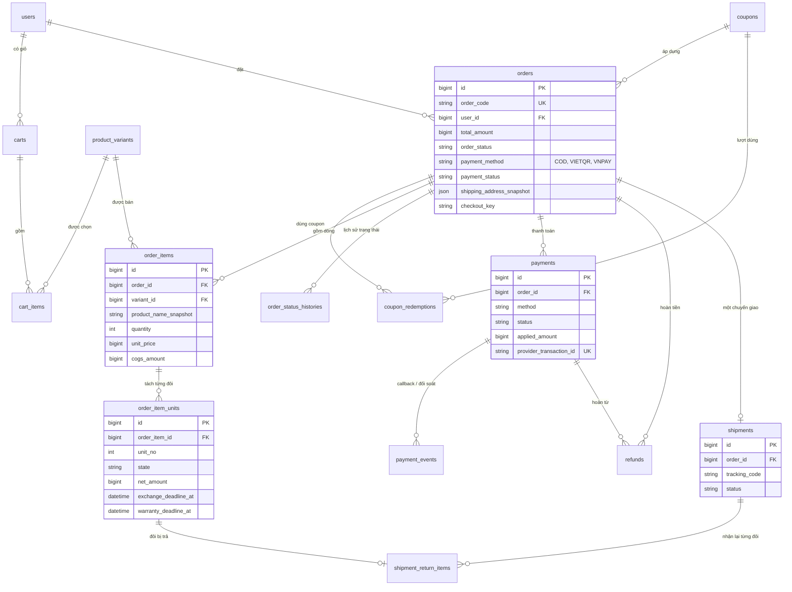
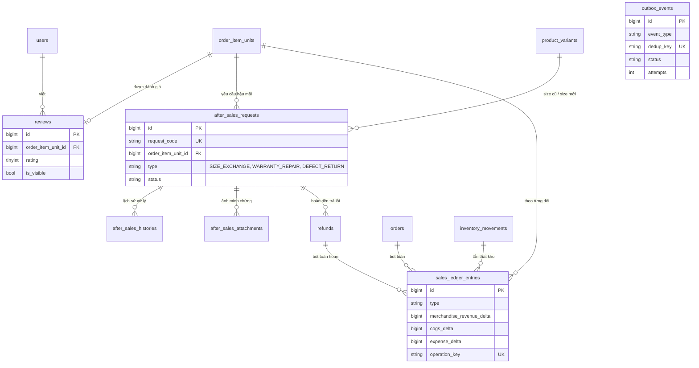

# Cena Store — Luồng nghiệp vụ, ERD và danh sách chức năng

> Tài liệu tóm tắt để cả nhóm hiểu project và trả lời được khi thầy hỏi.
> Nguồn: [specification.md](specification.md) (kế hoạch gốc) và [database/schema.md](database/schema.md) — cập nhật 01/11/2026.
> Sơ đồ viết bằng Mermaid: xem đẹp nhất trên GitHub hoặc VS Code (cài extension Markdown Preview Mermaid).

**Mục lục**

1. [Project là gì](#1-project-là-gì)
2. [Luồng nghiệp vụ chính: từ xem giày đến giao hàng](#2-luồng-nghiệp-vụ-chính)
3. [Sơ đồ ERD](#3-sơ-đồ-erd)
4. [Giải thích từng bảng](#4-giải-thích-từng-bảng)
5. [Danh sách chức năng: đã làm và sẽ làm](#5-danh-sách-chức-năng)
6. [Các câu thầy hay hỏi](#6-các-câu-thầy-hay-hỏi)

---

## 1. Project là gì

Website bán giày một cửa hàng, một kho, viết bằng **Laravel 13 (PHP 8.4) + MySQL 8.4**, giao diện Blade/Tailwind giữ thiết kế Cena gốc.

- **Khách (Customer):** xem giày, lọc, thêm giỏ, đặt hàng, thanh toán (COD / chuyển khoản VietQR / VNPay Sandbox), theo dõi đơn, đánh giá, yêu cầu đổi size / bảo hành / trả hàng lỗi.
- **Nhân viên (Staff):** xử lý đơn, đóng gói, giao hàng, nhận hàng trả, xử lý hậu mãi.
- **Quản trị (Admin):** quản lý sản phẩm, nhập kho, coupon, người dùng, hoàn tiền, xem báo cáo.

Ba vai trò lưu trong bảng `roles`, gán cho người dùng qua `user_roles`.

---

## 2. Luồng nghiệp vụ chính

Luồng quan trọng nhất là **đặt mua một đôi giày → giao thành công**. Các luồng khác (hủy, giao thất bại, đổi size, trả hàng) đều rẽ nhánh từ luồng này.

### 2.1. Sơ đồ tổng quát

### 2.2. Diễn giải từng bước

| # | Bước | Ai làm | Bảng bị ghi | Ghi chú dễ nhớ |
|---|---|---|---|---|
| 1 | Nhập hàng từ nhà cung cấp | Admin | `stock_imports`, `stock_import_items`, `product_variants`, `inventory_movements` | Phiếu nháp (DRAFT) sửa được; khi **POST** thì tồn kho tăng và tính lại giá vốn bình quân. Đã POST thì không sửa nữa. |
| 2 | Xem và lọc giày | Khách | chỉ đọc `products`, `product_colors`, `product_variants`, `product_images` | Một mẫu giày có nhiều màu, mỗi màu có nhiều size. Mỗi (màu, size) là một SKU. |
| 3 | Thêm vào giỏ | Khách | `carts`, `cart_items` | Thêm giỏ **chưa giữ hàng**. Khách chưa đăng nhập vẫn có giỏ; đăng nhập thì gộp giỏ. |
| 4 | Checkout | Khách | `orders`, `order_items`, `order_item_units`, `coupon_redemptions`, `inventory_movements` | Server tự tính tiền, không tin số tiền gửi từ trình duyệt. Kiểm còn hàng rồi **giữ hàng** (reserved). Bấm đặt 2 lần vẫn chỉ ra 1 đơn. |
| 5 | Thanh toán | Khách / hệ thống / Staff | `payments`, `payment_events`, `orders.payment_status` | COD: trả khi nhận. VietQR: Staff đối soát sao kê. VNPay: cổng gọi về (IPN), kiểm chữ ký và số tiền. |
| 6 | Xác nhận, đóng gói | Staff | `orders`, `order_status_histories` | Mỗi lần đổi trạng thái đều ghi lịch sử, ai làm, lúc nào. |
| 7 | Giao cho đơn vị vận chuyển | Staff | `shipments`, `inventory_movements`, `order_items.cogs_amount` | Lúc này hàng **rời kho**: tồn kho và hàng giữ cùng giảm; chốt giá vốn của đơn. |
| 8 | Giao thành công | Staff | `orders` → DELIVERED, `sales_ledger_entries` | Chỉ khi **đã giao và đã thu đủ tiền** mới tính là doanh thu. Bắt đầu tính hạn đổi size 7 ngày, bảo hành 6 tháng. |
| 9 | Sau bán | Khách / Staff | `reviews`, `after_sales_requests`, `refunds` | Đánh giá và hậu mãi gắn với **từng đôi** đã mua, không phải cả đơn. |

**Rẽ nhánh hay gặp**

- **Hủy trước khi giao:** đơn → CANCELLED, chỉ nhả phần giữ hàng (`reserved_qty` giảm), không cộng tồn kho vì hàng chưa rời kho.
- **Hết hạn thanh toán online (30 phút)** hoặc **COD không xác nhận sau 24 giờ:** hệ thống tự hủy.
- **Giao thất bại:** hàng nhận về được đưa vào **kho cách ly** (`quarantine_qty`), kiểm tra xong mới nhập lại để bán hoặc ghi hỏng.
- **Đổi size:** giữ đôi size mới, nhận đôi cũ, đổi xong thì ghi hai chiều kho trong cùng một lần.
- **Trả hàng lỗi:** nhận đôi lỗi về cách ly → hoàn tiền đúng phần của đôi đó.

### 2.3. Ba con số tồn kho (rất hay bị hỏi)

Mỗi SKU trong `product_variants` có ba con số:

| Cột | Ý nghĩa | Ví dụ |
|---|---|---|
| `stock_qty` | Số đôi đang nằm trong kho, bán được, **gồm cả đôi đã giữ cho đơn** | 10 |
| `reserved_qty` | Trong số đó, bao nhiêu đôi đã giữ cho đơn chưa giao | 3 |
| `quarantine_qty` | Đôi khách trả về / giao thất bại, đang chờ kiểm tra, **chưa được bán** | 1 |

**Còn bán được = `stock_qty − reserved_qty` = 7.** Mọi thay đổi ba con số này đều ghi một dòng trong `inventory_movements` (trước, thay đổi, sau), nên luôn truy vết được.

### 2.4. Trạng thái đơn hàng

Trạng thái thanh toán đi riêng: `UNPAID → PAID → (REFUND_PENDING → PARTIALLY_REFUNDED / REFUNDED)`.

---

## 3. Sơ đồ ERD

Có **34 bảng nghiệp vụ** (cộng 6 bảng hạ tầng của Laravel: sessions, cache, jobs... và bảng `migrations` = 41 bảng). Để dễ đọc, ERD chia thành 4 cụm. Ký hiệu: `||--o{` là "một – nhiều".

### 3.1. Cụm Tài khoản và Địa chỉ

### 3.2. Cụm Sản phẩm và Kho

### 3.3. Cụm Giỏ hàng, Đơn hàng, Thanh toán, Giao hàng

### 3.4. Cụm Hậu mãi, Đánh giá, Sổ cái, Thông báo

`outbox_events` không có khóa ngoại cứng: nó lưu loại đối tượng (`aggregate_type`: đơn, RMA, hoàn tiền, user) và id của đối tượng đó.

---

## 4. Giải thích từng bảng

Quy ước chung: tiền là **số nguyên VND** (không nhân 100), giá vốn là `DECIMAL(20,4)`, thời gian lưu UTC và hiển thị giờ Việt Nam. Các bảng có `deleted_at` dùng **xóa mềm** (ẩn đi chứ không xóa thật) để không mất lịch sử đơn cũ.

### Nhóm 1 — Tài khoản và địa chỉ (6 bảng)

| # | Bảng | Dùng để làm gì | Cột quan trọng |
|---|---|---|---|
| 1 | `users` | Tài khoản đăng nhập của mọi người dùng | `email` (duy nhất), `password` (đã băm), `is_active` (khóa tài khoản), `auth_version` (tăng lên để đăng xuất mọi phiên khi đổi mật khẩu/khóa) |
| 2 | `roles` | Danh sách vai trò: admin, staff, customer | `slug` |
| 3 | `user_roles` | Gán vai trò cho người dùng (một người có thể nhiều vai trò) | `user_id`, `role_id`, `assigned_by` (ai cấp quyền) |
| 4 | `password_reset_challenges` | Quên mật khẩu bằng mã OTP | `otp_hash` (chỉ lưu mã đã băm), `attempts` (tối đa 5 lần sai), `expires_at` (15 phút) |
| 5 | `administrative_units` | Danh mục tỉnh/thành và phường/xã (2 cấp, theo địa giới mới) | `code`, `level`, `parent_id` (phường thuộc tỉnh nào), `dataset_version` |
| 6 | `addresses` | Sổ địa chỉ giao hàng của khách | `province_id`, `ward_id`, `street_address`, `is_default`; có lưu kèm tên tỉnh/phường lúc chọn |

### Nhóm 2 — Danh mục và sản phẩm (5 bảng)

| # | Bảng | Dùng để làm gì | Cột quan trọng |
|---|---|---|---|
| 7 | `categories` | Danh mục giày, tối đa 2 cấp (vd: Nam → Chạy bộ) | `parent_id`, `gender_group`, `slug` |
| 8 | `products` | Một mẫu giày (vd: Air Force 1) | `base_price`, `promotion_price`, `warranty_months` (6), `exchange_days` (7), `rating_avg` |
| 9 | `product_colors` | Một phối màu của mẫu giày | `style_color_code` (vd: CW2288-111), `color_name`, `color_key` |
| 10 | `product_images` | Ảnh của từng phối màu | `storage_path` hoặc `external_url`, `is_thumbnail`, `display_order` |
| 11 | `product_variants` | **SKU = phối màu + size** — đơn vị bán và tồn kho thật | `size_value` (chuỗi "40.5", không dùng số thực), `sku`, `stock_qty`, `reserved_qty`, `quarantine_qty`, `average_cost` |

### Nhóm 3 — Nhập kho và sổ kho (4 bảng)

| # | Bảng | Dùng để làm gì | Cột quan trọng |
|---|---|---|---|
| 12 | `suppliers` | Nhà cung cấp | `code`, `name`, `is_active` |
| 13 | `stock_imports` | Phiếu nhập kho | `status` (DRAFT/POSTED/CANCELLED), `total_quantity`, `total_cost_amount`, `posted_at` |
| 14 | `stock_import_items` | Từng dòng của phiếu nhập: SKU nào, bao nhiêu, giá nhập | `variant_id`, `quantity`, `unit_cost_amount` |
| 15 | `inventory_movements` | **Sổ kho**: mỗi lần kho thay đổi là một dòng, không sửa/xóa | `action` (nhập, giữ, nhả, xuất, nhận trả...), các cột `*_delta`, `*_before`, `*_after`, `operation_key` (chống ghi trùng) |

### Nhóm 4 — Giỏ hàng và coupon (4 bảng)

| # | Bảng | Dùng để làm gì | Cột quan trọng |
|---|---|---|---|
| 16 | `carts` | Giỏ hàng của user hoặc của khách chưa đăng nhập | `user_id` hoặc `guest_token_hash`, `version` (tăng mỗi lần sửa giỏ) |
| 17 | `cart_items` | Món trong giỏ | `variant_id` (mỗi SKU một dòng), `quantity` (1–10) |
| 18 | `coupons` | Mã giảm giá | `type` (PERCENTAGE / FIXED / FREE_SHIPPING), `value`, `usage_limit`, `per_user_limit`, thời hạn |
| 19 | `coupon_redemptions` | Mỗi lần một đơn dùng coupon | `status` (RESERVED → CONSUMED, hoặc RELEASED khi hủy đơn); chống dùng quá lượt |

### Nhóm 5 — Đơn hàng (4 bảng)

| # | Bảng | Dùng để làm gì | Cột quan trọng |
|---|---|---|---|
| 20 | `orders` | Đơn hàng — trung tâm của hệ thống | `order_code`, tiền (`subtotal_amount`, giảm giá, phí ship, `total_amount`), `order_status`, `payment_method`, `payment_status`, `shipping_address_snapshot`, `checkout_key` (chống tạo đơn trùng) |
| 21 | `order_items` | Từng dòng sản phẩm trong đơn | `variant_id`, `quantity`, `unit_price`, các cột `*_snapshot` (tên, màu, size lúc mua), `cogs_amount` (giá vốn chốt lúc xuất kho) |
| 22 | `order_item_units` | **Tách mỗi đôi thành một dòng** (mua 2 đôi = 2 dòng) | `unit_no`, `state`, `net_amount` (tiền của riêng đôi đó), hạn đổi size, hạn bảo hành |
| 23 | `order_status_histories` | Lịch sử đổi trạng thái đơn | `from_status`, `to_status`, `actor_id`, `reason_code` |

### Nhóm 6 — Thanh toán và hoàn tiền (3 bảng)

| # | Bảng | Dùng để làm gì | Cột quan trọng |
|---|---|---|---|
| 24 | `payments` | Mỗi lần thử thanh toán / ghi nhận tiền | `method`, `status`, `expected_amount`, `received_amount`, `applied_amount`, `provider_transaction_id` (duy nhất) |
| 25 | `payment_events` | Mỗi lần VNPay gọi về hoặc Staff đối soát | `event_key` (chống xử lý lặp), `signature_valid`, `payload_redacted` (đã che thông tin nhạy cảm) |
| 26 | `refunds` | Một khoản hoàn tiền | `status` (REQUESTED → APPROVED → SUCCEEDED...), `amount`, ai yêu cầu/duyệt/chi, bằng chứng chuyển khoản |

### Nhóm 7 — Giao hàng (2 bảng)

| # | Bảng | Dùng để làm gì | Cột quan trọng |
|---|---|---|---|
| 27 | `shipments` | Chuyến giao của đơn (1 đơn 1 chuyến) | `tracking_code`, `carrier_name`, `status` (READY, IN_TRANSIT, DELIVERED, RETURNING...) |
| 28 | `shipment_return_items` | Nhận lại từng đôi khi giao thất bại | `order_item_unit_id`, `disposition` (nhập lại bán / ghi hỏng), `cost_basis` |

### Nhóm 8 — Đánh giá và hậu mãi (4 bảng)

| # | Bảng | Dùng để làm gì | Cột quan trọng |
|---|---|---|---|
| 29 | `reviews` | Đánh giá của khách cho một đôi đã nhận | `rating` (1–5), `comment`, `admin_reply`, `is_visible` |
| 30 | `after_sales_requests` | Yêu cầu hậu mãi (RMA) trên một đôi | `type` (đổi size / bảo hành sửa / trả hàng lỗi), `status`, size cũ – size mới, chi phí sửa |
| 31 | `after_sales_histories` | Lịch sử xử lý từng yêu cầu hậu mãi | `from_status`, `to_status`, `event_type`, `visibility` (khách xem được hay chỉ nội bộ) |
| 32 | `after_sales_attachments` | Ảnh minh chứng của khách (lưu riêng tư) | `path`, `mime_type`, `size_bytes`, `sha256` |

### Nhóm 9 — Báo cáo và thông báo (2 bảng)

| # | Bảng | Dùng để làm gì | Cột quan trọng |
|---|---|---|---|
| 33 | `sales_ledger_entries` | **Sổ cái bán hàng** để làm báo cáo doanh thu, giá vốn, lợi nhuận | `type` (ghi nhận bán, đảo doanh thu, tổn thất kho...), các cột `*_delta` (có thể âm), `operation_key` |
| 34 | `outbox_events` | Hàng đợi email/thông báo, gửi sau khi dữ liệu đã lưu xong | `event_type`, `dedup_key`, `status`, `attempts` (tối đa 10), `lease_until` |

---

## 5. Danh sách chức năng

Kế hoạch có **12 giai đoạn (P00–P11), 51 task**, làm tuần tự. Ký hiệu: ✅ đã xong · 🟡 đang làm · 🎨 đã có giao diện chuẩn bị, chưa nối backend · ⬜ chưa làm.

### 5.1. Đã thực hiện

| Hạng mục | Trạng thái | Nội dung |
|---|---|---|
| Khởi tạo project, môi trường, CI | ✅ | Laravel 13, MySQL 8.4 riêng cho dev và test; GitHub Actions tự cài sạch và chạy toàn bộ test |
| Giao diện trang chủ | ✅ | Port nguyên thiết kế Cena gốc sang Blade (hero, bộ sưu tập, menu, footer) |
| Cơ sở dữ liệu | ✅ | 34 bảng nghiệp vụ, 70 khóa ngoại, 110 ràng buộc CHECK; rollback và dựng lại được |
| Model và dữ liệu trả về | ✅ | 34 model, 31 enum, Resource tách Khách/Admin (khách không thấy giá vốn, ghi chú nội bộ) |
| Quy tắc tiền và thời gian | ✅ | Tiền VND nguyên, chia tiền giảm giá không lệch 1đ, giá vốn bình quân, hạn đổi size/bảo hành theo giờ VN |
| Vai trò và tài khoản demo | 🟡 | Seed 3 vai trò, tài khoản demo bật tùy chọn. Còn thiếu dữ liệu tỉnh/phường thật |
| Sổ cái bán hàng, hàng đợi thông báo | 🟡 | Code + test xong, chưa có màn hình dùng tới |
| Dịch vụ kho (InventoryService) | 🟡 | Giữ/nhả/xuất/nhập/cách ly/điều chỉnh kho, chống bán quá số lượng khi 2 người mua cùng lúc |
| Component giao diện chuẩn bị | 🎨 | Form đăng nhập/đăng ký/OTP/hồ sơ/địa chỉ, form sản phẩm admin, thẻ sản phẩm, bộ lọc, giỏ, đơn hàng, RMA... |

Hiện có **855 test tự động** chạy trên MySQL thật, đều đạt. Người dùng mở web **mới chỉ thấy trang chủ**: các chức năng bên dưới chưa dùng được.

### 5.2. Sẽ thực hiện

| Giai đoạn | Chức năng | Trạng thái |
|---|---|---|
| P01.04 | Nhập dữ liệu tỉnh/phường thật, seed nền đầy đủ | 🟡 chờ dataset + validator |
| P02 | Đăng ký, đăng nhập, đăng xuất, khóa tài khoản; phân quyền Admin/Staff; quên mật khẩu bằng OTP; hồ sơ + avatar; sổ địa chỉ | 🎨 |
| P03 | Layout chung; quản lý danh mục, nhà cung cấp; quản lý sản phẩm kèm màu/size/ảnh; trang danh sách sản phẩm | 🎨 |
| P04 | Phiếu nhập kho, thẻ kho, kiểm kê, dữ liệu tồn kho mẫu | ⬜ (đã có dịch vụ kho) |
| P05 | Trang chủ, danh sách, chi tiết sản phẩm; giỏ hàng AJAX; gộp giỏ khi đăng nhập | 🎨 |
| P06 | Tính giá, coupon, checkout tạo đơn, tự hủy đơn quá hạn | ⬜ |
| P07 | Thanh toán COD, VietQR, VNPay Sandbox; hoàn tiền | ⬜ |
| P08 | Quản lý đơn, giao hàng, giao thất bại, theo dõi đơn, in phiếu PDF | 🎨 |
| P09 | Đánh giá sản phẩm; đổi size, bảo hành, trả hàng lỗi theo từng đôi | 🎨 |
| P10 | Dashboard doanh thu/giá vốn/tồn kho (biểu đồ); gửi email; dữ liệu demo | ⬜ |
| P11 | Kiểm thử toàn bộ, kiểm thử trình duyệt, rà bảo mật, triển khai, báo cáo môn học | ⬜ |

**Thứ tự bắt buộc:** P01.04 → P01.05 → P02 → P03 → P04 → P05 → P06 → P07 → P08 → P09 → P10 → P11. Muốn demo đăng nhập thật cần xong P02.01; demo mua hàng COD cần tới P06.03 và P07.01.

---

## 6. Các câu thầy hay hỏi

**Vì sao phải có `order_item_units` khi đã có `order_items`?**
Vì hậu mãi, đánh giá, hoàn tiền tính trên **từng đôi**. Mua 2 đôi, đổi size 1 đôi và trả 1 đôi lỗi thì phải biết rõ đôi nào. `order_items` = dòng hàng (SKU × số lượng), `order_item_units` = từng đôi cụ thể.

**Vì sao lưu "snapshot" (tên, giá, địa chỉ) trong đơn mà không nối thẳng bảng sản phẩm/địa chỉ?**
Sau này sản phẩm có thể đổi tên, đổi giá, khách sửa địa chỉ. Đơn cũ phải giữ đúng thông tin **tại lúc mua**.

**Vì sao cần `inventory_movements` khi đã có `stock_qty`?**
`stock_qty` chỉ cho biết con số hiện tại. Sổ kho cho biết **vì sao** có con số đó (nhập phiếu nào, giao đơn nào). Cộng tất cả dòng sổ kho phải ra đúng số hiện tại; lệch là có lỗi.

**Làm sao chống 2 người cùng mua đôi cuối cùng?**
Khi checkout, hệ thống khóa dòng SKU trong database (`SELECT ... FOR UPDATE`), kiểm còn hàng rồi mới giữ hàng. Người thứ hai phải chờ, và thấy hết hàng. Đã có test chạy 2 tiến trình MySQL thật để chứng minh.

**Bấm "Đặt hàng" 2 lần có ra 2 đơn không?**
Không. Mỗi lần checkout có `checkout_key`, unique theo user. Gửi lại cùng key thì trả về đơn cũ. Tương tự, kho, sổ cái và thông báo đều có `operation_key` / `dedup_key` để không ghi trùng.

**Khi nào tính là doanh thu?**
Chỉ khi đơn **đã giao thành công và đã thu đủ tiền**. Thanh toán trước hoặc hoàn tiền không tự động là doanh thu; doanh thu được ghi vào `sales_ledger_entries`.

**Giá vốn tính thế nào?**
Bình quân gia quyền: mỗi lần nhập, `giá vốn mới = (tồn × giá cũ + số nhập × giá nhập) / (tồn + số nhập)`, làm tròn 4 chữ số thập phân. Khi xuất kho, chốt giá vốn hiện tại vào đơn để tính lợi nhuận.

**Vì sao tiền dùng số nguyên?**
Số thực (float) bị sai số kiểu 0.1 + 0.2 ≠ 0.3. VND không có xu nên dùng `BIGINT`; phân bổ giảm giá theo quy tắc dư lớn nhất để tổng không lệch 1đ.

**Khác gì so với source cũ (Spring Boot + SQL Server)?**
Source cũ bị thiếu: kiểm tồn kho khi đặt, quyền sở hữu giỏ/đơn, lịch sử kho, thanh toán thật, hậu mãi, báo cáo đúng định nghĩa. Bản mới thiết kế lại để giải quyết các lỗi đó (đặc tả mục 16 liệt kê 48 vấn đề).
