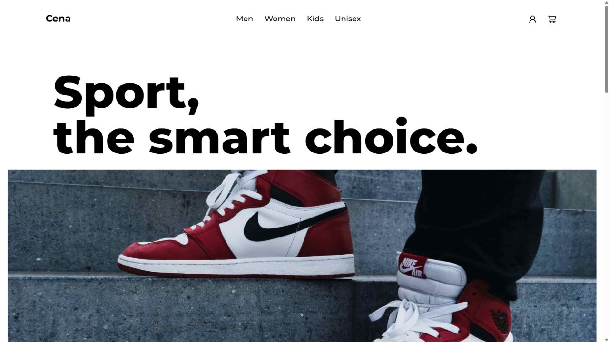
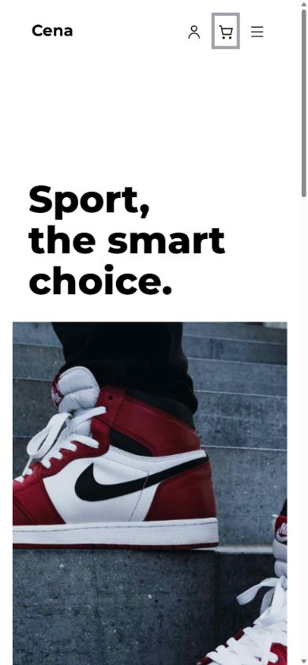
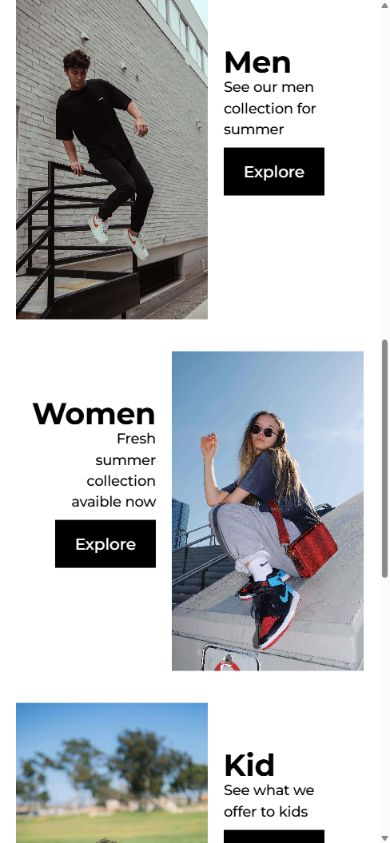
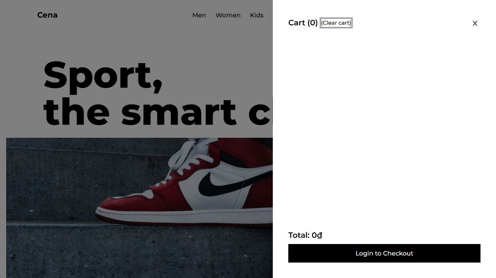

# Biên bản nghiệm thu P00 — Cena Store Laravel

Ngày: **31/10/2026**. Kết quả: **P00.01, P00.02, P00.03 hoàn thành trong môi trường local đã kiểm chứng**. Workflow GitHub Actions được tạo và kiểm bằng actionlint; chưa có run remote trên GitHub. Không suy diễn kết quả local thành kết quả runner Linux/remote.

## 1. Phạm vi đã giao

Project mới: `C:/Users/trung/Downloads/cena-store-laravel`, Git riêng, nhánh `codex/p00-foundation`. Không tạo commit/push/remote. Source cũ `C:/Users/trung/Downloads/Shoe-Store_HQTCSDL/Shoe-Store_HQTCSDL` không bị chỉnh sửa.

Đã nhận và áp dụng yêu cầu bổ sung của người dùng: **giữ giao diện source gốc**. Homepage, hero, typography Montserrat, màu sắc, nội dung, collections, navbar/footer và icon gốc đã được chuyển sang Blade/CSS/Alpine. Không dùng giao diện giới thiệu “Từng bước khác biệt” tạo lúc đầu.

Đây là nền tảng P00. Menu/cart là shell hiển thị; Explore/Account báo sắp mở, chưa tạo sản phẩm/giỏ/đơn hay xác thực thật. Các màn hình còn lại được chuyển theo phase nghiệp vụ, giữ thiết kế gốc. Không tuyên bố toàn bộ website đã hoàn thành.

## 2. Nghiệm thu từng task

| Task / tiêu chí | Tệp và bằng chứng | Kết quả |
|---|---|---|
| P00.01 — Đọc kế hoạch/source và phân biệt port/viết mới | `../architecture/decisions.md`, `../specification.md` | PASS: ghi rõ giữ UI, viết lại auth/DB/services/transactions |
| P00.01 — Chốt danh mục/schema/thuật ngữ | ADR-003..006; nguyên danh mục34 bảng, enum,15 bất biến | PASS:34 miền+6 hạ tầng; migrations không tính vào40 |
| P00.01 — Laravel13, role pivot, màu riêng, VND, reserve, shipment/RMA | Decisions + config/store.php; contract đồng nhất với spec | PASS: contract đã freeze; không giả nhận đã có nghiệp vụ |
| P00.01 — Ma trận yêu cầu môn học | `../requirements/traceability.md`, rubric-extract.txt, source-manifest.json | PASS: rubric thật đã đọc; ngày nộp cụ thể/đề tài duyệt chưa tự điền |
| P00.02 — Project mới giữ source cũ | source-preservation-result.json, before/after manifests | PASS:320 file giữ nguyên,0 thêm/xóa/sửa ở source cũ |
| P00.02 — Runtime thực tế và extensions | runtime-versions.json; composer check-platform-reqs | PASS:PHP8.4.27, Composer2.9.4, Node22.23.4/npm10.9.9, MySQL8.4.3 |
| P00.02 — Dependency đúng nhánh/version, lock | composer.json/lock, package.json/lock | PASS:Tailwind3.4, Alpine3, Chart4, Vite, DomPDF; không --force |
| P00.02 — Validate/install/ci/build | clean-install-result.json + clean-install-log.txt | PASS:tất cả exit0, từ thư mục không có vendor/node_modules/build |
| P00.02 — Blade render thật | FoundationSmokeTest,34 HTTP probes, ảnh UI | PASS:trang chủ/health200, assets/font/ảnh tải được |
| P00.02 — DB/user riêng, Mailpit, public/private | InfrastructureConnectionTest; http-storage-mailpit.json | PASS:MySQL thật, quyền chéo bị từ chối; SMTP/UI chạy; private không public |
| P00.03 — Test database không trỏ development | phpunit.xml, TestCase, TestDatabaseGuard, unit matrix | PASS:MySQL/cena_store_test/cena_test hoặc cena_ci; DB_URL rỗng; không root/app user |
| P00.03 — Smoke kiểm tên DB thực và quyền | InfrastructureConnectionTest | PASS:SELECT DATABASE()/CURRENT_USER()/VERSION()/time_zone trên MySQL thật |
| P00.03 — Từ chối config cache nguy hiểm | config-cache-rejected.txt | PASS:negative check bị chặn, sau đó clear cache và toàn suite qua |
| P00.03 — CI workflow | .github/workflows/ci.yml; workflow-lint.json | PASS:actionlint1.7.12 exit0; chưa chạy GitHub remote |
| P00.03 — Clean checkout tương đương | clean-install-result.json; clean-copy-source-match.json | PASS:export theo Git ignore, env/password mới, DB server/datadir mới, usercena_ci,95 file mã/cấu hình khớp |
| P00.03 — CI không provision nhầm môi trường có dữ liệu | ci-bootstrap-safety.json | PASS:từ chối env có sẵn trước connect; từ chối schema/account có sẵn trước sửa quyền/password |
| P00.03 — Secret/upload/cache không vào Git | git-and-secret-check.json; .gitignore | PASS:env/uploads/vendor/node_modules/build bị ignore; không thấy credential/key local trong file đủ điều kiện đưa vào Git |
| P00.03 — Nhật ký/README/quy trình commit | ../ai-progress.md, README.md | PASS:task/evidence/giới hạn/task tiếp theo; chưa commit khi người dùng chưa yêu cầu |

## 3. Lệnh đã chạy và kết quả thật

Các lệnh gốc dưới đây được gọi bằng runtime portable qua `scripts/php.ps1`, `composer.ps1`, `npm.ps1`. Clean-copy gọi trực tiếp binary tương ứng, không phụ thuộc PATH hệ thống.

| Lệnh / kiểm tra | Kết quả |
|---|---|
| `composer validate --strict` | exit0, manifest hợp lệ và lock đồng bộ |
| `composer install --no-interaction --prefer-dist --no-progress` | exit0; cài mới thành công trong clean-copy |
| `composer check-platform-reqs` | exit0, toàn bộ requirement đạt |
| `npm ci` | exit0,98 packages được cài; audit0 vulnerabilities tại thời điểm kiểm |
| `npm run build` | exit0; Vite8.3.5 build CSS/JS và font local |
| `php artisan migrate --force --no-interaction` | exit0;3 migrations hạ tầng |
| `php artisan migrate --env=testing --force --no-interaction` | exit0; schema test riêng |
| `php artisan storage:link --no-interaction` | exit0; Windows Junction chỉ tới storage/app/public |
| `php artisan test --compact tests/Unit/TestDatabaseGuardTest.php` | 8 tests qua:2 tài khoản hợp lệ,6 cấu hình bị từ chối |
| `php artisan test --compact tests/Feature/FoundationSmokeTest.php` | 6 tests qua:home gốc/health/route chưa làm/private/config/PDF |
| `php artisan test --compact tests/Feature/InfrastructureConnectionTest.php` | 3 tests qua:DB thật/7 bảng/quyền chéo |
| `php artisan test --compact` | **19 tests passed,39 assertions** |
| `php artisan test --compact --order-by=random --random-order-seed=20261031` | **19 tests passed,39 assertions**, clean-copy MySQL mới |
| `php vendor/bin/pint --format agent` và `--dirty --format agent` | PASS; clean-copy không đổi hash PHP sau formatter |
| `php artisan view:cache --no-interaction` | exit0, Blade compile thành công |
| `php -l` trên33 file PHP source không gồm Blade/vendor | tất cả exit0 |
| PowerShell Parser trên7 helper scripts | 0 syntax errors |
| `actionlint .github/workflows/ci.yml` | exit0, version1.7.12, archive checksum đã kiểm |
| `git diff --check` | exit0 |
| HTTP `/`, `/up`, assets/font/ảnh và public/private probes |34 lượt kiểm có status đúng kỳ vọng |
| Mailpit UI / SMTP EHLO / NOOP | HTTP200 /250 /250; không gửi email ra ngoài |

19 test gồm17 test/case mới của P00 và2 ví dụ có sẵn trong Laravel skeleton. Hai ví dụ baseline được giữ nguyên; không dùng chúng làm bằng chứng nghiệp vụ. P00 chưa kiểm race condition tiền/kho, chưa có Money/PricingService hoặc payment/RMA để test. Những bằng chứng đó thuộc đúng phase sau.

Một lần test ban đầu dùng `Schema::getTableListing()` trả tên có schema prefix trên Laravel13; đã chuyển sang `schemaQualified: false`, chạy lại file test và cả suite thành công. Khi port animation, media utility Tailwind ghi đè kích thước cuối của hero; đã đưa kích thước cuối vào style như trạng thái inline mà Framer dùng, kiểm lại desktop/mobile. Không còn lỗi đã biết từ hai vấn đề này.

## 4. Database và cách ly

| Môi trường | Server | Database | User | Bảng tại P00 |
|---|---|---|---|---:|
| Local development | MySQL8.4.3,127.0.0.1:3307, datadir riêng | cena_store | cena_app |7 |
| Local PHPUnit | cùng instance riêng | cena_store_test | cena_test |7 |
| Clean-copy cuối | MySQL8.4.3 mới,127.0.0.1:3308, datadir mới | cena_store / cena_store_test | cena_app / cena_ci |7 mỗi DB |

7 bảng gồm `sessions`, `cache`, `cache_locks`, `jobs`, `job_batches`, `failed_jobs`, `migrations`. Chưa có34 bảng miền; số41 chỉ áp dụng sau P01.01. Không tạo `password_reset_tokens` mặc định. Không có thao tác tiền/kho/ledger trong P00, vì vậy bảng đối chiếu biến động tiền/kho chưa áp dụng.

User app/test chỉ có quyền SELECT/INSERT/UPDATE/DELETE/CREATE/ALTER/INDEX/DROP/REFERENCES trên schema được cấp. Test `SELECT` vào `cena_store.migrations` bị MySQL từ chối (1044/1142). Negative cache check chứng minh guard từ chối cấu hình cache trước khi test DB chạy; sau kiểm tra cache đã được xóa.

Clean-copy cuối xuất **108 file** đủ điều kiện theo Git ignore, không mang `.env`, `.env.testing`, vendor, node_modules hoặc build. Bootstrap CI tự sinh password/APP_KEY mới, dùng root chỉ để tạo schema/user trên server disposable. Hai tài khoản runtime luôn hạn chế quyền.95 file source/config ngoài docs và README đối chiếu SHA256 khớp bản bàn giao. Sau kiểm tra, chỉ process MySQL3308 có command line trỏ đúng datadir kiểm chứng được dừng; instance local3307 và source cũ không bị dừng/sửa.

Chi tiết lệnh/duration: [clean-install-result.json](clean-install-result.json), [log cài sạch](clean-install-log.txt), [đối chiếu source](clean-copy-source-match.json).

## 5. Giao diện gốc và kiểm tra trình duyệt

- Nguồn đối chiếu: Home/CollectionList/Collection, NavBar/NavMenu/MotionImage, Footer, global.css, Tailwind config và các animation trong frontend gốc.
- Font family/weights, custom font sizes, breakpoint, khoảng cách và cách đảo chiều collection giữ theo nguồn. Ảnh `main/men/women/kid/unisex` và favicon có hash trùng100%: `legacy-assets.json`. Icon SVG path trích đúng react-icons4.3.1 theo integrity trong lockfile gốc, giữ license.
- Desktop **1280×720** và mobile **390×844**: hero/headline đúng breakpoint,5 ảnh tải được, không tràn ngang ở trạng thái đã kiểm. Các collection xem được trên mobile.
- Đã mở/đóng cart shell; menu mobile mở/đóng, chọn Men cuộn tới collection; Explore hiện thông báo sắp mở; Escape đóng dialog và trả focus; console không ghi nhận error/warn trong lượt kiểm.
- Những nút chưa có nghiệp vụ thật không gọi API cũ hoặc endpoint giả. Không giữ dòng “Free shipping” vô điều kiện của drawer cũ, vì phí vận chuyển phải do PricingService tính khi triển khai; layout drawer giữ theo nguồn.
- CSS animation thay Framer, font tự phục vụ thay Google Fonts CDN; hỗ trợ reduced-motion/focus. Chưa chạy bản Next cũ để đo pixel-diff, nên không tuyên bố tương đương tuyệt đối từng pixel/từng frame. Các màn hình ngoài homepage/shell còn chuyển theo phase.

## 6. Bảo toàn source cũ và secret

[source-preservation-result.json](source-preservation-result.json): **320 file trước và sau,0 file thêm,0 file xóa,0 file thay đổi**. HEAD cũ giữ `8d33aa90da8546190a64f1984728103d33975820`; Git status cũ vẫn chỉ có file báo cáo TXT untracked đã tồn tại trước P00. Manifests trước/sau lưu cạnh biên bản này.

Scan các file đủ điều kiện đưa vào Git không thấy password root/app/test hoặc APP_KEY local thực tế. Đây là kiểm tra credential/key của môi trường đã tạo, không được diễn đạt thành chứng nhận tuyệt đối mọi loại secret trong tương lai. Log/evidence không in giá trị credential. Private proof file và public proof file dùng trong kiểm HTTP đã được xóa sau kiểm tra.

## 7. Giới hạn còn lại và bàn giao

- Workflow **chưa chạy trên GitHub Actions remote**; đã kiểm cú pháp/rules bằng actionlint và thực hiện install/build/migrate/test trên clean-copy Windows/MySQL mới. Không có run URL và không bịa badge CI xanh.
- Runtime local sẵn sàng tại http://127.0.0.1:8000; Mailpit tại http://127.0.0.1:8025. PHP built-in server chỉ phục vụ phát triển local; chưa triển khai Internet.
- Auth, catalog thật, CRUD, giỏ lưu DB, checkout, kho, thu/hoàn tiền, shipment, review, RMA, báo cáo và worker/scheduler nghiệp vụ chưa thuộc kết quả P00.
- Rubric đã đối chiếu; ngày kết thúc học phần/ngày nộp cụ thể, đề tài duyệt và danh sách/phân công nhóm cần dữ liệu thực khi làm hồ sơ. Hạn nộp theo rubric là sau khi kết thúc học phần một tuần.
- Task tiếp theo: **P01.01**. Tạo34 bảng miền theo dictionary/FK/index/constraints, giữ6 bảng hạ tầng hiện có; cập nhật expectation7 bảng của InfrastructureConnectionTest thành danh mục41 đúng lúc schema hoàn thành. Không bỏ guard DB/user hoặc thay MySQL bằng SQLite để làm test qua.
