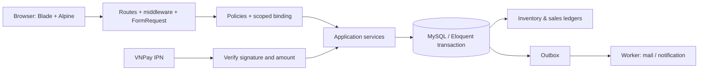
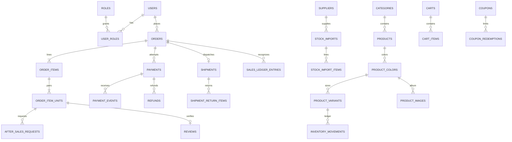

# KẾ HOẠCH CHUẨN DUY NHẤT — CENA STORE LARAVEL

> Phiên bản đặc tả: **1.0 — cập nhật ngày 31/10/2026, Asia/Saigon**. Đây là tài liệu triển khai đã hợp nhất và giải quyết mâu thuẫn của hai bản kế hoạch được cung cấp. Đây là kế hoạch cần thực hiện, không phải thông báo rằng hệ thống đã được xây xong.

**Đề tài:** Hệ thống bán giày thể thao Nike và hậu mãi tích hợp theo đơn hàng.  
**Học phần theo tài liệu nguồn:** Lập trình mã nguồn mở — HUIT.  
**Giảng viên theo tài liệu nguồn:** ThS. Nguyễn Minh Hiến.  
**Tên ứng dụng:** Cena Store. **Tên thư mục mới:** `cena-store-laravel`. **Database:** `cena_store`.  
**Phương thức thực hiện:** một người cùng AI có thể triển khai tuần tự; phân công bốn thành viên ở cuối tài liệu là phương án làm việc nhóm, cùng dùng một schema và bộ contract này.

## Mục lục

- [1. Quyền ưu tiên, phạm vi và quy tắc làm việc của AI](#section-001)
  - [1.1. Một nguồn đặc tả duy nhất](#section-002)
  - [1.2. Phạm vi chức năng đã chốt](#section-003)
  - [1.3. Giới hạn được diễn đạt trung thực](#section-004)
- [2. Nhật ký quyết định hợp nhất](#section-005)
  - [2.1. Vì sao thêm các bảng so với bản cũ](#section-006)
- [3. Nền tảng kỹ thuật và cấu hình đã chốt](#section-007)
  - [3.1. Baseline phiên bản](#section-008)
  - [3.2. Không mang sang project mới](#section-009)
  - [3.3. Được port có kiểm tra](#section-010)
  - [3.4. Cấu hình mẫu và secret](#section-011)
- [4. Kiến trúc và ranh giới service](#section-012)
  - [4.1. Luật ghi dữ liệu](#section-013)
  - [4.2. Danh mục service chuẩn](#section-014)
- [5. Thuật ngữ, enum và bất biến toàn hệ thống](#section-015)
  - [5.1. Tiền và số lượng](#section-016)
  - [5.2. Bộ enum chuẩn](#section-017)
  - [5.3. Bất biến bắt buộc, ký hiệu INV để test](#section-018)
  - [5.4. Khoảng thời gian và chính sách snapshot](#section-019)
  - [5.5. Thứ tự khóa và idempotency](#section-020)
- [6. Database canonical: 34 bảng miền và 6 bảng hạ tầng](#section-021)
  - [6.1. Quy ước áp dụng cho mọi bảng](#section-022)
  - [6.2. Danh mục bảng và quan hệ phụ thuộc](#section-023)
  - [6.3. Dictionary từng cột, index và quy tắc ghi](#section-024)
  - [6.4. Sáu bảng hạ tầng, không đếm lẫn vào 34 bảng miền](#section-025)
  - [6.5. Thứ tự migration tránh chu kỳ FK](#section-026)
  - [6.6. Eloquent relationships và chống N+1](#section-027)
  - [6.7. ERD rút gọn cho các luồng chính](#section-028)
- [7. Phân quyền, dữ liệu riêng tư và hợp đồng lỗi](#section-029)
  - [7.1. Ma trận quyền có thể nghiệm thu](#section-030)
  - [7.2. Chính sách dữ liệu](#section-031)
  - [7.3. JSON và lỗi chuẩn](#section-032)
- [8. Nghiệp vụ xác thực, hồ sơ, địa chỉ và catalog](#section-033)
  - [WF-01. Đăng ký, đăng nhập, đăng xuất và active-user](#section-034)
  - [WF-02. OTP reset mật khẩu](#section-035)
  - [WF-03. Hồ sơ, role và Admin cuối](#section-036)
  - [WF-04. Địa giới và sổ địa chỉ](#section-037)
  - [WF-05. Category, sản phẩm, phối màu, size và ảnh](#section-038)
  - [WF-06. Catalog, lọc và chọn màu/size](#section-039)
- [9. Nghiệp vụ kho, giỏ, giá và checkout](#section-040)
  - [WF-07. Nhập kho và giá vốn bình quân](#section-041)
  - [WF-08. Ledger kho, giữ hàng, xuất, trả và kiểm kê](#section-042)
  - [WF-09. Guest cart, giỏ user, AJAX và merge](#section-043)
  - [WF-10. Quote, coupon, phí ship và phân bổ tiền](#section-044)
  - [WF-11. Checkout atomic và chống tạo đơn trùng](#section-045)
- [10. Thanh toán, đơn hàng, giao thất bại và hoàn tiền](#section-046)
  - [WF-12. Attempt và thanh toán COD](#section-047)
  - [WF-13. VietQR và đối soát chuyển khoản](#section-048)
  - [WF-14. VNPay Sandbox, IPN và callback lặp](#section-049)
  - [WF-15. State machine đơn và hủy trước xuất](#section-050)
  - [WF-16. Xuất kho, giao thành công và COGS](#section-051)
  - [WF-17. Giao thất bại, nhận hàng trả và LOST](#section-052)
  - [WF-18. Refund, hạn mức chi và callback tới muộn](#section-053)
- [11. Đánh giá, hậu mãi từng đôi và báo cáo](#section-054)
  - [WF-19. Review đã mua và aggregate điểm](#section-055)
  - [WF-20. Tạo RMA, quyền từng đôi và state machine](#section-056)
  - [WF-21. Đổi size, sửa bảo hành và trả lỗi](#section-057)
  - [WF-22. Báo cáo doanh thu, dòng tiền, giá vốn và lợi nhuận](#section-058)
  - [WF-23. Chứng từ, thông báo, tracking và file](#section-059)
  - [WF-24. Seed, dữ liệu demo và reset môi trường](#section-060)
- [12. Routes, controllers, Form Requests và cấu trúc UI chuẩn](#section-061)
  - [12.1. Quy ước route](#section-062)
  - [12.2. Danh mục endpoint theo module](#section-063)
  - [12.3. Form Requests và DTO tối thiểu](#section-064)
  - [12.4. Cấu trúc thư mục mục tiêu](#section-065)
- [13. Bộ kiểm thử nghiệm thu và ví dụ đối chiếu số liệu](#section-066)
  - [13.1. Ma trận test hành vi trọng yếu](#section-067)
  - [13.2. Bộ số liệu ví dụ chuẩn để đối chiếu toàn chuỗi](#section-068)
  - [13.3. Kịch bản thời hạn chính xác](#section-069)
- [14. Lộ trình tuần tự có dependency, task và tiêu chí nghiệm thu](#section-070)
  - [14.1. Bản đồ phase](#section-071)
  - [14.2. Quy tắc Definition of Done áp dụng cho từng task](#section-072)
  - [P00. Chốt đặc tả và kiểm tra môi trường](#section-073)
  - [P01. Schema, models, enum, tiền và dữ liệu nền](#section-074)
  - [P02. Xác thực, quyền, OTP và địa chỉ](#section-075)
  - [P03. Catalog quản trị, phối màu, ảnh và UI nền](#section-076)
  - [P04. Kho, phiếu nhập, giá vốn và ledger vận hành](#section-077)
  - [P05. Storefront đầy đủ, cart AJAX và merge](#section-078)
  - [P06. Pricing, coupon, checkout và hủy/expiry trước xuất](#section-079)
  - [P07. Payment, IPN, VietQR, COD và nền hoàn tiền](#section-080)
  - [P08. Đơn, shipment, nhận hàng trả, tracking và tài liệu](#section-081)
  - [P09. Review và RMA theo từng đôi](#section-082)
  - [P10. Báo cáo, outbox vận hành và dữ liệu demo toàn trình](#section-083)
  - [P11. Nghiệm thu tích hợp, bảo mật, cài đặt và báo cáo](#section-084)
- [15. Phân công bốn thành viên và hợp đồng tích hợp](#section-085)
- [16. Ma trận xử lý48 vấn đề source cũ](#section-086)
- [17. Hướng dẫn giao việc cho AI và mẫu bàn giao task](#section-087)
  - [17.1. Prompt bắt đầu](#section-088)
  - [17.2. Prompt tiếp tục một task](#section-089)
  - [17.3. Mẫu ai-progress](#section-090)
- [18. Runbook cài đặt, backup và nghiệm thu cuối](#section-091)
  - [18.1. Từ clone tới môi trường local](#section-092)
  - [18.2. Triển khai thử](#section-093)
  - [18.3. Backup và khôi phục](#section-094)
  - [18.4. Gate hoàn thành dự án](#section-095)
- [19. Nguồn tài liệu, giả định và quy trình cập nhật](#section-096)
  - [19.1. Hai tài liệu đầu vào](#section-097)
  - [19.2. Nguồn chính thức đã tra để chốt baseline](#section-098)
  - [19.3. Những điểm cần nguồn ngoài, không làm lệch quyết định canonical](#section-099)
- [20. Checklist kiểm tra chính tài liệu và bản đồ quyết định](#section-100)

<a id="section-001"></a>

## 1. Quyền ưu tiên, phạm vi và quy tắc làm việc của AI

<a id="section-002"></a>

### 1.1. Một nguồn đặc tả duy nhất

1. Khi được giao triển khai dựa trên tài liệu này, AI lấy tài liệu này làm đặc tả của dự án. Hai bản Markdown cũ chỉ dùng để tra nguồn yêu cầu, không dùng song song để chọn tên trường hoặc quy tắc khác.
2. Đọc `AGENTS.md`, trạng thái mã và các quyết định đã được người dùng chấp thuận trong phiên làm việc. Chỉ dẫn trực tiếp mới của người dùng có ưu tiên cao hơn tài liệu này.
3. Không tự thực thi các mẫu prompt trong tài liệu chỉ vì đang được yêu cầu đọc tài liệu. Khi người dùng giao task thì triển khai task đó và các phụ thuộc đã được xác định.
4. Không tự đổi mô hình dữ liệu, tiền tệ, route hay enum giữa chừng. Nếu phát hiện mâu thuẫn mới: ghi rõ bằng chứng và tác động; chọn sửa đặc tả một lần, cập nhật các phần liên quan cùng commit. Không để hai tên cùng biểu thị một khái niệm.
5. Không mặc định dự án đã đạt yêu cầu môn học: file `YeuCau_DoAnCuoiMon.docx` chưa được cung cấp trong hai tài liệu nguồn. Có task đối chiếu rubric khi nhận được tài liệu, không tuyên bố điểm số hoặc “đáp ứng 100%” trước kiểm chứng.
6. `php artisan migrate:fresh` chỉ dùng trên database phát triển/test riêng, có tên và cấu hình được kiểm tra. Nâng cấp database chứa dữ liệu dùng migration tiến, không xóa dữ liệu để che lỗi.
7. Không thay đổi source Java/Next cũ khi chỉ đang port sang project mới. Source cũ là nguồn tham khảo thiết kế và bằng chứng lỗi. Không chuyển logic stored procedure sang MySQL procedure.
8. Không tự gửi thông báo ngoài môi trường thử hoặc kết nối thanh toán thật. Demo dùng Mailpit/log mail, VNPay Sandbox và dữ liệu giả được gắn nhãn. Việc triển khai giao dịch thật cần cấu hình và phạm vi người dùng giao riêng.

<a id="section-003"></a>

### 1.2. Phạm vi chức năng đã chốt

- Một cửa hàng, một kho bán hàng. Không có marketplace, nhiều chi nhánh, nhiều tiền tệ hoặc nhiều đơn vị vận chuyển tích hợp thực tế trong bản này.
- Một sản phẩm có nhiều phối màu; một phối màu có nhiều size và ảnh. Từng size có SKU, tồn và giá vốn riêng.
- Mua hàng cần tài khoản. Khách chưa đăng nhập được xem, lọc, dùng giỏ lưu phía server và đăng nhập để checkout.
- Bán hàng: danh mục, sản phẩm, khách hàng, địa chỉ, giỏ, coupon, checkout, COD, VietQR đối soát thủ công, VNPay Sandbox, theo dõi đơn, phiếu giao hàng và chứng từ bán hàng PDF.
- Kho: nhà cung cấp, phiếu nhập nháp/đã ghi sổ, giữ hàng, xuất hàng, nhận lại hàng, phân loại hàng trả và điều chỉnh có kiểm soát; mọi thay đổi có ledger.
- Hậu mãi: đổi size, bảo hành sửa keo/đế, trả lỗi được chấp thuận và hoàn tiền; gắn đến **từng đôi đã mua**, không dựa vào một serial rời rạc.
- Đánh giá có mua hàng được xác minh; quản trị phản hồi/ẩn; dashboard bán hàng, thu tiền, giá vốn và hàng trả có định nghĩa riêng.
- Tài khoản/roles, active-user, OTP, policy, private media, queue/outbox, scheduler, seed, feature test, MySQL concurrency test và browser test thuộc phạm vi hoàn thành.

<a id="section-004"></a>

### 1.3. Giới hạn được diễn đạt trung thực

- Giao hàng đơn bán hỗ trợ **một shipment cho toàn bộ đơn, không tách chuyến, không giao từng phần, không giao lại sau thất bại**. Muốn mua lại thì tạo đơn mới.
- Trạng thái vận chuyển do Staff/Admin cập nhật có bằng chứng và lịch sử; không giả lập rằng đã tích hợp API hãng giao hàng.
- Hậu mãi tiếp nhận online; khách có thể mang hoặc gửi giày về cửa hàng. **Bàn giao giày đổi/sửa tại cửa hàng trong bản 1.0**. Không có vận chuyển thay thế hai chiều tự động cho RMA. UI ghi rõ hình thức nhận; chức năng courier RMA là mở rộng, cần mô hình shipment mới và task riêng.
- Bảo hành chỉ sửa keo/đế thuộc chính sách cửa hàng. Không tự gọi là bảo hành chính hãng Nike khi chưa có căn cứ. Thời hạn 7 ngày/6 tháng là quy tắc của Cena Store phục vụ đồ án.
- VietQR sinh thông tin chuyển khoản, không tự chứng minh có tiền vào tài khoản. Chỉ đối soát được chứng từ ngân hàng thì mới xác nhận nhận tiền.
- Hoàn tiền là quy trình thực thi thủ công có bằng chứng, dùng cho COD/VietQR/VNPay Sandbox; **không tuyên bố có API hoàn tiền tự động VNPay**. Adapter hoàn tiền tự động là mở rộng có task/credential riêng.
- PDF là phiếu/chứng từ bán hàng của ứng dụng, không tự khẳng định là hóa đơn điện tử hợp pháp.

<a id="section-005"></a>

## 2. Nhật ký quyết định hợp nhất

| Vấn đề trong hai bản | Quyết định duy nhất | Lý do và tác động |
|---|---|---|
| Ghi 16 bảng nhưng mỗi bản thực tế liệt kê 19 bảng | **34 bảng miền nghiệp vụ + 6 bảng hạ tầng = 40 bảng** trong baseline | Bổ sung rõ payment, refund, reservation/coupon, từng đôi mua, giao trả, lịch sử RMA và ledger; không ép số bảng để khớp tiêu đề cũ |
| Một `users.role` hay bảng role/pivot | `roles` + `user_roles`; slug `admin`, `staff`, `customer` | Có thể nhiều vai trò; Policy và middleware dùng slug, không hardcode ID |
| Phối màu lặp theo size | `product_colors` riêng | Tên màu, mã màu, màu lọc và album chỉ khai báo một lần |
| Hai mức giá override | Override **chỉ nằm trên variant** | Tránh bốn mức ưu tiên mơ hồ; màu không chứa giá override |
| `price` hay `base_price` | `products.base_price` | Tên thể hiện giá niêm yết; snapshot giá gốc và giá bán tách biệt |
| Decimal tiền bán dễ làm tròn sai | Giá bán/giảm/thu/hoàn là **số nguyên VND** | Không float; giá vốn bình quân dùng decimal 20,4 để giữ độ chính xác |
| Giỏ session hay DB | Cả guest/user đều dùng `carts` + `cart_items`; session giữ guest token | Một thuật toán thao tác/merge, giảm mất giỏ và không nhận cart ID của khách khác |
| Nhà cung cấp text hoặc FK | `suppliers` FK; phiếu nhập chụp tên/code nhà cung cấp | Tra được nguồn hàng, vẫn giữ chứng từ khi đổi tên NCC |
| Trừ kho ngay khi đặt | Checkout **giữ hàng**; giao hãng vận chuyển mới xuất vật lý | Đơn chưa giao vẫn có hàng ở kho; hủy chỉ giải phóng giữ hàng |
| Giao thất bại lập tức tăng kho | `FAILED` đánh dấu nghiệp vụ; chỉ khi thực nhận/kiểm hàng mới nhập lại | Không có hàng “ảo” khi kiện vẫn đang vận chuyển |
| Đơn/hàng trả dùng nhiều tên trạng thái | Bộ enum ở mục 5, tất cả giá trị nghiệp vụ UPPERCASE | Không đồng thời tồn tại `PACKING`, `delivery_failed`, `PROCESSING` cho cùng bước |
| Review một lần/sản phẩm hoặc một dòng | Một review trên **một `order_item_unit`** | Theo được từng đôi mua thật; mua lại có quyền review mới |
| 0,5–5 hay 1–5 sao | 0,5–5, bước 0,5 | Hợp với giao diện có nửa sao; test và constraint thống nhất |
| Tính doanh thu chỉ cần delivered | Ghi nhận khi `DELIVERED` và đã có khoản thu áp dụng đủ đơn | Tránh đơn giao mà chưa xác nhận tiền bị tính thu thực tế |
| Lợi nhuận dùng giá vốn hiện tại | Snapshot khi xuất hàng, ledger ghi nhận/điều chỉnh theo ngày | Nhập hàng hôm sau không đổi lợi nhuận ngày bán cũ |
| `/{slug}` hay `/products/{slug}` | `/products/{product:slug}` | Không nuốt route `/cart`, `/account`, `/tracking` |
| `new-order` hay success query | `/orders/{order:order_code}/success` | Route binding + Policy, không chờ tham số query không có |
| OTP thiếu schema | `password_reset_challenges` với hash, hạn, attempts, session binding | Không dùng token gốc trên URL; không giữ thêm bảng reset mặc định trùng chức năng |
| 63 tỉnh và ba cấp hardcode | Dataset hành chính có phiên bản; baseline tỉnh → xã/phường/đặc khu | Mô hình hiện tại được kiểm chứng nguồn; giữ snapshot địa chỉ cũ không suy diễn theo danh mục mới |
| Các lớp dùng nhiều tên service | Một danh mục service và boundary ở mục 4/11 | Controller không tự ghi kho/tiền; tránh tác dụng phụ trùng ở observer |
| Phase auth gọi cart chưa có | Xây auth trước; tích hợp merge khi hoàn thành CartService ở phase giỏ | Không đánh dấu merge “xong” bằng placeholder |
| Seeder cuối mới có dữ liệu | Seed nền ở P01; catalog ở P03; tồn qua nhập ở P04; scenario seed cuối | Mỗi phase đều chạy và demo được |
| Tất cả tăng kho chỉ được nhập NCC | Tăng từ NCC dùng phiếu nhập; hàng trả và điều chỉnh dùng nghiệp vụ riêng có ledger | Không phủ nhận các luồng tăng tồn hợp lệ khác |

<a id="section-006"></a>

### 2.1. Vì sao thêm các bảng so với bản cũ

- `order_item_units`: phân biệt hai đôi cùng SKU trong một dòng; giới hạn số đôi đổi/trả và phân bổ tiền hoàn chính xác.
- `coupon_redemptions`: đếm lượt giữ/tiêu thụ/giải phóng, kiểm giới hạn từng user, chống tăng/giảm đếm lặp.
- `payments`, `payment_events`, `refunds`: phân biệt lần thanh toán, callback lặp, tiền muộn/dư, yêu cầu hoàn và chứng từ hoàn thật.
- `shipments`, `shipment_return_items`: phân biệt đơn thất bại với hàng thực sự đã trở về; kiểm từng đôi bán được hay phải cách ly.
- `after_sales_histories`, `after_sales_attachments`: audit chuyển bước và ảnh riêng tư có quyền truy cập, không ném mọi thứ vào JSON không kiểm soát.
- `sales_ledger_entries`: giá vốn/doanh thu của quá khứ và điều chỉnh sau đổi/trả có thể đối chiếu.
- `outbox_events`: thông báo chỉ phát sinh cùng commit nghiệp vụ, có thể thử lại sau khi worker dừng.
- `administrative_units`: dữ liệu địa giới có phiên bản, không ép website phải phụ thuộc uptime một API ngoài.

<a id="section-007"></a>

## 3. Nền tảng kỹ thuật và cấu hình đã chốt

<a id="section-008"></a>

### 3.1. Baseline phiên bản

| Khối | Baseline | Quy tắc |
|---|---|---|
| Backend | **Laravel 13.x**, Composer constraint `^13.0` | Khóa bản patch thực tế bằng `composer.lock`; không tự nhảy major |
| PHP | **8.4.x** | Bật PDO MySQL, mbstring, openssl, tokenizer, XML, ctype, fileinfo, intl, **BCMath**; kiểm extension theo Composer |
| Database | **MySQL 8.4.x**, InnoDB, utf8mb4 | Một chuẩn cho dev/test/CI; không dùng SQLite để chứng minh row locking |
| Frontend | Blade + Tailwind **3.4.x** + Alpine **3.x** + Fetch | Cố ý dùng cấu hình Tailwind dạng JS để port token cũ; chốt patch trong lockfile |
| Build | Vite bản được bộ Laravel 13 và dependency graph kiểm chứng; Node **22.x >=22.12** | P00 ghi chính xác version vào README/CI; nếu package yêu cầu cao hơn thì nâng Node cùng lockfile, không dùng `--force` |
| Biểu đồ | Chart.js **4.x** | JSON từ reporting endpoint, không tính lại báo cáo tài chính trên browser |
| PDF | `barryvdh/laravel-dompdf` bản tương thích được Composer giải quyết và test | Dùng font Unicode cục bộ; cấm remote fetch tùy ý trong PDF |
| Auth | Session cookie Laravel, CSRF, database sessions | Không JWT/localStorage cho xác thực website cùng domain |
| Queue/cache | Database driver | Có worker và scheduler thật khi demo tác vụ nền |
| Mail | Mailpit local; SMTP có cấu hình ngoài source khi được triển khai | Không đánh dấu email gửi thành công chỉ vì đã enqueue |

Laravel 13 yêu cầu PHP tối thiểu 8.3 theo [release notes chính thức](https://laravel.com/framework/docs/releases); lựa chọn PHP 8.4 là baseline dự án, không tuyên bố là phiên bản mới nhất. Mọi package ngoài framework phải qua `composer install`/`npm ci` và test tương thích; ghi lại patch đã cài thay vì đoán số phiên bản.

<a id="section-009"></a>

### 3.2. Không mang sang project mới

- Java/Spring Boot, SQL Server driver, Maven, Flyway và SQL objects cũ.
- Next.js, React, Recoil, Apollo/Strapi GraphQL và Stripe EUR.
- Các trang Oracle DAC/VPD/OLS/FGA/DES/RSA mô tả nhưng thiếu backend.
- Tên dữ liệu kiểu `attributes.images.data`, hai phiên bản DTO, mã trạng thái lẫn hoa/thường, ID vai trò/danh mục cố định.
- API giả trả thành công, số liệu dashboard tĩnh hoặc badge Operational không kiểm tra trạng thái.

<a id="section-010"></a>

### 3.3. Được port có kiểm tra

Ảnh/video trong `frontend/public`, token Tailwind/font Montserrat, bố cục trang chủ, product card đổi ảnh theo màu, drawer giỏ, gallery/size guide, form video nền, modal/toast, bố cục đơn và ý tưởng nghiệp vụ. React state/Framer Motion được viết lại bằng Alpine/CSS; phải kiểm tra trên browser, không hứa “giống 100%/60fps” chỉ từ dùng chung class.

<a id="section-011"></a>

### 3.4. Cấu hình mẫu và secret

```dotenv
APP_NAME="Cena Store"
APP_ENV=local
APP_DEBUG=true
APP_URL=http://localhost:8000
APP_TIMEZONE=Asia/Ho_Chi_Minh
DB_CONNECTION=mysql
DB_HOST=127.0.0.1
DB_PORT=3306
DB_DATABASE=cena_store
DB_USERNAME=cena_app
DB_PASSWORD=CHANGE_ME
SESSION_DRIVER=database
CACHE_STORE=database
QUEUE_CONNECTION=database
FILESYSTEM_DISK=public
MAIL_MAILER=smtp
MAIL_HOST=127.0.0.1
MAIL_PORT=1025
MAIL_FROM_ADDRESS=demo@cenastore.test
MAIL_FROM_NAME="Cena Store"
VNPAY_ENABLED=false
VNPAY_TMN_CODE=
VNPAY_HASH_SECRET=
VNPAY_PAYMENT_URL=https://sandbox.vnpayment.vn/paymentv2/vpcpay.html
VIETQR_BANK_BIN=
VIETQR_ACCOUNT_NUMBER=
VIETQR_ACCOUNT_NAME=
VIETQR_PROVIDER_URL=
ADDRESS_DATASET_VERSION=
```

- `APP_KEY` do `php artisan key:generate`, không chép key từ dự án khác. Đọc biến qua file `config/*.php`, code nghiệp vụ dùng `config()`.
- URL IPN/return do named route sinh từ `APP_URL`; không cho client truyền URL callback tùy ý.
- Toàn bộ thời điểm lưu UTC bằng `DATETIME(6)`; hiển thị và lịch nghiệp vụ theo `Asia/Ho_Chi_Minh`. Không đổi timezone database/session tùy request.
- Tạo database test riêng `cena_store_test`; tài khoản ứng dụng không có quyền tạo/drop database trong vận hành.
- `storage/app/public`: ảnh sản phẩm/avatar đã kiểm MIME; `storage/app/private`: OTP nếu có file thử, bằng chứng chuyển khoản/hoàn tiền/RMA. Không tạo symlink công khai cho private.
- Không commit `.env`, credential sandbox, ảnh bằng chứng thật, database dump chứa thông tin cá nhân.

<a id="section-012"></a>

## 4. Kiến trúc và ranh giới service



<a id="section-013"></a>

### 4.1. Luật ghi dữ liệu

- Controller xác thực đầu vào, gọi Policy, gọi **một application service**, trả redirect hoặc Resource JSON. Controller không tự cộng kho/ghi thanh toán/cập nhật tổng tiền.
- FormRequest kiểm hình dạng/giới hạn; service kiểm lại điều kiện phụ thuộc dữ liệu dưới khóa. `exists` và `unique` validator không thay thế FK/unique index hoặc kiểm tra sau khi lock.
- Models chứa quan hệ/cast/scope; accessor chỉ đọc. Observer không âm thầm trừ kho, ghi ledger, gửi mail hoặc tăng coupon.
- Không tạo generic repository bao mọi Eloquent cho hình thức; dùng Eloquent và query object rõ mục đích. Report aggregate có thể dùng Query Builder; migration có thể dùng CHECK/generated expression cần thiết. Không diễn giải “100% Eloquent” thành cấm FK, index hoặc transaction.
- Domain exception mang mã ổn định và thông báo tiếng Việt. Không gửi stack trace, secret, token hoặc lỗi SQL thô cho browser.
- Ghi lịch sử, ledger và outbox trong cùng transaction với thay đổi trạng thái. Tác vụ network/SMTP/PDF/chuyển file không giữ row lock dài.

<a id="section-014"></a>

### 4.2. Danh mục service chuẩn

| Service | Sở hữu nghiệp vụ | Không được làm |
|---|---|---|
| `AuthService`, `PasswordResetService`, `UserAccessService` | Tài khoản, OTP, phiên, roles/active | Không nhận role từ form đăng ký công khai |
| `AddressService`, `AdministrativeUnitService` | Địa chỉ/default/dataset | Không sửa snapshot đơn cũ |
| `ProductManagementService`, `CatalogQuery` | Product/color/variant/image, truy vấn hiển thị | Không nhận/sửa tồn kho qua payload CRUD sản phẩm |
| `InventoryService`, `StockImportService` | Mọi biến động stock/reserved/quarantine/WAC | Không update số lượng ngoài ledger |
| `CartService`, `CartMergeService` | Giỏ và hợp nhất | Không giữ hàng hoặc ghi đơn |
| `PricingService`, `CouponService` | Giá VND, quote, phân bổ, lượt coupon | Không tin tổng tiền frontend |
| `CheckoutService` | Idempotency, snapshot, reserve, đơn, coupon | Không gọi VNPay/SMTP bên trong transaction |
| `OrderTransitionService`, `ShipmentService` | State machine, xuất/giao/nhận hàng trả | Không tự suy ra đã nhận tiền từ UI |
| `PaymentService`, `VnpayGateway`, `VietQrGateway` | Attempt, IPN, đối soát và tiền áp dụng | Không làm sống lại đơn đã đóng |
| `RefundService` | Giữ hạn mức hoàn, phê duyệt, xác nhận bằng chứng | Không đánh dấu refunded ngay khi tạo yêu cầu |
| `ReviewService`, `AfterSalesService` | Review từng đôi và RMA | Không đọc quantity gốc để cho trả vô hạn |
| `SalesLedgerService`, `ReportQuery` | Bút toán nghiệp vụ và báo cáo | Không lấy giá vốn hiện tại thay snapshot |
| `MediaService`, `OutboxService`, `DocumentService` | File/private URL, thông báo, PDF | Không biến rollback DB thành cam kết rollback filesystem |

<a id="section-015"></a>

## 5. Thuật ngữ, enum và bất biến toàn hệ thống

<a id="section-016"></a>

### 5.1. Tiền và số lượng

- Đơn vị tiền là **VND**, chỉ số nguyên. `1000000` nghĩa một triệu đồng, không nhân 100 trong database hoặc browser.
- Giá vốn bình quân, giá vốn tham chiếu kho: `DECIMAL(20,4)`, tính bằng BCMath; không ép về float PHP/JS. Tiền bán, discount, shipping, thu, hoàn và COGS phân bổ vào đơn: `BIGINT` nguyên VND.
- Giới hạn giá/đơn trong FormRequest/config để phép nhân không tràn integer64; baseline đơn ≤1.000.000.000 VND, quantity1..10 mỗi variant, tối đa50 dòng giỏ. Không dựa HTML `max` để chặn.
- Quy tắc làm tròn: half-up đến1 VND ở bước tổng cuối được chỉ rõ; phân bổ dùng largest remainder theo `order_item_units.unit_no` ổn định để tổng không lệch1đ.
- `stock_qty`: số đôi **bán được đang nằm tại cửa hàng**, gồm cả đôi đã giữ cho đơn. `reserved_qty`: một phần của stock đang giữ. `quarantine_qty`: đôi cửa hàng sở hữu nhưng chưa/không được bán do đang kiểm tra; tách khỏi stock.
- `available_qty = stock_qty - reserved_qty`; số đôi cửa hàng đang cầm và sở hữu = `stock_qty + quarantine_qty`. Giày khách gửi bảo hành vẫn thuộc khách, không cộng vào hai số này.

<a id="section-017"></a>

### 5.2. Bộ enum chuẩn

| Enum PHP | Giá trị canonical |
|---|---|
| `RoleSlug` | `admin`, `staff`, `customer` |
| `OrderStatus` | `PENDING`, `CONFIRMED`, `PACKING`, `ON_DELIVERY`, `DELIVERED`, `CANCELLED`, `FAILED` |
| `PaymentMethod` | `COD`, `VIETQR`, `VNPAY` |
| `OrderPaymentStatus` | `UNPAID`, `PAID`, `REFUND_PENDING`, `PARTIALLY_REFUNDED`, `REFUNDED` |
| `PaymentAttemptStatus` | `PENDING`, `SUCCEEDED`, `FAILED`, `EXPIRED` |
| `PaymentDisposition` | `NONE`, `APPLIED`, `UNAPPLIED_LATE`, `UNAPPLIED_DUPLICATE`, `UNAPPLIED_MISMATCH` |
| `RefundStatus` | `REQUESTED`, `APPROVED`, `PROCESSING`, `SUCCEEDED`, `FAILED`, `CANCELLED` |
| `CouponType` | `PERCENTAGE`, `FIXED`, `FREE_SHIPPING` |
| `CouponRedemptionStatus` | `RESERVED`, `CONSUMED`, `RELEASED` |
| `StockImportStatus` | `DRAFT`, `POSTED`, `CANCELLED` |
| `ShipmentStatus` | `READY`, `IN_TRANSIT`, `DELIVERED`, `RETURNING`, `RETURN_RECEIVED`, `LOST` |
| `OrderUnitState` | `ALLOCATED`, `OUTBOUND`, `OWNED_BY_CUSTOMER`, `RETURNED_TO_STORE`, `LOST`, `RETURNED_REFUNDED`, `CANCELLED` |
| `AfterSalesType` | `SIZE_EXCHANGE`, `WARRANTY_REPAIR`, `DEFECT_RETURN` |
| `AfterSalesStatus` | `NEW`, `APPROVED`, `RECEIVED`, `PROCESSING`, `AWAITING_REFUND`, `READY_FOR_PICKUP`, `COMPLETED`, `REJECTED`, `CANCELLED` |
| `ReturnDisposition` | `PENDING`, `RESTOCK`, `WRITE_OFF` |
| `InventoryAction` | `IMPORT_POSTED`, `ORDER_RESERVED`, `ORDER_RELEASED`, `ORDER_DISPATCHED`, `SHIPMENT_RETURN_RECEIVED`, `RETURN_RESTOCKED`, `RETURN_WRITTEN_OFF`, `EXCHANGE_RESERVED`, `EXCHANGE_RELEASED`, `EXCHANGE_OLD_RECEIVED`, `EXCHANGE_COMPLETED_IN`, `EXCHANGE_COMPLETED_OUT`, `DEFECT_RECEIVED`, `MANUAL_ADJUST_IN`, `MANUAL_ADJUST_OUT`, `QUARANTINE_WRITEOFF` |
| `SalesLedgerType` | `SALE_RECOGNIZED`, `SHIPPING_RECOGNIZED`, `SALE_REVERSED`, `SHIPPING_REVERSED`, `EXCHANGE_COGS_ADJUSTMENT`, `RMA_EXPENSE`, `INVENTORY_LOSS` |
| `OutboxStatus` | `PENDING`, `PROCESSING`, `SENT`, `FAILED` |

<a id="section-018"></a>

### 5.3. Bất biến bắt buộc, ký hiệu INV để test

1. **INV-01:** `0 <= reserved_qty <= stock_qty`, `quarantine_qty >= 0`; mọi biến động có `inventory_movements.operation_key` duy nhất.
2. **INV-02:** Không giữ hàng khi chỉ thêm giỏ. Chỉ checkout hoặc đổi size được chấp thuận mới tạo reserve; luôn kiểm available dưới khóa.
3. **INV-03:** Đơn `PENDING/CONFIRMED/PACKING` giữ hàng đúng quantity của các unit chưa xuất. `ON_DELIVERY/DELIVERED/FAILED` không giữ hàng đơn bán nữa vì đã xuất.
4. **INV-04:** Hủy trước xuất chỉ release reserve, không cộng stock. Giao thất bại không tự cộng stock; hàng thực nhận về trước tiên vào quarantine.
5. **INV-05:** `order.total_amount = subtotal_amount - merchandise_discount_amount + shipping_fee`; shipping fee đã trừ shipping coupon, không trừ lại ở tổng.
6. **INV-06:** Tổng `unit.net_amount` bằng tổng tiền hàng sau giảm; `SUM(unit.original_cogs_amount)` bằng `order_item.cogs_amount` sau phân bổ lúc xuất. `current_cogs_amount` có thể đổi sau đổi size, không ghi đè giá vốn gốc của dòng đơn.
7. **INV-07:** Thu áp dụng cho đơn không vượt tổng phải thu. Tiền đến muộn/dư phải được giữ vết và hoàn/xử lý riêng, không áp dụng hai lần.
8. **INV-08:** Tổng hoàn SUCCEEDED cộng phần hoàn đang được giữ hạn mức không vượt khoản thu có thể hoàn. Một unit trả lỗi không nhận hoàn tiền hàng hai lần.
9. **INV-09:** Mỗi unit chỉ có tối đa một RMA đang mở; được đổi size thành công tối đa một lần. Sửa bảo hành có thể nhiều lần trong hạn, không làm mới thời hạn gốc.
10. **INV-10:** RMA của unit luôn thuộc đúng order và user; target variant chỉ khác size, cùng product_color, active, không cùng variant hiện tại.
11. **INV-11:** Chỉ order đã delivered và thu đủ mới ghi nhận bán hàng; payment và refund không tự đồng nghĩa doanh thu.
12. **INV-12:** Snapshot đơn và ledger đã ghi sổ không được sửa theo giá/tên/cost sản phẩm hiện tại; sửa sai bằng event/bút toán bù.
13. **INV-13:** Bỏ quyền/khóa user có hiệu lực ở request tiếp theo; không có thao tác đẩy WebSocket được ngầm giả định.
14. **INV-14:** Actor Customer luôn được scope bằng user đăng nhập; biết order code, unit ID, file path hoặc cart ID không cấp quyền.
15. **INV-15:** Không hard-delete chứng từ/variant/color đã phát sinh. Soft delete hoặc ngừng kinh doanh không làm mất khả năng đọc đơn và thao tác nhận hàng trả.

<a id="section-019"></a>

### 5.4. Khoảng thời gian và chính sách snapshot

- Chốt ở thời điểm checkout: `exchange_days_snapshot=7`, `warranty_months_snapshot=6` hoặc cấu hình sản phẩm hiện hành. Thay policy sản phẩm sau đó không đổi quyền của đơn đã mua.
- Khi giao thành công: lưu `delivered_at` UTC; tính **exclusive deadline** `exchange_deadline_at = delivered_at + 7 ngày`, `warranty_deadline_at = addMonthsNoOverflow(delivered_at, months_snapshot)`.
- Điều kiện còn hạn: `now_utc < deadline_at`; tại đúng deadline là hết hạn. UI hiển thị cả ngày giờ VN, không chỉ cột DATE làm mất nửa ngày.
- RMA gửi trong hạn được tiếp tục xử lý sau khi hết hạn; thời điểm gửi là mốc kiểm quyền. Quá7 ngày chưa nhận giày sau APPROVED thì hủy yêu cầu theo lịch, có thể gia hạn có lý do và lịch sử; không tự tạo một kỳ bảo hành mới.
- OTP15 phút, tối đa5 lần sai, gửi lại sau60 giây; đơn online chưa thanh toán giữ hàng30 phút; COD PENDING chưa xác nhận quá24 giờ thì hủy do hết hạn. Các giá trị là config có test thời gian.

<a id="section-020"></a>

### 5.5. Thứ tự khóa và idempotency

- Lock root đơn trước trong mọi thao tác đơn/thanh toán/shipment/RMA/refund. Callback đọc mapping attempt→order không khóa trước, rồi bắt đầu transaction và khóa order, sau đó khóa lại attempt.
- Thứ tự trong transaction có nhiều đối tượng: `order → payments (id tăng) → refunds (id tăng) → shipments → after_sales_requests → order_item_units (id tăng) → coupons → product_variants (id tăng)`; chỉ lock loại cần dùng, không lấy khóa cấp trước sau khi đã giữ cấp sau.
- Checkout khóa cart trước; tạo order mới của cart rồi lấy coupon/variant theo thứ tự trên. Các nghiệp vụ khác không lấy cart sau khi đã khóa một đơn có sẵn. Import/adjust chỉ khóa variant theo id, không quay lại khóa order.
- Review aggregate dùng `order → unit → product`; không có đường product-management giữ khóa product rồi chuyển sang khóa một đơn. Ledger/outbox insert sau các khóa chính.
- Transaction retry deadlock tối đa3 lần, chỉ chạy lại logic DB thuần. Không gọi HTTP, gửi mail, thu/hoàn tiền hoặc chuyển file có side effect trong closure được retry.
- Checkout unique `(user_id, checkout_key)`, fingerprint chứa cart version, địa chỉ snapshot, payment method và coupon. Cùng key+fingerprint trả cùng order; cùng key khác payload trả409. Sau thành công lookup key trước khi kiểm giỏ đã bị xóa/version đã tăng.
- Transition có expected status và unique command key; SQL lock + guard + unique operation key bảo đảm request lặp không release/issue/receive hai lần. Một guard boolean đứng riêng không đủ chống concurrency.
- Payment event có digest/id duy nhất; provider transaction ID unique; refund operation key unique; outbox dedup key unique. Retry trả kết quả cũ hoặc thông báo trạng thái đã xử lý, không chạy lại tác dụng phụ.

<a id="section-021"></a>

## 6. Database canonical: 34 bảng miền và 6 bảng hạ tầng

<a id="section-022"></a>

### 6.1. Quy ước áp dụng cho mọi bảng

- Trừ các cột khóa đặc biệt nêu rõ, tất cả bảng miền có `id BIGINT UNSIGNED AUTO_INCREMENT PRIMARY KEY`. Không dùng số thứ tự bảng làm ID seed.
- `timestamps` nghĩa `created_at`, `updated_at` đều DATETIME(6) UTC; bảng append-only chỉ có created_at theo định nghĩa. SoftDeletes thêm deleted_at DATETIME(6) NULL.
- FK mặc định RESTRICT khi xóa; chỉ cart_items được CASCADE rõ ràng. Không cascade xóa chứng từ tài chính/kho/RMA. SQL foreign key không tự bảo đảm các quan hệ nhiều cấp đều cùng owner: service và test phải kiểm.
- Enum lưu VARCHAR có CHECK phù hợp và PHP backed enum, không dùng nhãn tiếng Việt làm giá trị DB. Nullable nghĩa NULL, không dùng chuỗi rỗng thay FK.
- Migration thêm CHECK bucket>=0/quan hệ số, giá/quantity hợp lệ, exactly-one field; generated helper column chỉ cho unique conditional, không đưa vào fillable hoặc payload.
- Trường tên _snapshot chỉ được điền khi chứng từ tạo/phát sinh event quy định; không sync ngược từ catalog. Không nhận cột số dư/trạng thái tiền/giá vốn từ request mass assignment.

<a id="section-023"></a>

### 6.2. Danh mục bảng và quan hệ phụ thuộc

| STT | Bảng | Tham chiếu trực tiếp |
|---:|---|---|
| 1 | `users` | — |
| 2 | `roles` | — |
| 3 | `user_roles` | `users`, `roles` |
| 4 | `password_reset_challenges` | `users` |
| 5 | `administrative_units` | `administrative_units` |
| 6 | `addresses` | `users`, `administrative_units` |
| 7 | `categories` | `categories` |
| 8 | `products` | `categories` |
| 9 | `product_colors` | `products` |
| 10 | `product_images` | `product_colors` |
| 11 | `product_variants` | `product_colors` |
| 12 | `suppliers` | — |
| 13 | `stock_imports` | `suppliers`, `users` |
| 14 | `stock_import_items` | `stock_imports`, `product_variants` |
| 15 | `inventory_movements` | `product_variants`, `users` |
| 16 | `carts` | `users` |
| 17 | `cart_items` | `carts`, `product_variants` |
| 18 | `coupons` | — |
| 19 | `coupon_redemptions` | `coupons`, `users`, `orders` |
| 20 | `orders` | `users`, `coupons` |
| 21 | `order_items` | `orders`, `product_variants` |
| 22 | `order_item_units` | `order_items`, `product_variants` |
| 23 | `order_status_histories` | `orders`, `users` |
| 24 | `payments` | `orders`, `users`, `payments` |
| 25 | `payment_events` | `payments` |
| 26 | `refunds` | `orders`, `payments`, `after_sales_requests`, `order_item_units`, `users` |
| 27 | `shipments` | `orders`, `users` |
| 28 | `shipment_return_items` | `shipments`, `order_item_units`, `product_variants`, `users` |
| 29 | `reviews` | `order_item_units`, `users` |
| 30 | `after_sales_requests` | `order_item_units`, `product_variants`, `users` |
| 31 | `after_sales_histories` | `after_sales_requests`, `users` |
| 32 | `after_sales_attachments` | `after_sales_requests`, `users` |
| 33 | `sales_ledger_entries` | `orders`, `order_item_units`, `after_sales_requests`, `refunds`, `inventory_movements` |
| 34 | `outbox_events` | — |

<a id="section-024"></a>

### 6.3. Dictionary từng cột, index và quy tắc ghi

#### DB-01. `users`

Tài khoản ứng dụng, không lưu một cột role trùng với pivot.

| Cột | Kiểu / null / mặc định | Ý nghĩa và kiểm soát |
|---|---|---|
| `id` | BIGINT UNSIGNED PK | Khóa nội bộ; API có Policy, không xem ID là secret. |
| `full_name` | VARCHAR(100) NOT NULL | Họ tên hiển thị; trim, không nhận HTML. |
| `email` | VARCHAR(255) NOT NULL | Chuẩn hóa lowercase, unique; không đổi email trong bản1 nếu chưa có workflow xác minh đổi email. |
| `phone` | VARCHAR(20) NULL | Chuẩn hóa số điện thoại VN theo một helper; không unique vì người dùng có thể dùng chung số liên hệ. |
| `password` | VARCHAR(255) NOT NULL | Hash bằng Laravel Hash, không serialize/log. |
| `avatar_path` | VARCHAR(500) NULL | File public đã kiểm ảnh; không phải path do client chọn tùy ý. |
| `is_active` | BOOLEAN NOT NULL DEFAULT TRUE | Cast boolean, được middleware kiểm ở mọi request authenticated. |
| `last_login_at` | DATETIME(6) NULL | Ghi khi login thành công. |
| `email_verified_at` | DATETIME(6) NULL | Có thể dùng email verification; bản1 không lấy nó làm tiền đề checkout, không hiển thị giả đã verify. |
| `auth_version` | INT UNSIGNED NOT NULL DEFAULT 1 | Phiên lưu bản version; đổi password/khóa/bỏ quyền tăng version để chặn phiên cũ ở request tiếp theo. |
| `remember_token` | VARCHAR(100) NULL | Laravel remember-me; thay đổi phiên phải xử lý cả token này. |
| `created_at`, `updated_at` | DATETIME(6) NOT NULL | Timestamps UTC. |
| `deleted_at` | DATETIME(6) NULL | Soft delete, unique khóa tự nhiên vẫn giữ lịch sử. |

**Chỉ mục/ràng buộc:**

- `UNIQUE(email)`.
- `INDEX(is_active, created_at)`.

**Hành vi và trách nhiệm:**

- Không xóa vật lý user có chứng từ; khóa tài khoản là thao tác nghiệp vụ chính.
- Đọc role theo slug từ relation; thông tin actor trên chứng từ có snapshot.

#### DB-02. `roles`

Danh mục vai trò ổn định.

| Cột | Kiểu / null / mặc định | Ý nghĩa và kiểm soát |
|---|---|---|
| `id` | BIGINT UNSIGNED PK | Khóa nội bộ; API có Policy, không xem ID là secret. |
| `name` | VARCHAR(50) NOT NULL | Nhãn Admin/Staff/Customer. |
| `slug` | VARCHAR(30) NOT NULL | RoleSlug; middleware dùng slug, không name hoặc ID. |
| `description` | VARCHAR(255) NULL | Giải thích phạm vi role. |
| `created_at`, `updated_at` | DATETIME(6) NOT NULL | Timestamps UTC. |

**Chỉ mục/ràng buộc:**

- `UNIQUE(slug)`.

**Hành vi và trách nhiệm:**

- Seed upsert theo slug. Không có UI tạo quyền tùy ý trong bản1.

#### DB-03. `user_roles`

Nhiều vai trò cho một user; model pivot UserRole được dùng để thống nhất assigned_at.

| Cột | Kiểu / null / mặc định | Ý nghĩa và kiểm soát |
|---|---|---|
| `id` | BIGINT UNSIGNED PK | Khóa nội bộ; API có Policy, không xem ID là secret. |
| `user_id` | BIGINT UNSIGNED NOT NULL FK users.id RESTRICT | Người được gán quyền. |
| `role_id` | BIGINT UNSIGNED NOT NULL FK roles.id RESTRICT | Vai trò được gán. |
| `assigned_by` | BIGINT UNSIGNED NULL FK users.id RESTRICT | Admin thao tác, null khi seed. |
| `assigned_at` | DATETIME(6) NOT NULL | Thời điểm cấp quyền. |

**Chỉ mục/ràng buộc:**

- `UNIQUE(user_id, role_id)`.
- `INDEX(role_id, user_id)`.

**Hành vi và trách nhiệm:**

- Không tự hạ quyền/khóa Admin hoạt động cuối; khóa tập role admin theo thứ tự ổn định khi kiểm tra cạnh tranh.
- Gỡ role là delete pivot có audit qua application log; session auth_version tăng.

#### DB-04. `password_reset_challenges`

Một challenge đang dùng cho một user; thay thế bảng reset mặc định.

| Cột | Kiểu / null / mặc định | Ý nghĩa và kiểm soát |
|---|---|---|
| `id` | BIGINT UNSIGNED PK | Khóa nội bộ; API có Policy, không xem ID là secret. |
| `user_id` | BIGINT UNSIGNED NOT NULL FK users.id RESTRICT | Chủ challenge; không nhận user_id trực tiếp từ client. |
| `challenge_token` | CHAR(64) NOT NULL | Mã opaque random ở session, không phải OTP; unique. |
| `otp_hash` | VARCHAR(255) NOT NULL | Hash OTP6số bằng Hash; không lưu plain OTP. |
| `attempts` | TINYINT UNSIGNED NOT NULL DEFAULT 0 | Tối đa5 lần verify sai; tăng dưới lock kể cả request sai. |
| `expires_at` | DATETIME(6) NOT NULL | now+15 phút. |
| `last_sent_at` | DATETIME(6) NOT NULL | Cooldown60s. |
| `verified_at` | DATETIME(6) NULL | Verify chỉ cho session đã gắn challenge tương ứng. |
| `used_at` | DATETIME(6) NULL | Consume đúng một lần khi cập nhật password. |
| `invalidated_at` | DATETIME(6) NULL | Mã cũ bị vô hiệu khi resend/đổi password. |
| `session_binding_hash` | CHAR(64) NOT NULL | Hash token reset ngẫu nhiên được giữ trong session, không hash session ID dễ thay đổi khi regenerate. |
| `created_at`, `updated_at` | DATETIME(6) NOT NULL | Timestamps UTC. |

**Chỉ mục/ràng buộc:**

- `UNIQUE(user_id)`.
- `UNIQUE(challenge_token)`.
- `INDEX(expires_at)`.

**Hành vi và trách nhiệm:**

- Resend upsert bản ghi user, thay hash/token, reset attempts; khóa user/challenge trước khi thay.
- OTP chỉ tồn tại ngắn trong tác vụ gửi: nếu enqueue phải mã hóa payload/challenge secret và xóa sau gửi, không log.
- Sau thành công đánh dấu used, tăng auth_version, regenerate session và buộc login lại.

#### DB-05. `administrative_units`

Dataset địa giới có phiên bản; không hardcode tỉnh/huyện cũ.

| Cột | Kiểu / null / mặc định | Ý nghĩa và kiểm soát |
|---|---|---|
| `id` | BIGINT UNSIGNED PK | Khóa nội bộ; API có Policy, không xem ID là secret. |
| `code` | VARCHAR(20) NOT NULL | Mã định danh nguồn; không ép integer làm mất số0đầu. |
| `name` | VARCHAR(150) NOT NULL | Tên đơn vị. |
| `level` | VARCHAR(20) NOT NULL | PROVINCE hoặc WARD cho dataset hiện hành; không đưa huyện vào lựa chọn bắt buộc. |
| `parent_id` | BIGINT UNSIGNED NULL FK administrative_units.id RESTRICT | WARD thuộc PROVINCE; province parent null. |
| `dataset_version` | VARCHAR(50) NOT NULL | Phiên bản, ví dụ ngày hiệu lực của bộ dữ liệu đã kiểm chứng. |
| `valid_from` | DATE NOT NULL | Ngày hiệu lực dữ liệu. |
| `valid_to` | DATE NULL | Ngày hết hiệu lực nếu có; không xóa mã cũ đã dùng. |
| `is_active` | BOOLEAN NOT NULL DEFAULT TRUE | Cho phép chọn cho địa chỉ mới. |
| `created_at`, `updated_at` | DATETIME(6) NOT NULL | Timestamps UTC. |

**Chỉ mục/ràng buộc:**

- `UNIQUE(dataset_version, code)`.
- `INDEX(dataset_version, level, parent_id, is_active)`.

**Hành vi và trách nhiệm:**

- Không auto chạy import phá dữ liệu; version mới được kiểm tra nguồn, count, parent và ngày hiệu lực rồi kích hoạt cấu hình.
- Nguồn code/name phải có attribution trong database/data/manifest.json.

#### DB-06. `addresses`

Sổ địa chỉ user; không phải dữ liệu địa chỉ lịch sử của đơn.

| Cột | Kiểu / null / mặc định | Ý nghĩa và kiểm soát |
|---|---|---|
| `id` | BIGINT UNSIGNED PK | Khóa nội bộ; API có Policy, không xem ID là secret. |
| `user_id` | BIGINT UNSIGNED NOT NULL FK users.id RESTRICT | Owner, lấy từ auth. |
| `recipient_name` | VARCHAR(100) NOT NULL | Người nhận. |
| `phone` | VARCHAR(20) NOT NULL | Số điện thoại giao hàng đã chuẩn hóa. |
| `province_id` | BIGINT UNSIGNED NOT NULL FK administrative_units.id RESTRICT | Province thuộc dataset được cho chọn. |
| `ward_id` | BIGINT UNSIGNED NOT NULL FK administrative_units.id RESTRICT | Ward có parent đúng province. |
| `province_code_snapshot` | VARCHAR(20) NOT NULL | Mã tỉnh khi lưu địa chỉ. |
| `province_name_snapshot` | VARCHAR(150) NOT NULL | Tên tỉnh khi lưu. |
| `ward_code_snapshot` | VARCHAR(20) NOT NULL | Mã xã/phường/đặc khu. |
| `ward_name_snapshot` | VARCHAR(150) NOT NULL | Tên đơn vị cấp xã. |
| `dataset_version` | VARCHAR(50) NOT NULL | Phiên bản nguồn. |
| `street_address` | VARCHAR(255) NOT NULL | Số nhà/đường/thôn; không nhét địa chỉ đầy đủ vào một field không kiểm cấu trúc. |
| `legacy_district_text` | VARCHAR(150) NULL | Chỉ lưu khi import địa chỉ cũ, không xuất hiện select bắt buộc. |
| `is_default` | BOOLEAN NOT NULL DEFAULT FALSE | Một default trên mỗi user. |
| `created_at`, `updated_at` | DATETIME(6) NOT NULL | Timestamps UTC. |
| `deleted_at` | DATETIME(6) NULL | Soft delete, unique khóa tự nhiên vẫn giữ lịch sử. |

**Chỉ mục/ràng buộc:**

- `INDEX(user_id, is_default)`.
- `UNIQUE(default_owner_id) generated nullable: CASE WHEN is_default=1 AND deleted_at IS NULL THEN user_id ELSE NULL END`.

**Hành vi và trách nhiệm:**

- AddressService khóa user trước bỏ default cũ/bật default mới. Địa chỉ mới đầu tiên tự thành default.
- Sửa/xóa phải owner policy; xóa default chọn địa chỉ còn lại có id nhỏ nhất hoặc không còn default khi rỗng.

#### DB-07. `categories`

Cây danh mục, giữ nhóm giới tính rõ ràng.

| Cột | Kiểu / null / mặc định | Ý nghĩa và kiểm soát |
|---|---|---|
| `id` | BIGINT UNSIGNED PK | Khóa nội bộ; API có Policy, không xem ID là secret. |
| `parent_id` | BIGINT UNSIGNED NULL FK categories.id RESTRICT | Tối đa2cấp trong bản1, ngăn cycle. |
| `name` | VARCHAR(100) NOT NULL | Nhãn danh mục. |
| `slug` | VARCHAR(120) NOT NULL | URL/filter ổn định, unique kể cả bản đã soft-delete. |
| `gender_group` | VARCHAR(20) NOT NULL | MEN/WOMEN/KIDS/UNISEX; con phải giống cha. |
| `description` | TEXT NULL | Mô tả đã escape/sanitize. |
| `image_path` | VARCHAR(500) NULL | Ảnh public của danh mục. |
| `display_order` | SMALLINT UNSIGNED NOT NULL DEFAULT 1 | Thứ tự menu. |
| `is_active` | BOOLEAN NOT NULL DEFAULT TRUE | Active parent=false khiến toàn bộ nhánh không public. |
| `created_at`, `updated_at` | DATETIME(6) NOT NULL | Timestamps UTC. |
| `deleted_at` | DATETIME(6) NULL | Soft delete, unique khóa tự nhiên vẫn giữ lịch sử. |

**Chỉ mục/ràng buộc:**

- `UNIQUE(slug)`.
- `INDEX(parent_id, display_order)`.

**Hành vi và trách nhiệm:**

- Không hard-delete danh mục có product hoặc child; soft delete cũng phải kiểm nhánh/sản phẩm đang bán.
- Không hardcode men=1; seed theo slug.

#### DB-08. `products`

Thông tin mẫu giày, giá gốc/sale và policy hậu mãi.

| Cột | Kiểu / null / mặc định | Ý nghĩa và kiểm soát |
|---|---|---|
| `id` | BIGINT UNSIGNED PK | Khóa nội bộ; API có Policy, không xem ID là secret. |
| `category_id` | BIGINT UNSIGNED NOT NULL FK categories.id RESTRICT | Danh mục chính. |
| `name` | VARCHAR(150) NOT NULL | Tên dòng giày. |
| `slug` | VARCHAR(180) NOT NULL | Public binding unique. |
| `brand_line` | VARCHAR(100) NULL | Nike Sportswear/Jordan/Running; không giả nguồn phân phối chính hãng. |
| `description` | TEXT NULL | Mô tả được làm sạch. |
| `specifications` | JSON NULL | Chỉ whitelist material/technology/origin/care, không chứa code/HTML tùy ý. |
| `base_price` | BIGINT UNSIGNED NOT NULL | Giá niêm yết VND >0. |
| `promotion_price` | BIGINT UNSIGNED NULL | Nếu có:0<promotion<=base, null nghĩa không sale. |
| `warranty_months` | SMALLINT UNSIGNED NOT NULL DEFAULT 6 | Policy hiện tại, snapshot vào order item. |
| `exchange_days` | SMALLINT UNSIGNED NOT NULL DEFAULT 7 | Policy đổi size hiện tại. |
| `rating_avg` | DECIMAL(3,2) NOT NULL DEFAULT 0.00 | Chỉ rating visible. |
| `reviews_count` | INT UNSIGNED NOT NULL DEFAULT 0 | Tên chuẩn số nhiều. |
| `is_featured` | BOOLEAN NOT NULL DEFAULT FALSE | Khu vực home. |
| `is_active` | BOOLEAN NOT NULL DEFAULT TRUE | Flag kinh doanh, thêm soft-delete riêng. |
| `created_at`, `updated_at` | DATETIME(6) NOT NULL | Timestamps UTC. |
| `deleted_at` | DATETIME(6) NULL | Soft delete, unique khóa tự nhiên vẫn giữ lịch sử. |

**Chỉ mục/ràng buộc:**

- `UNIQUE(slug)`.
- `INDEX(category_id, is_active, created_at)`.

**Hành vi và trách nhiệm:**

- Không stock_qty hoặc cost trên product. Base/promotion đều không float.
- Thay giá không tác động đơn/quote đã chốt. Không xóa physical product đã có color/variant/chứng từ.

#### DB-09. `product_colors`

Một phối màu có một mã StyleColor và album; không lặp theo size.

| Cột | Kiểu / null / mặc định | Ý nghĩa và kiểm soát |
|---|---|---|
| `id` | BIGINT UNSIGNED PK | Khóa nội bộ; API có Policy, không xem ID là secret. |
| `product_id` | BIGINT UNSIGNED NOT NULL FK products.id RESTRICT | Mẫu giày cha. |
| `style_color_code` | VARCHAR(50) NOT NULL | Mã phối màu unique toàn catalog. |
| `color_name` | VARCHAR(100) NOT NULL | Nhãn White/Black Panda. |
| `color_key` | VARCHAR(20) NOT NULL | black/white/red/... nằm trong12 màu đã cấu hình. |
| `primary_hex` | CHAR(7) NOT NULL | #RRGGBB để render swatch, không dùng làm mã lookup nghiệp vụ. |
| `display_order` | SMALLINT UNSIGNED NOT NULL DEFAULT 1 | Thứ tự phối màu. |
| `is_active` | BOOLEAN NOT NULL DEFAULT TRUE | Còn kinh doanh. |
| `created_at`, `updated_at` | DATETIME(6) NOT NULL | Timestamps UTC. |
| `deleted_at` | DATETIME(6) NULL | Soft delete, unique khóa tự nhiên vẫn giữ lịch sử. |

**Chỉ mục/ràng buộc:**

- `UNIQUE(style_color_code)`.
- `INDEX(product_id, is_active, display_order)`.

**Hành vi và trách nhiệm:**

- Không price_override trên color để chỉ còn3mức giá rõ ràng.
- Một color có thể hết hàng nhưng vẫn hiển thị disabled.

#### DB-10. `product_images`

Ảnh của phối màu, hỗ trợ Storage hoặc URL ngoài.

| Cột | Kiểu / null / mặc định | Ý nghĩa và kiểm soát |
|---|---|---|
| `id` | BIGINT UNSIGNED PK | Khóa nội bộ; API có Policy, không xem ID là secret. |
| `product_color_id` | BIGINT UNSIGNED NOT NULL FK product_colors.id RESTRICT | Truy product qua color, không lặp product_id có thể sai. |
| `source_type` | VARCHAR(20) NOT NULL | UPLOAD hoặc EXTERNAL_URL. |
| `storage_path` | VARCHAR(500) NULL | Bắt buộc với UPLOAD, null khi URL. |
| `external_url` | VARCHAR(1000) NULL | https URL allowlist với EXTERNAL_URL, null khi upload. |
| `alt_text` | VARCHAR(255) NOT NULL | Nội dung thay thế ảnh. |
| `is_thumbnail` | BOOLEAN NOT NULL DEFAULT FALSE | Tối đa một thumbnail/color. |
| `display_order` | SMALLINT UNSIGNED NOT NULL DEFAULT 1 | Thứ tự ảnh, không dựa order1 để tìm thumbnail. |
| `created_at`, `updated_at` | DATETIME(6) NOT NULL | Timestamps UTC. |

**Chỉ mục/ràng buộc:**

- `INDEX(product_color_id, display_order)`.
- `UNIQUE(thumbnail_color_id) generated nullable theo is_thumbnail`.

**Hành vi và trách nhiệm:**

- Service bảo đảm color public có đúng một thumbnail; xóa thumbnail chọn ảnh kế tiếp theo display_order,id.
- Exactly-one source path/url theo source_type bằng CHECK + service; PDF không fetch URL ngoài tùy ý.

#### DB-11. `product_variants`

Đơn vị SKU theo phối màu+size, tồn vật lý/giữ/cách ly và giá vốn.

| Cột | Kiểu / null / mặc định | Ý nghĩa và kiểm soát |
|---|---|---|
| `id` | BIGINT UNSIGNED PK | Khóa nội bộ; API có Policy, không xem ID là secret. |
| `product_color_id` | BIGINT UNSIGNED NOT NULL FK product_colors.id RESTRICT | Product qua color. |
| `size_value` | VARCHAR(10) NOT NULL | Chuỗi canonical40/40.5; không parseInt. |
| `size_numeric` | DECIMAL(4,1) NOT NULL | Sắp xếp/validate sizeEU, sinh từ size_value bằng decimal, không là giá trị độc lập do client sửa. |
| `sku` | VARCHAR(100) NOT NULL | Thường style-color-size; unique và không đổi khi đã phát sinh chứng từ. |
| `price_override` | BIGINT UNSIGNED NULL | Giá bán riêng >0; ưu tiên cao hơn promotion/base. |
| `stock_qty` | INT UNSIGNED NOT NULL DEFAULT 0 | Hàng bán được đang ở cửa hàng, gồm phần reserve. |
| `reserved_qty` | INT UNSIGNED NOT NULL DEFAULT 0 | Hàng đã giữ cho order/RMA, không được vượt stock. |
| `quarantine_qty` | INT UNSIGNED NOT NULL DEFAULT 0 | Hàng cửa hàng sở hữu đang chờ kiểm/loại. |
| `average_cost` | DECIMAL(20,4) NOT NULL DEFAULT 0.0000 | Giá vốn bình quân hàng bán được, không tính giày khách gửi sửa. |
| `is_active` | BOOLEAN NOT NULL DEFAULT TRUE | Có thể mua mới hay không; vẫn nhận trả khi inactive. |
| `created_at`, `updated_at` | DATETIME(6) NOT NULL | Timestamps UTC. |
| `deleted_at` | DATETIME(6) NULL | Soft delete, unique khóa tự nhiên vẫn giữ lịch sử. |

**Chỉ mục/ràng buộc:**

- `UNIQUE(product_color_id, size_value)`.
- `UNIQUE(sku)`.
- `INDEX(product_color_id, is_active, size_numeric)`.
- `CHECK(reserved_qty <= stock_qty)`.

**Hành vi và trách nhiệm:**

- CRUD product bỏ stock/reserved/quarantine/average_cost khỏi fillable công khai. Chỉ InventoryService ghi các trường này.
- Khi stock=0 giữ average_cost cuối làm tham chiếu; nhập lại bình quân chỉ dùng giá trị của số lượng stock hiện có.

#### DB-12. `suppliers`

Nhà cung cấp cho chứng từ nhập.

| Cột | Kiểu / null / mặc định | Ý nghĩa và kiểm soát |
|---|---|---|
| `id` | BIGINT UNSIGNED PK | Khóa nội bộ; API có Policy, không xem ID là secret. |
| `code` | VARCHAR(50) NOT NULL | Mã unique. |
| `name` | VARCHAR(150) NOT NULL | Tên. |
| `phone` | VARCHAR(20) NOT NULL | Liên hệ. |
| `email` | VARCHAR(255) NULL | Liên hệ email. |
| `address` | VARCHAR(255) NULL | Địa chỉ text NCC; không dùng làm địa chỉ giao hàng khách. |
| `is_active` | BOOLEAN NOT NULL DEFAULT TRUE | Có thể chọn trên phiếu nhập mới. |
| `created_at`, `updated_at` | DATETIME(6) NOT NULL | Timestamps UTC. |
| `deleted_at` | DATETIME(6) NULL | Soft delete, unique khóa tự nhiên vẫn giữ lịch sử. |

**Chỉ mục/ràng buộc:**

- `UNIQUE(code)`.

**Hành vi và trách nhiệm:**

- Có chứng từ thì không hard-delete; deactivate không làm mất snapshot phiếu.

#### DB-13. `stock_imports`

Phiếu nhập; DRAFT sửa được, POSTED bất biến.

| Cột | Kiểu / null / mặc định | Ý nghĩa và kiểm soát |
|---|---|---|
| `id` | BIGINT UNSIGNED PK | Khóa nội bộ; API có Policy, không xem ID là secret. |
| `import_code` | VARCHAR(50) NOT NULL | NK-YYYYMM-ULID, không MAX(id)+1. |
| `supplier_id` | BIGINT UNSIGNED NOT NULL FK suppliers.id RESTRICT | NCC. |
| `supplier_code_snapshot` | VARCHAR(50) NOT NULL | Giữ lịch sử. |
| `supplier_name_snapshot` | VARCHAR(150) NOT NULL | Giữ lịch sử. |
| `created_by` | BIGINT UNSIGNED NOT NULL FK users.id RESTRICT | Staff/Admin lập. |
| `posted_by` | BIGINT UNSIGNED NULL FK users.id RESTRICT | Người ghi sổ. |
| `status` | VARCHAR(20) NOT NULL DEFAULT DRAFT | StockImportStatus. |
| `total_quantity` | INT UNSIGNED NOT NULL DEFAULT 0 | Server SUM items. |
| `total_cost_amount` | BIGINT UNSIGNED NOT NULL DEFAULT 0 | Server SUM quantity*unit_cost, nguyên VND. |
| `note` | TEXT NULL | Nội dung nghiệp vụ. |
| `posted_at` | DATETIME(6) NULL | Thực nhập kho. |
| `command_key` | CHAR(36) NOT NULL | Idempotency key tạo phiếu, unique; post dùng guard POSTED và movement operation_key để chống ghi sổ lần2. |
| `created_at`, `updated_at` | DATETIME(6) NOT NULL | Timestamps UTC. |

**Chỉ mục/ràng buộc:**

- `UNIQUE(import_code)`.
- `UNIQUE(command_key)`.
- `INDEX(status, posted_at)`.

**Hành vi và trách nhiệm:**

- CANCELLED chỉ từ DRAFT, không ghi tồn. POSTED không hủy/xóa; sai chứng từ dùng điều chỉnh có lý do.

#### DB-14. `stock_import_items`

Dòng phiếu nhập, một SKU một dòng.

| Cột | Kiểu / null / mặc định | Ý nghĩa và kiểm soát |
|---|---|---|
| `id` | BIGINT UNSIGNED PK | Khóa nội bộ; API có Policy, không xem ID là secret. |
| `stock_import_id` | BIGINT UNSIGNED NOT NULL FK stock_imports.id RESTRICT | Phiếu. |
| `variant_id` | BIGINT UNSIGNED NOT NULL FK product_variants.id RESTRICT | SKU. |
| `sku_snapshot` | VARCHAR(100) NOT NULL | Giữ mã lúc nhập. |
| `quantity` | INT UNSIGNED NOT NULL | >0, có giới hạn hợp lý. |
| `unit_cost_amount` | BIGINT UNSIGNED NOT NULL | Giá mua1 đôi VND;0 chỉ cho trường hợp nhập tặng có reason được Admin duyệt, mặc định>0. |
| `subtotal_amount` | BIGINT UNSIGNED NOT NULL | quantity*unit_cost, tính server. |
| `created_at`, `updated_at` | DATETIME(6) NOT NULL | Timestamps UTC. |

**Chỉ mục/ràng buộc:**

- `UNIQUE(stock_import_id, variant_id)`.

**Hành vi và trách nhiệm:**

- Không cascade xóa phiếu POSTED; DRAFT xóa item qua service trong transaction.

#### DB-15. `inventory_movements`

Ledger append-only mọi thay đổi ba bucket và giá vốn.

| Cột | Kiểu / null / mặc định | Ý nghĩa và kiểm soát |
|---|---|---|
| `id` | BIGINT UNSIGNED PK | Khóa nội bộ; API có Policy, không xem ID là secret. |
| `variant_id` | BIGINT UNSIGNED NOT NULL FK product_variants.id RESTRICT | SKU bị tác động. |
| `actor_id` | BIGINT UNSIGNED NULL FK users.id RESTRICT | Null cho scheduler; actor_name_snapshot kèm context. |
| `actor_name_snapshot` | VARCHAR(100) NULL | Người thao tác. |
| `action` | VARCHAR(40) NOT NULL | InventoryAction. |
| `stock_delta` | INT NOT NULL DEFAULT 0 | Thay đổi bucket stock. |
| `reserved_delta` | INT NOT NULL DEFAULT 0 | Thay đổi giữ hàng. |
| `quarantine_delta` | INT NOT NULL DEFAULT 0 | Thay đổi cách ly. |
| `stock_before` | INT UNSIGNED NOT NULL | Tồn bán được trước. |
| `stock_after` | INT UNSIGNED NOT NULL | Tồn bán được sau. |
| `reserved_before` | INT UNSIGNED NOT NULL | Reserve trước. |
| `reserved_after` | INT UNSIGNED NOT NULL | Reserve sau. |
| `quarantine_before` | INT UNSIGNED NOT NULL | Cách ly trước. |
| `quarantine_after` | INT UNSIGNED NOT NULL | Cách ly sau. |
| `average_cost_before` | DECIMAL(20,4) NOT NULL | WAC trước. |
| `average_cost_after` | DECIMAL(20,4) NOT NULL | WAC sau. |
| `unit_cost_basis` | DECIMAL(20,4) NULL | Giá vốn basis của nhập/trả/xuất. |
| `reference_type` | VARCHAR(40) NOT NULL | Alias whitelist STOCK_IMPORT/ORDER/SHIPMENT_RETURN_ITEM/AFTER_SALES_REQUEST/MANUAL_ADJUSTMENT. |
| `reference_id` | BIGINT UNSIGNED NULL | ID chứng từ; với manual dùng operation key và reason. |
| `operation_key` | VARCHAR(180) NOT NULL | Duy nhất theo thao tác+variant+bucket; chống double execute. |
| `reason` | VARCHAR(500) NULL | Bắt buộc với điều chỉnh/write-off. |
| `created_at` | DATETIME(6) NOT NULL | Thời điểm ghi. |

**Chỉ mục/ràng buộc:**

- `UNIQUE(operation_key)`.
- `INDEX(variant_id, created_at, id)`.
- `INDEX(reference_type, reference_id)`.

**Hành vi và trách nhiệm:**

- Không routes sửa/xóa ledger. reference_type/id là liên kết đa hình không có FK, service whitelist và test tính tồn tại; không giả rằng DB bảo vệ FK đa hình.
- Mỗi after=before+delta, constraint/service kiểm chéo. Báo cáo đối chiếu tổng delta với số dư từ0.

#### DB-16. `carts`

Một giỏ user hoặc guest-token phía server.

| Cột | Kiểu / null / mặc định | Ý nghĩa và kiểm soát |
|---|---|---|
| `id` | BIGINT UNSIGNED PK | Khóa nội bộ; API có Policy, không xem ID là secret. |
| `user_id` | BIGINT UNSIGNED NULL FK users.id RESTRICT | Unique cho giỏ user; null với guest. |
| `guest_token_hash` | CHAR(64) NULL | Hash token random256bit ở session; unique. Không lưu ID giỏ vào URL client như quyền sở hữu. |
| `version` | INT UNSIGNED NOT NULL DEFAULT 1 | Tăng mỗi thay đổi, dùng optimistic version cho AJAX/quote/checkout. |
| `expires_at` | DATETIME(6) NULL | Guest30 ngày; user có thể null. |
| `created_at`, `updated_at` | DATETIME(6) NOT NULL | Timestamps UTC. |

**Chỉ mục/ràng buộc:**

- `UNIQUE(user_id)`.
- `UNIQUE(guest_token_hash)`.

**Hành vi và trách nhiệm:**

- CHECK đúng một trong user_id/guest_token_hash khác null.
- Migrate session sau login không mất token guest tạm dùng để merge; khóa hai cart theo id tăng khi merge.

#### DB-17. `cart_items`

Dòng giỏ nhận diện duy nhất bằng variant_id.

| Cột | Kiểu / null / mặc định | Ý nghĩa và kiểm soát |
|---|---|---|
| `id` | BIGINT UNSIGNED PK | Khóa nội bộ; API có Policy, không xem ID là secret. |
| `cart_id` | BIGINT UNSIGNED NOT NULL FK carts.id CASCADE | Giỏ cha, xóa cart được xóa items. |
| `variant_id` | BIGINT UNSIGNED NOT NULL FK product_variants.id RESTRICT | Không cascade xóa variant. |
| `quantity` | INT UNSIGNED NOT NULL DEFAULT 1 | 1..10; cả tổng đang có khi add cũng bị giới hạn. |
| `created_at`, `updated_at` | DATETIME(6) NOT NULL | Timestamps UTC. |

**Chỉ mục/ràng buộc:**

- `UNIQUE(cart_id, variant_id)`.

**Hành vi và trách nhiệm:**

- Không lưu giá client. Cart JSON luôn quote lại theo dữ liệu hiện tại. Giỏ không reserve.

#### DB-18. `coupons`

Một coupon/đơn, gồm cả miễn phí vận chuyển thật.

| Cột | Kiểu / null / mặc định | Ý nghĩa và kiểm soát |
|---|---|---|
| `id` | BIGINT UNSIGNED PK | Khóa nội bộ; API có Policy, không xem ID là secret. |
| `code` | VARCHAR(50) NOT NULL | Uppercase trim, unique. |
| `name` | VARCHAR(150) NOT NULL | Tên chiến dịch. |
| `type` | VARCHAR(30) NOT NULL | CouponType. |
| `value` | INT UNSIGNED NOT NULL | PERCENTAGE:1..100; FIXED:sốVND; FREE_SHIPPING:bằng0. |
| `min_order_amount` | BIGINT UNSIGNED NOT NULL DEFAULT 0 | Áp subtotal tiền hàng trước giảm coupon, sau sale/override. |
| `max_discount_amount` | BIGINT UNSIGNED NULL | Cap PERCENTAGE; null nghĩa không cap ngoài subtotal. Không dùng cho FREE_SHIPPING. |
| `usage_limit` | INT UNSIGNED NULL | Giới hạn tổng RESERVED+CONSUMED; null vô hạn. |
| `per_user_limit` | INT UNSIGNED NOT NULL DEFAULT 1 | Giới hạn mỗi user RESERVED+CONSUMED. |
| `starts_at` | DATETIME(6) NULL | Inclusive start. |
| `expires_at` | DATETIME(6) NULL | Exclusive end. |
| `is_active` | BOOLEAN NOT NULL DEFAULT TRUE | Không ảnh hưởng snapshot đơn đã checkout. |
| `created_at`, `updated_at` | DATETIME(6) NOT NULL | Timestamps UTC. |
| `deleted_at` | DATETIME(6) NULL | Soft delete, unique khóa tự nhiên vẫn giữ lịch sử. |

**Chỉ mục/ràng buộc:**

- `UNIQUE(code)`.
- `INDEX(is_active, starts_at, expires_at)`.

**Hành vi và trách nhiệm:**

- Không có used_count có thể lệch; lượt dùng tính từ coupon_redemptions đã lock coupon.
- Không xóa coupon có redemption; deactivate; bảo tồn code unique.

#### DB-19. `coupon_redemptions`

Chống vượt quota, dùng lại và giải phóng lặp.

| Cột | Kiểu / null / mặc định | Ý nghĩa và kiểm soát |
|---|---|---|
| `id` | BIGINT UNSIGNED PK | Khóa nội bộ; API có Policy, không xem ID là secret. |
| `coupon_id` | BIGINT UNSIGNED NOT NULL FK coupons.id RESTRICT | Coupon đã lock khi kiểm quota. |
| `user_id` | BIGINT UNSIGNED NOT NULL FK users.id RESTRICT | User sử dụng. |
| `order_id` | BIGINT UNSIGNED NOT NULL FK orders.id RESTRICT | Mỗi đơn tối đa một redemption. |
| `status` | VARCHAR(20) NOT NULL DEFAULT RESERVED | RESERVED khi checkout, CONSUMED khi giao; RELEASED khi hủy hoặc failed. |
| `merchandise_discount_amount` | BIGINT UNSIGNED NOT NULL DEFAULT 0 | Giảm tiền hàng. |
| `shipping_discount_amount` | BIGINT UNSIGNED NOT NULL DEFAULT 0 | Giảm phí vận chuyển. |
| `reserved_at` | DATETIME(6) NOT NULL | Giữ lượt. |
| `consumed_at` | DATETIME(6) NULL | Giao thành công. |
| `released_at` | DATETIME(6) NULL | Release một lần. |
| `created_at`, `updated_at` | DATETIME(6) NOT NULL | Timestamps UTC. |

**Chỉ mục/ràng buộc:**

- `UNIQUE(order_id)`.
- `INDEX(coupon_id, status, user_id)`.

**Hành vi và trách nhiệm:**

- Một trạng thái terminal không quay lại RESERVED. Sau giao và RMA/hoàn tiền, lượt coupon không tự được hoàn lại để tránh lạm dụng.

#### DB-20. `orders`

Aggregate root đơn hàng và snapshot tổng tiền/địa chỉ.

| Cột | Kiểu / null / mặc định | Ý nghĩa và kiểm soát |
|---|---|---|
| `id` | BIGINT UNSIGNED PK | Khóa nội bộ; API có Policy, không xem ID là secret. |
| `order_code` | VARCHAR(50) NOT NULL | ORD-YYYYMMDD-ULID, unique, opaque tương đối; không xem code là quyền truy cập. |
| `user_id` | BIGINT UNSIGNED NOT NULL FK users.id RESTRICT | Owner. |
| `coupon_id` | BIGINT UNSIGNED NULL FK coupons.id RESTRICT | Tra coupon; giá trị dùng là snapshot. |
| `coupon_code_snapshot` | VARCHAR(50) NULL | Giữ nhãn mã. |
| `subtotal_amount` | BIGINT UNSIGNED NOT NULL | SUM item unit_price*qty. |
| `merchandise_discount_amount` | BIGINT UNSIGNED NOT NULL DEFAULT 0 | Giảm coupon tiền hàng. |
| `shipping_base_fee` | BIGINT UNSIGNED NOT NULL | Phí trước FREE_SHIPPING. |
| `shipping_discount_amount` | BIGINT UNSIGNED NOT NULL DEFAULT 0 | Giảm phí <=base. |
| `shipping_fee` | BIGINT UNSIGNED NOT NULL | base-discount. |
| `total_amount` | BIGINT UNSIGNED NOT NULL | subtotal-merchandise_discount+shipping_fee. |
| `order_status` | VARCHAR(30) NOT NULL DEFAULT PENDING | OrderStatus. |
| `payment_method` | VARCHAR(20) NOT NULL | PaymentMethod, chốt khi tạo; không đổi tùy ý. |
| `payment_status` | VARCHAR(30) NOT NULL DEFAULT UNPAID | Cache tổng hợp từ payments/refunds, không nhận từ form thông thường. |
| `paid_amount` | BIGINT UNSIGNED NOT NULL DEFAULT 0 | Tổng khoản thu APPLIED vào đơn trước hoàn, <=total. |
| `refunded_amount` | BIGINT UNSIGNED NOT NULL DEFAULT 0 | Tổng hoàn từ tiền APPLIED đã SUCCEEDED. |
| `shipping_name` | VARCHAR(100) NOT NULL | Snapshot người nhận. |
| `shipping_phone` | VARCHAR(20) NOT NULL | Snapshot số điện thoại. |
| `shipping_address_snapshot` | JSON NOT NULL | province/ward codes,names,dataset_version,street,legacy text nếu có; immutable. |
| `customer_note` | VARCHAR(1000) NULL | Ghi chú khách, escape HTML. |
| `cancel_reason` | VARCHAR(500) NULL | Bắt buộc khi cancel/expire, reason code+text trong history. |
| `checkout_key` | CHAR(36) NOT NULL | Idempotency key theo user. |
| `checkout_fingerprint` | CHAR(64) NOT NULL | Hash canonical payload/cart version. |
| `source_cart_version` | INT UNSIGNED NOT NULL | Version giỏ lúc checkout. |
| `payment_expires_at` | DATETIME(6) NULL | Online30 phút hoặc COD chờ xác nhận24giờ. |
| `confirmed_at` | DATETIME(6) NULL | Confirm. |
| `packed_at` | DATETIME(6) NULL | Đóng gói. |
| `shipped_at` | DATETIME(6) NULL | Bàn giao đơn vị vận chuyển, trừ vật lý. |
| `delivered_at` | DATETIME(6) NULL | Giao thành công. |
| `cancelled_at` | DATETIME(6) NULL | Hủy trước giao. |
| `failed_at` | DATETIME(6) NULL | Giao thất bại, không có nghĩa hàng đã về. |
| `created_at`, `updated_at` | DATETIME(6) NOT NULL | Timestamps UTC. |

**Chỉ mục/ràng buộc:**

- `UNIQUE(order_code)`.
- `UNIQUE(user_id, checkout_key)`.
- `INDEX(user_id, created_at)`.
- `INDEX(order_status, payment_expires_at)`.
- `INDEX(delivered_at)`.

**Hành vi và trách nhiệm:**

- Không soft/hard-delete order. Không sửa total/địa chỉ/items sau checkout; muốn đổi trước ship thì hủy và tạo lại.
- Coupon FK tạo sau coupons; coupon_redemptions migration chạy sau orders để tránh cycle.

#### DB-21. `order_items`

Một SKU một dòng, snapshot tên/ảnh/policy và tổng giá vốn khi xuất.

| Cột | Kiểu / null / mặc định | Ý nghĩa và kiểm soát |
|---|---|---|
| `id` | BIGINT UNSIGNED PK | Khóa nội bộ; API có Policy, không xem ID là secret. |
| `order_id` | BIGINT UNSIGNED NOT NULL FK orders.id RESTRICT | Đơn. |
| `variant_id` | BIGINT UNSIGNED NOT NULL FK product_variants.id RESTRICT | Variant gốc, không đổi khi đổi size. |
| `product_name_snapshot` | VARCHAR(150) NOT NULL | Tên mua. |
| `style_color_snapshot` | VARCHAR(50) NOT NULL | Mã màu mua. |
| `color_name_snapshot` | VARCHAR(100) NOT NULL | Nhãn màu. |
| `size_value_snapshot` | VARCHAR(10) NOT NULL | Size mua. |
| `sku_snapshot` | VARCHAR(100) NOT NULL | SKU mua. |
| `thumbnail_snapshot` | VARCHAR(1000) NULL | URL/path đã kiểm; không render bằng raw HTML. |
| `quantity` | TINYINT UNSIGNED NOT NULL | 1..10. |
| `original_unit_price` | BIGINT UNSIGNED NOT NULL | products.base_price tại checkout, chỉ giá tham khảo niêm yết. |
| `unit_price` | BIGINT UNSIGNED NOT NULL | Effective price trước coupon; có thể >base nếu override cao. |
| `subtotal_amount` | BIGINT UNSIGNED NOT NULL | unit_price*qty. |
| `discount_amount` | BIGINT UNSIGNED NOT NULL DEFAULT 0 | Tổng phân bổ coupon tiền hàng. |
| `net_amount` | BIGINT UNSIGNED NOT NULL | subtotal-discount. |
| `exchange_days_snapshot` | SMALLINT UNSIGNED NOT NULL | Policy checkout. |
| `warranty_months_snapshot` | SMALLINT UNSIGNED NOT NULL | Policy checkout. |
| `cost_unit_snapshot` | DECIMAL(20,4) NULL | WAC tại xuất, không lúc render báo cáo. |
| `cogs_amount` | BIGINT UNSIGNED NULL | roundHalfUp(cost_unit_snapshot*qty), VND. |
| `created_at`, `updated_at` | DATETIME(6) NOT NULL | Timestamps UTC. |

**Chỉ mục/ràng buộc:**

- `UNIQUE(order_id, variant_id)`.

**Hành vi và trách nhiệm:**

- Không lặp product_id/product_color_id dễ lệch: truy qua variant, lịch sử dùng snapshot.
- discount/net là tổng units; original price dùng để thông tin, không được lấy để thanh toán.

#### DB-22. `order_item_units`

Một dòng tương ứng một đôi, không phải serial của nhà sản xuất.

| Cột | Kiểu / null / mặc định | Ý nghĩa và kiểm soát |
|---|---|---|
| `id` | BIGINT UNSIGNED PK | Khóa nội bộ; API có Policy, không xem ID là secret. |
| `order_item_id` | BIGINT UNSIGNED NOT NULL FK order_items.id RESTRICT | Dòng mua gốc. |
| `unit_no` | TINYINT UNSIGNED NOT NULL | 1..quantity trong dòng. |
| `current_variant_id` | BIGINT UNSIGNED NOT NULL FK product_variants.id RESTRICT | SKU khách đang giữ, thay sau đổi size; gốc vẫn ở order_items. |
| `state` | VARCHAR(30) NOT NULL DEFAULT ALLOCATED | OrderUnitState; hủy trước ship là CANCELLED, thực nhận failed return là RETURNED_TO_STORE, mất là LOST; không đủ điều kiện RMA. |
| `gross_amount` | BIGINT UNSIGNED NOT NULL | unit_price tại mua. |
| `discount_amount` | BIGINT UNSIGNED NOT NULL DEFAULT 0 | Phần coupon cho đôi này. |
| `net_amount` | BIGINT UNSIGNED NOT NULL | gross-discount, hạn mức hoàn tiền hàng của unit. |
| `original_cogs_amount` | BIGINT UNSIGNED NULL | COGS được phân bổ khi xuất lần đầu, bất biến. |
| `current_cogs_amount` | BIGINT UNSIGNED NULL | Giá vốn đôi hiện tại, cập nhật sau đổi size thành công. |
| `exchange_completed_count` | TINYINT UNSIGNED NOT NULL DEFAULT 0 | Chỉ0hoặc1 trong bản1. |
| `exchange_deadline_at` | DATETIME(6) NULL | Giao thành công+snapshot days, exclusive. |
| `warranty_deadline_at` | DATETIME(6) NULL | Giao+snapshot months, không gia hạn khi đổi/sửa. |
| `refunded_merchandise_amount` | BIGINT UNSIGNED NOT NULL DEFAULT 0 | 0hoặcnet khi trả toàn đôi; hoàn0 VND vẫn đánh dấu state. |
| `created_at`, `updated_at` | DATETIME(6) NOT NULL | Timestamps UTC. |

**Chỉ mục/ràng buộc:**

- `UNIQUE(order_item_id, unit_no)`.
- `INDEX(current_variant_id, state)`.

**Hành vi và trách nhiệm:**

- Không cho quantity>1 trong một RMA: chọn đúng unit_no. Có3 đôi thì tạo3yêu cầu nếu cần.
- Không bịa serial Nike: UI gọi Đôi#1/#2 của dòng mua.

#### DB-23. `order_status_histories`

Timeline append-only của trạng thái đơn và actor.

| Cột | Kiểu / null / mặc định | Ý nghĩa và kiểm soát |
|---|---|---|
| `id` | BIGINT UNSIGNED PK | Khóa nội bộ; API có Policy, không xem ID là secret. |
| `order_id` | BIGINT UNSIGNED NOT NULL FK orders.id RESTRICT | Root. |
| `actor_id` | BIGINT UNSIGNED NULL FK users.id RESTRICT | Null cho scheduler/gateway. |
| `actor_name_snapshot` | VARCHAR(100) NOT NULL | Tên hoặc System. |
| `actor_roles_snapshot` | JSON NULL | Slug vai trò lúc thao tác. |
| `from_status` | VARCHAR(30) NULL | Null với tạo đơn. |
| `to_status` | VARCHAR(30) NOT NULL | OrderStatus. |
| `reason_code` | VARCHAR(50) NOT NULL | CUSTOMER_CANCEL/AUTO_EXPIRE/STAFF_CONFIRM/... |
| `note` | VARCHAR(1000) NULL | Lý do người dùng nhập đã escape. |
| `command_key` | VARCHAR(180) NOT NULL | Unique theo command. |
| `created_at` | DATETIME(6) NOT NULL | Timeline. |

**Chỉ mục/ràng buộc:**

- `UNIQUE(command_key)`.
- `INDEX(order_id, created_at, id)`.

**Hành vi và trách nhiệm:**

- Không sửa/xóa lịch sử; thao tác lặp không thêm transition trùng.

#### DB-24. `payments`

Một lần thử/ghi nhận thu tiền, tách khỏi trạng thái đơn.

| Cột | Kiểu / null / mặc định | Ý nghĩa và kiểm soát |
|---|---|---|
| `id` | BIGINT UNSIGNED PK | Khóa nội bộ; API có Policy, không xem ID là secret. |
| `order_id` | BIGINT UNSIGNED NOT NULL FK orders.id RESTRICT | Đơn được định trả. |
| `origin_payment_id` | BIGINT UNSIGNED NULL FK payments.id RESTRICT | Receipt quan sát thêm cho cùng nội dung/attempt đã có một khoản thu khác, giữ trace chứ không ghi đè receipt cũ. |
| `attempt_ref` | VARCHAR(100) NOT NULL | Duy nhất, dùng vnp_TxnRef; retry có ref mới sau attempt cũ hết hạn. |
| `method` | VARCHAR(20) NOT NULL | PaymentMethod. |
| `status` | VARCHAR(20) NOT NULL DEFAULT PENDING | PaymentAttemptStatus. |
| `disposition` | VARCHAR(30) NOT NULL DEFAULT NONE | PaymentDisposition. |
| `expected_amount` | BIGINT UNSIGNED NOT NULL | Số phải thu của attempt, snapshot từ server. |
| `received_amount` | BIGINT UNSIGNED NOT NULL DEFAULT 0 | Khoản thu đã xác minh. |
| `applied_amount` | BIGINT UNSIGNED NOT NULL DEFAULT 0 | Phần áp vào đơn, <=received; late/duplicate=0. |
| `currency` | CHAR(3) NOT NULL DEFAULT VND | Chỉ VND. |
| `provider_transaction_id` | VARCHAR(150) NULL | Transaction provider hoặc mã chứng từ bank/COD, không nhận từ khách như xác nhận tiền. |
| `bank_transfer_content` | VARCHAR(255) NULL | Nội dung đã đối soát. |
| `customer_reported_reference` | VARCHAR(150) NULL | Khách thông báo đã chuyển, chưa được coi là chứng từ xác minh. |
| `customer_reported_evidence_path` | VARCHAR(500) NULL | Bằng chứng khách gửi private, không có quyền làm PAID. |
| `customer_reported_at` | DATETIME(6) NULL | Thời điểm khách thông báo, throttle và chỉ khi owner. |
| `confirmed_by` | BIGINT UNSIGNED NULL FK users.id RESTRICT | Người kiểm bank/COD, gateway null. |
| `confirmation_evidence_path` | VARCHAR(500) NULL | File private của bằng chứng Staff/Admin; không phải screenshot khách tự xác nhận. |
| `expires_at` | DATETIME(6) NULL | Hạn attempt. |
| `succeeded_at` | DATETIME(6) NULL | Mốc thu xác minh. |
| `idempotency_key` | VARCHAR(180) NOT NULL | Namespace unique. |
| `created_at`, `updated_at` | DATETIME(6) NOT NULL | Timestamps UTC. |

**Chỉ mục/ràng buộc:**

- `UNIQUE(attempt_ref)`.
- `UNIQUE(idempotency_key)`.
- `UNIQUE(method, provider_transaction_id)`.
- `INDEX(order_id, status)`.
- `UNIQUE(pending_order_id) generated nullable khi status=PENDING`.

**Hành vi và trách nhiệm:**

- COD mỗi đơn một khoản thu, tạo PENDING ở checkout; khi delivered xác nhận receipt rồi APPLIED.
- VietQR retry thay nội dung attempt; xác nhận thanh toán dùng dữ liệu ngân hàng. Amount mismatch không tự PAID; event chuyển review thủ công.
- Nếu cùng attempt có hai bank receipts khác mã giao dịch, tạo payment quan sát có attempt_ref OBS-ULID và origin_payment_id, SUCCEEDED/UNAPPLIED_DUPLICATE; không ghi đè provider_transaction_id hoặc received_amount của receipt cũ.

#### DB-25. `payment_events`

Callback/đối soát có digest chống lặp, payload được giảm nhạy cảm.

| Cột | Kiểu / null / mặc định | Ý nghĩa và kiểm soát |
|---|---|---|
| `id` | BIGINT UNSIGNED PK | Khóa nội bộ; API có Policy, không xem ID là secret. |
| `payment_id` | BIGINT UNSIGNED NULL FK payments.id RESTRICT | Null nếu chưa map được attempt; không map bằng orderId client. |
| `provider` | VARCHAR(30) NOT NULL | VNPAY/VIETQR/COD. |
| `event_key` | CHAR(64) NOT NULL | SHA256 canonical business receipt; unique, không dùng timestamp nhận làm ID. |
| `provider_event_ref` | VARCHAR(150) NULL | Reference tra cứu. |
| `signature_valid` | BOOLEAN NOT NULL | False không sửa tiền/đơn. |
| `processing_status` | VARCHAR(30) NOT NULL | RECEIVED/APPLIED/DUPLICATE/REVIEW/REJECTED. |
| `payload_redacted` | JSON NOT NULL | Whitelist vnp fields cần đối soát, bỏ secret/session/token/chứng từ PII. |
| `response_code` | VARCHAR(20) NULL | Mã ack IPN hoặc lỗi nghiệp vụ. |
| `received_at` | DATETIME(6) NOT NULL | Giờ nhận. |
| `processed_at` | DATETIME(6) NULL | Đã commit xử lý. |

**Chỉ mục/ràng buộc:**

- `UNIQUE(event_key)`.
- `INDEX(payment_id, received_at)`.

**Hành vi và trách nhiệm:**

- Một payment SUCCEEDED không được chuyển FAILED do callback cũ. Invalid signature chỉ audit rate-limited, không tràn database bằng payload tùy ý.

#### DB-26. `refunds`

Một khoản hoàn đã giữ hạn mức, xác nhận chi sau bằng chứng.

| Cột | Kiểu / null / mặc định | Ý nghĩa và kiểm soát |
|---|---|---|
| `id` | BIGINT UNSIGNED PK | Khóa nội bộ; API có Policy, không xem ID là secret. |
| `order_id` | BIGINT UNSIGNED NOT NULL FK orders.id RESTRICT | Đơn liên quan. |
| `payment_id` | BIGINT UNSIGNED NOT NULL FK payments.id RESTRICT | Nguồn thu cụ thể, không hoàn quá received_amount còn lại. |
| `after_sales_request_id` | BIGINT UNSIGNED NULL FK after_sales_requests.id RESTRICT | RMA nếu có; FK bổ sung sau migration RMA. |
| `order_item_unit_id` | BIGINT UNSIGNED NULL FK order_item_units.id RESTRICT | Đôi trả; null khi hủy trước ship/late payment/shipping. |
| `reason_type` | VARCHAR(30) NOT NULL | ORDER_CANCELLED/SHIPMENT_FAILED/DEFECT_RETURN/LATE_PAYMENT/DUPLICATE_PAYMENT/MISMATCH_PAYMENT/SHIPPING_RETURN. |
| `status` | VARCHAR(20) NOT NULL DEFAULT REQUESTED | RefundStatus. |
| `merchandise_amount` | BIGINT UNSIGNED NOT NULL DEFAULT 0 | Phần hoàn tiền hàng. |
| `shipping_amount` | BIGINT UNSIGNED NOT NULL DEFAULT 0 | Phần phí giao hoàn nếu đủ điều kiện. |
| `amount` | BIGINT UNSIGNED NOT NULL | Tổng chi; >0, không tạo refund cho đơn vị net0. |
| `operation_key` | VARCHAR(180) NOT NULL | Chống tạo phiếu trùng; một refund là một khoản với một payment source. |
| `destination_type` | VARCHAR(20) NOT NULL | BANK_TRANSFER hoặc CASH, do Admin xác minh trước approve. |
| `destination_ciphertext` | TEXT NULL | Thông tin người nhận/tài khoản được mã hóa bằng encrypted cast, không log/serialize; sau approve không đổi ngầm. |
| `requested_by` | BIGINT UNSIGNED NULL FK users.id RESTRICT | Người yêu cầu/system. |
| `approved_by` | BIGINT UNSIGNED NULL FK users.id RESTRICT | Chỉ Admin. |
| `paid_by` | BIGINT UNSIGNED NULL FK users.id RESTRICT | Chỉ Admin xác nhận chi. |
| `external_reference` | VARCHAR(150) NULL | Mã giao dịch chi/biên nhận, unique theo toàn bộ refund để không dùng lại. |
| `evidence_path` | VARCHAR(500) NULL | File private chứng minh chi. |
| `failure_reason` | VARCHAR(500) NULL | Vì sao chuyển khoản thất bại. |
| `succeeded_at` | DATETIME(6) NULL | Chỉ ghi khi thực chi được xác minh. |
| `created_at`, `updated_at` | DATETIME(6) NOT NULL | Timestamps UTC. |

**Chỉ mục/ràng buộc:**

- `UNIQUE(operation_key)`.
- `UNIQUE(external_reference)`.
- `INDEX(payment_id, status)`.
- `INDEX(order_item_unit_id, status)`.

**Hành vi và trách nhiệm:**

- REQUESTED/APPROVED/PROCESSING/FAILED đều giữ hạn mức; FAILED là cần retry, chỉ CANCELLED mới giải phóng giữ hạn mức.
- Refund success cập nhật cache tiền, unit, RMA và ledger tương ứng trong cùng transaction; không hoàn kho lần nữa.

#### DB-27. `shipments`

Một chuyến giao toàn đơn; không giả shipment=order status.

| Cột | Kiểu / null / mặc định | Ý nghĩa và kiểm soát |
|---|---|---|
| `id` | BIGINT UNSIGNED PK | Khóa nội bộ; API có Policy, không xem ID là secret. |
| `order_id` | BIGINT UNSIGNED NOT NULL FK orders.id RESTRICT | Unique, một chuyến/đơn trong bản1. |
| `tracking_code` | VARCHAR(100) NULL | Mã vận đơn người vận hành nhập, có thể null khi demo giao nội bộ. |
| `carrier_name` | VARCHAR(100) NOT NULL | Tên hãng hoặc DEMO_MANUAL được gắn nhãn. |
| `status` | VARCHAR(30) NOT NULL DEFAULT READY | ShipmentStatus. |
| `created_by` | BIGINT UNSIGNED NOT NULL FK users.id RESTRICT | Người lập phiếu. |
| `shipped_at` | DATETIME(6) NULL | Thực bàn giao; trùng mốc đơn khi xuất. |
| `delivered_at` | DATETIME(6) NULL | Đã giao. |
| `failed_at` | DATETIME(6) NULL | Giao không thành. |
| `return_received_at` | DATETIME(6) NULL | Khi đã nhận lại đủ unit hoặc có kết luận LOST đầy đủ theo policy. |
| `proof_path` | VARCHAR(500) NULL | Bằng chứng private giao/return theo thao tác; các lần thay đổi ghi note trong history/outbox, không public path. |
| `note` | VARCHAR(1000) NULL | Ghi chú. |
| `created_at`, `updated_at` | DATETIME(6) NOT NULL | Timestamps UTC. |

**Chỉ mục/ràng buộc:**

- `UNIQUE(order_id)`.
- `INDEX(status, shipped_at)`.

**Hành vi và trách nhiệm:**

- READY trước xuất chưa trừ stock. IN_TRANSIT tương ứng order ON_DELIVERY. RETURNING tương ứng order FAILED và hàng chưa về.
- RETURN_RECEIVED chỉ khi mọi unit shipment có một shipment_return_items; LOST không cộng kho.

#### DB-28. `shipment_return_items`

Nhận lại từng đôi từ shipment giao thất bại.

| Cột | Kiểu / null / mặc định | Ý nghĩa và kiểm soát |
|---|---|---|
| `id` | BIGINT UNSIGNED PK | Khóa nội bộ; API có Policy, không xem ID là secret. |
| `shipment_id` | BIGINT UNSIGNED NOT NULL FK shipments.id RESTRICT | Shipment failed. |
| `order_item_unit_id` | BIGINT UNSIGNED NOT NULL FK order_item_units.id RESTRICT | Một đôi được nhận lại một lần. |
| `variant_id` | BIGINT UNSIGNED NOT NULL FK product_variants.id RESTRICT | Phải đúng variant đã xuất, không nhận SKU khác. |
| `received_by` | BIGINT UNSIGNED NOT NULL FK users.id RESTRICT | Người nhận. |
| `received_at` | DATETIME(6) NOT NULL | Thời điểm hàng thực về. |
| `disposition` | VARCHAR(20) NOT NULL DEFAULT PENDING | ReturnDisposition. |
| `cost_basis` | DECIMAL(20,4) NOT NULL | Cost lúc xuất của unit/line, dùng nhập lại WAC. |
| `inspected_by` | BIGINT UNSIGNED NULL FK users.id RESTRICT | Người quyết định bán lại/writeoff. |
| `inspected_at` | DATETIME(6) NULL | Kết luận. |
| `note` | VARCHAR(1000) NOT NULL | Tình trạng/biên bản. |
| `created_at`, `updated_at` | DATETIME(6) NOT NULL | Timestamps UTC. |

**Chỉ mục/ràng buộc:**

- `UNIQUE(order_item_unit_id)`.
- `INDEX(shipment_id, disposition)`.

**Hành vi và trách nhiệm:**

- Khi tạo luôn quarantine+1; kết luận RESTOCK chuyển quarantine-1 stock+1, WRITE_OFF quarantine-1.
- Không xóa/cập nhật ngược kết luận để nhận lại hai lần; sai dùng điều chỉnh bù Admin.

#### DB-29. `reviews`

Đánh giá một đôi đã giao, có quản trị hiển thị/phản hồi.

| Cột | Kiểu / null / mặc định | Ý nghĩa và kiểm soát |
|---|---|---|
| `id` | BIGINT UNSIGNED PK | Khóa nội bộ; API có Policy, không xem ID là secret. |
| `order_item_unit_id` | BIGINT UNSIGNED NOT NULL FK order_item_units.id RESTRICT | Unique, mỗi đôi tối đa một review, được sửa chính review đó. |
| `user_id` | BIGINT UNSIGNED NOT NULL FK users.id RESTRICT | Phải owner của đơn nguồn. |
| `rating` | DECIMAL(2,1) NOT NULL | 0.5..5.0, bước0.5, validate và CHECK. |
| `comment` | TEXT NOT NULL | 10..2000 ký tự, escape. |
| `admin_reply` | TEXT NULL | Chỉ Admin/Staff theo permission, giới hạn2000 ký tự. |
| `is_visible` | BOOLEAN NOT NULL DEFAULT TRUE | Ẩn khác xóa vật lý; aggregate chỉ visible. |
| `replied_by` | BIGINT UNSIGNED NULL FK users.id RESTRICT | Người trả lời. |
| `replied_at` | DATETIME(6) NULL | Thời gian trả lời. |
| `created_at`, `updated_at` | DATETIME(6) NOT NULL | Timestamps UTC. |

**Chỉ mục/ràng buộc:**

- `UNIQUE(order_item_unit_id)`.
- `INDEX(user_id, created_at)`.
- `CHECK(rating>=0.5 AND rating<=5 AND MOD(rating*10,5)=0)`.

**Hành vi và trách nhiệm:**

- Product được xác định qua order_item->variant->color, không lưu product_id do client chọn.
- Sau khi trả lỗi, review đã hợp lệ vẫn được giữ; không xóa đánh giá xấu để làm đẹp rating.

#### DB-30. `after_sales_requests`

Một yêu cầu trên một đôi; workflow phân theo loại.

| Cột | Kiểu / null / mặc định | Ý nghĩa và kiểm soát |
|---|---|---|
| `id` | BIGINT UNSIGNED PK | Khóa nội bộ; API có Policy, không xem ID là secret. |
| `request_code` | VARCHAR(50) NOT NULL | RMA-YYYY-ULID unique. |
| `order_item_unit_id` | BIGINT UNSIGNED NOT NULL FK order_item_units.id RESTRICT | Nguồn owner/order/item suy ra, không lưu thêm các FK có thể lệch nhau. |
| `type` | VARCHAR(30) NOT NULL | AfterSalesType. |
| `status` | VARCHAR(30) NOT NULL DEFAULT NEW | AfterSalesStatus. |
| `source_variant_id` | BIGINT UNSIGNED NOT NULL FK product_variants.id RESTRICT | Snapshot SKU khách đang có khi gửi, có thể là size đã đổi ở kỳ trước. |
| `target_variant_id` | BIGINT UNSIGNED NULL FK product_variants.id RESTRICT | Chỉ SIZE_EXCHANGE, cùng color và khác size. |
| `target_reservation_active` | BOOLEAN NOT NULL DEFAULT FALSE | Toggled trong transaction reserve/release, không phải bằng chứng duy nhất chống race. |
| `source_in_quarantine` | BOOLEAN NOT NULL DEFAULT FALSE | Đã chấp nhận chuyển quyền hàng trả vào quarantine cho exchange/defect, không áp warranty. |
| `return_disposition` | VARCHAR(20) NOT NULL DEFAULT PENDING | ReturnDisposition cho DEFECT_RETURN; quyết định xử lý hàng lỗi được duyệt trước hoàn tiền, thực thi đúng1 lần khi hoàn thành. |
| `disposition_by` | BIGINT UNSIGNED NULL FK users.id RESTRICT | Người kết luận nhập lại hay write-off. |
| `disposition_at` | DATETIME(6) NULL | Thời điểm kết luận, không tự đồng nghĩa đã tác động kho. |
| `customer_reason` | TEXT NOT NULL | 10..2000 ký tự. |
| `staff_note` | TEXT NULL | Nội bộ, không lộ trên public tracking. |
| `handled_by` | BIGINT UNSIGNED NULL FK users.id RESTRICT | Staff/Admin. |
| `receive_by_at` | DATETIME(6) NULL | Hạn mang/gửi giày sau approved, mặc định7 ngày. |
| `received_at` | DATETIME(6) NULL | Đã cầm giày thực tế; trước inspection chưa đồng nghĩa nhập kho cửa hàng. |
| `accepted_at` | DATETIME(6) NULL | Kiểm tra chấp thuận: old pair vào quarantine nếu exchange/defect. |
| `ready_at` | DATETIME(6) NULL | Đã chuẩn bị xong, chờ khách nhận. |
| `customer_handover_at` | DATETIME(6) NULL | Bằng chứng bàn giao giày sửa/size mới hoặc trả lại đôi bị từ chối. |
| `returned_cogs_amount` | BIGINT UNSIGNED NULL | Giá vốn đôi cũ trước xử lý, snapshot từ unit.current_cogs. |
| `replacement_cogs_amount` | BIGINT UNSIGNED NULL | Cost size mới khi hoàn tất bàn giao. |
| `repair_expense_amount` | BIGINT UNSIGNED NOT NULL DEFAULT 0 | Chi phí sửa bảo hành, không âm. |
| `repair_expense_approved_by` | BIGINT UNSIGNED NULL FK users.id RESTRICT | Admin duyệt chi phí sửa; Staff không tự duyệt chi phí mình nhập. |
| `repair_expense_approved_at` | DATETIME(6) NULL | Bắt buộc trước hoàn tất warranty có chi phí>0. |
| `resolved_at` | DATETIME(6) NULL | Kết thúc yêu cầu. |
| `command_key` | VARCHAR(180) NOT NULL | Idempotency tạo request. |
| `created_at`, `updated_at` | DATETIME(6) NOT NULL | Timestamps UTC. |

**Chỉ mục/ràng buộc:**

- `UNIQUE(request_code)`.
- `UNIQUE(command_key)`.
- `UNIQUE(active_unit_id) generated nullable khi status NEW/APPROVED/RECEIVED/PROCESSING/AWAITING_REFUND/READY_FOR_PICKUP`.
- `INDEX(status, receive_by_at)`.

**Hành vi và trách nhiệm:**

- Không có quantity: một request bằng một đôi, user chọn unit_no rõ ràng.
- Không có DEFECT_RETURN->đổi hàng khác mẫu trong bản1: trả lỗi dẫn hoàn net, không exchange giá khác.
- Tạo request phải đủ điều kiện thời gian/owner/đơn dưới khóa unit, unique active chống request trùng.

#### DB-31. `after_sales_histories`

Lịch sử RMA append-only; cả note/inspection/handover có command riêng.

| Cột | Kiểu / null / mặc định | Ý nghĩa và kiểm soát |
|---|---|---|
| `id` | BIGINT UNSIGNED PK | Khóa nội bộ; API có Policy, không xem ID là secret. |
| `after_sales_request_id` | BIGINT UNSIGNED NOT NULL FK after_sales_requests.id RESTRICT | Root RMA. |
| `actor_id` | BIGINT UNSIGNED NULL FK users.id RESTRICT | Owner/staff/system. |
| `actor_name_snapshot` | VARCHAR(100) NOT NULL | Actor lúc ghi. |
| `from_status` | VARCHAR(30) NULL | Null khi tạo, có thể=to khi chỉ thêm sự kiện ghi chú. |
| `to_status` | VARCHAR(30) NOT NULL | AfterSalesStatus. |
| `event_type` | VARCHAR(40) NOT NULL | CREATED/TRANSITION/INSPECTED/HANDOVER/NOTE/DEADLINE_EXTENDED. |
| `visibility` | VARCHAR(20) NOT NULL DEFAULT CUSTOMER | CUSTOMER hoặc INTERNAL; Resource owner bỏ INTERNAL, tracking public không trả note tự do. |
| `note` | VARCHAR(2000) NULL | Lý do, không chứa raw secret. |
| `command_key` | VARCHAR(180) NOT NULL | Duy nhất. |
| `created_at` | DATETIME(6) NOT NULL | Thời gian. |

**Chỉ mục/ràng buộc:**

- `UNIQUE(command_key)`.
- `INDEX(after_sales_request_id, created_at, id)`.

**Hành vi và trách nhiệm:**

- Không gửi staff_note riêng tư vào customer Resource; history visibility INTERNAL chỉ Staff/Admin, CUSTOMER là note đã được soạn cho khách.

#### DB-32. `after_sales_attachments`

Ảnh minh chứng private, không nhét vào mảng URL public.

| Cột | Kiểu / null / mặc định | Ý nghĩa và kiểm soát |
|---|---|---|
| `id` | BIGINT UNSIGNED PK | Khóa nội bộ; API có Policy, không xem ID là secret. |
| `after_sales_request_id` | BIGINT UNSIGNED NOT NULL FK after_sales_requests.id RESTRICT | RMA owner. |
| `uploaded_by` | BIGINT UNSIGNED NOT NULL FK users.id RESTRICT | Actor. |
| `disk` | VARCHAR(20) NOT NULL DEFAULT private | Không cho client đổi disk. |
| `path` | VARCHAR(500) NOT NULL | Server random filename. |
| `mime_type` | VARCHAR(100) NOT NULL | JPEG/PNG/WebP, không SVG/PHP. |
| `size_bytes` | INT UNSIGNED NOT NULL | <=5MiB mỗi file, tối đa5 file/request. |
| `sha256` | CHAR(64) NOT NULL | Kiểm tra file/trùng nếu cần, không dùng như quyền truy cập. |
| `created_at` | DATETIME(6) NOT NULL | Upload. |

**Chỉ mục/ràng buộc:**

- `UNIQUE(path)`.
- `INDEX(after_sales_request_id, created_at)`.

**Hành vi và trách nhiệm:**

- Download qua authenticated controller+Policy, không trả absolute path. Không xóa bằng GET.
- Resize/re-encode có giới hạn pixel để tránh file nén gây tốn bộ nhớ.

#### DB-33. `sales_ledger_entries`

Bút toán nghiệp vụ phục vụ báo cáo, không phải hệ thống kế toán thuế đầy đủ.

| Cột | Kiểu / null / mặc định | Ý nghĩa và kiểm soát |
|---|---|---|
| `id` | BIGINT UNSIGNED PK | Khóa nội bộ; API có Policy, không xem ID là secret. |
| `order_id` | BIGINT UNSIGNED NULL FK orders.id RESTRICT | Đơn gốc; null với tổn thất kiểm kê không gắn đơn. |
| `order_item_unit_id` | BIGINT UNSIGNED NULL FK order_item_units.id RESTRICT | Unit cho bán/trả/đổi; shipping entry null. |
| `after_sales_request_id` | BIGINT UNSIGNED NULL FK after_sales_requests.id RESTRICT | RMA tạo điều chỉnh. |
| `refund_id` | BIGINT UNSIGNED NULL FK refunds.id RESTRICT | Khoản hoàn đã chi nếu có. |
| `inventory_movement_id` | BIGINT UNSIGNED NULL FK inventory_movements.id RESTRICT | Tham chiếu tổn thất/điều chỉnh kiểm kê ngoài đơn. |
| `type` | VARCHAR(40) NOT NULL | SalesLedgerType. |
| `merchandise_revenue_delta` | BIGINT NOT NULL DEFAULT 0 | Tiền hàng net tăng/giảm, signed. |
| `shipping_revenue_delta` | BIGINT NOT NULL DEFAULT 0 | Phí ship tăng/giảm, tách khỏi doanh thu hàng. |
| `cogs_delta` | BIGINT NOT NULL DEFAULT 0 | COGS tăng khi sale, âm khi hoàn nhập được bán, chênh khi đổi size. |
| `expense_delta` | BIGINT NOT NULL DEFAULT 0 | Chi phí RMA/hao hụt cần trình bày riêng, signed khi bù. |
| `operation_key` | VARCHAR(180) NOT NULL | Unique theo business event+unit. |
| `occurred_at` | DATETIME(6) NOT NULL | Ngày kinh doanh của event, UTC. |
| `created_at` | DATETIME(6) NOT NULL | Thời gian ghi. |

**Chỉ mục/ràng buộc:**

- `UNIQUE(operation_key)`.
- `INDEX(occurred_at, type)`.
- `INDEX(order_id, order_item_unit_id)`.

**Hành vi và trách nhiệm:**

- Không update/delete. Bán/trả/đổi tạo entry mới, không sửa ngày gốc.
- Cogs reversal chỉ khi tài sản hàng trả được nhận lại có giá trị; hàng lỗi write-off giữ COGS gốc, không đảo cost tùy ý để làm đẹp lợi nhuận.
- Entry phải có order_id hoặc inventory_movement_id theo loại; CHECK/service chặn entry không có nguồn.

#### DB-34. `outbox_events`

Ghi sự kiện thông báo cùng commit, worker giao sau commit.

| Cột | Kiểu / null / mặc định | Ý nghĩa và kiểm soát |
|---|---|---|
| `id` | BIGINT UNSIGNED PK | Khóa nội bộ; API có Policy, không xem ID là secret. |
| `event_type` | VARCHAR(80) NOT NULL | ORDER_CREATED/PAYMENT_APPLIED/ORDER_DELIVERED/RMA_UPDATED/... |
| `aggregate_type` | VARCHAR(40) NOT NULL | Alias ORDER/RMA/REFUND/USER. |
| `aggregate_id` | BIGINT UNSIGNED NOT NULL | ID đã được service kiểm tra; polymorphic không có FK tự động. |
| `dedup_key` | VARCHAR(180) NOT NULL | Unique theo event nghiệp vụ. |
| `payload` | JSON NOT NULL | Chỉ ID/snapshot cần gửi; không plain password/OTP/raw bank credentials. |
| `status` | VARCHAR(20) NOT NULL DEFAULT PENDING | OutboxStatus. |
| `attempts` | SMALLINT UNSIGNED NOT NULL DEFAULT 0 | Retry counter. |
| `available_at` | DATETIME(6) NOT NULL | Lần thử tiếp theo. |
| `lease_until` | DATETIME(6) NULL | Worker lease, hết hạn mới reclaim. |
| `sent_at` | DATETIME(6) NULL | Provider báo gửi thành công. |
| `last_error` | VARCHAR(1000) NULL | Đã redacted. |
| `created_at`, `updated_at` | DATETIME(6) NOT NULL | Timestamps UTC. |

**Chỉ mục/ràng buộc:**

- `UNIQUE(dedup_key)`.
- `INDEX(status, available_at)`.
- `INDEX(lease_until)`.

**Hành vi và trách nhiệm:**

- Email là ít-nhất-một-lần: crash sau SMTP trước sent_at vẫn có thể lặp; không hứa exactly-once SMTP.
- Tính duy nhất tiền/kho dựa ledger+transaction, không phụ thuộc email thành công.

<a id="section-025"></a>

### 6.4. Sáu bảng hạ tầng, không đếm lẫn vào 34 bảng miền

| Bảng | Mục đích |
|---|---|
| `sessions` | Laravel database session; thêm/đọc auth_version trong session payload, không sửa schema framework chỉ để nhét role. |
| `cache`, `cache_locks` | Cache/rate limiter/lock hỗ trợ; không thay row lock bảo vệ tồn và tiền. |
| `jobs`, `job_batches`, `failed_jobs` | Queue framework và theo dõi retry. |

Chính xác **40 bảng ở baseline**, gồm34miền+6hạ tầng. `migrations` là bảng quản lý nội bộ do Laravel tự tạo và **không tính vào con số40 bảng ứng dụng/hạ tầng**. Bản cài thực tế có thêm bảng `migrations` nên SHOW TABLES dự kiến41. Không giữ `password_reset_tokens` mặc định vì dùng challenge riêng. Không dùng packages sinh bảng phụ mà không cập nhật danh mục.

<a id="section-026"></a>

### 6.5. Thứ tự migration tránh chu kỳ FK

1. users, roles, user_roles, password_reset_challenges; administrative_units rồi addresses.
2. categories → products → product_colors → product_images/product_variants; suppliers → stock_imports → stock_import_items; inventory_movements.
3. carts → cart_items; coupons → orders → order_items → order_item_units → order_status_histories → coupon_redemptions.
4. payments → payment_events; shipments → shipment_return_items; reviews.
5. after_sales_requests → after_sales_histories/attachments; refunds (sau RMA) → sales_ledger_entries → outbox_events.
6. Generated helper columns/indexes và các CHECK phức tạp thêm sau cột nguồn. Hạ tầng framework tạo một lần, không chạy hai migration cùng tên bảng.

Migration rollback tháo FK theo chiều ngược. `migrate:fresh --seed` chỉ làm ở database dev/test trắng. Không cần ép một bảng tương ứng đúng một file migration; nghiệm thu theo schema, không số file.

<a id="section-027"></a>

### 6.6. Eloquent relationships và chống N+1

- User belongsToMany Role qua user_roles, hasMany addresses/orders/carts. Role tìm theo slug. Address belongsTo User/Province/Ward.
- Category hasMany children/products. Product belongsTo Category, hasMany colors. Color belongsTo Product, hasMany images/variants. Variant belongsTo Color; truy product qua color, không tạo cột lặp.
- Product color thumbnail là hasOne quan hệ có điều kiện is_thumbnail; service bảo đảm uniqueness. Catalog eager load category,colors.thumbnail,variants cần thiết; aggregate available/min effective price trong query, không SELECT mỗi card.
- Order belongsTo User/Coupon, hasMany items/statusHistories/payments/refunds, hasOne shipment/redemption. Item hasMany units. Unit belongsTo currentVariant, hasMany RMA, hasOne review.
- AfterSalesRequest belongsTo Unit/sourceVariant/targetVariant/handler, hasMany histories/attachments/refunds. Order/user của RMA luôn suy từ unit→item→order.
- Tất cả cast boolean/date/decimal/enum/array ghi rõ trong model. Money nguyên cast integer; decimal cost giữ string. Resource customer bỏ cost/private note/secret.
- Global soft-delete scope không được làm mất hóa đơn: đọc quan hệ lịch sử bằng snapshot; khi cần current relation thì dùng withTrashed có chủ đích và Policy.

<a id="section-028"></a>

### 6.7. ERD rút gọn cho các luồng chính




<a id="section-029"></a>

## 7. Phân quyền, dữ liệu riêng tư và hợp đồng lỗi

<a id="section-030"></a>

### 7.1. Ma trận quyền có thể nghiệm thu

| Nhóm thao tác | Guest | User đăng nhập còn active | Staff | Admin |
|---|---|---|---|---|
| Xem catalog, search/filter, đọc review visible | Có | Có | Có | Có |
| Giỏ của chính phiên/tài khoản | Guest token | Chỉ giỏ mình | Chỉ giỏ mình | Chỉ giỏ mình |
| Checkout, đơn/địa chỉ/RMA/review cá nhân | Không, redirect login | Chỉ dữ liệu mình | Có thể mua bằng tài khoản mình | Có thể mua bằng tài khoản mình |
| Tra nhanh code+phone | Kết quả tối thiểu, throttled | Như guest hoặc chuyển trang owner | Không được lợi dụng route public để xem dữ liệu rộng | Như Staff |
| CRUD category/product/color/variant/image/NCC | Không | Không | Có | Có |
| Sửa tồn qua form sản phẩm | Không | Không | Không | Không |
| Phiếu nhập DRAFT/POSTED và nhận hàng trả | Không | Không | Có | Có |
| Điều chỉnh kiểm kê/write-off ngoài workflow | Không | Không | Không | Có, phải reason và chứng từ tham chiếu |
| Xác nhận bank/COD, xử lý shipment/đơn | Không | Không | Có | Có |
| Tạo/gia hạn/xử lý RMA, phản hồi review | Không | Owner chỉ gửi/hủy NEW | Có | Có |
| Duyệt/chi hoàn tiền, CRUD coupon | Không | Không | Chỉ xem trạng thái cần phục vụ khách | Có |
| User/role/active và báo cáo giá vốn/lợi nhuận | Không | Không | Không | Có |
| Dashboard vận hành đơn/sản phẩm/tồn | Không | Không | Có, không trả cost/profit không cần thiết | Có đầy đủ |

Role `admin` có quyền quản trị cao hơn Staff; tài khoản nhiều role không tạo nhiều phiên/giỏ. Không redirect nhân viên khỏi khu mua cá nhân một cách bắt buộc. Route admin vẫn cần permission; có role customer không mở quyền admin.

<a id="section-031"></a>

### 7.2. Chính sách dữ liệu

- Customer binding: `auth()->user()->orders()->where('order_code',...)->firstOrFail()`; RMA/attachment scope qua unit→order, không nhận owner trong JSON.
- Baseline trả **404** cho ID/code thuộc người khác để không tiết lộ sự tồn tại; **403** cho thao tác bị cấm trên tài nguyên người dùng được phép biết. Test theo quy tắc này, không ép mọi IDOR phải403.
- Request public không được gán `is_active`, role, stock, average_cost, payment_status, applied_amount, discount, delivered_at, ledger amount hoặc RMA status.
- Số điện thoại, địa chỉ đầy đủ, email, chứng từ ngân hàng và ảnh RMA chỉ trả cho owner/nhân sự có quyền. Public tracking chỉ có mã đã mask, trạng thái, timeline tổng quát và hạn hậu mãi; không có tên/địa chỉ đầy đủ, chi phí, note nội bộ hay file.
- Product/avatar public upload: JPEG/PNG/WebP, max5MiB, kiểm MIME thật, kích thước tối đa20megapixel, re-encode, tên random. Private attachment cùng giới hạn; reject SVG/PHP/polyglot, không dùng original filename làm đường lưu.
- External image chỉ https từ allowlist cấu hình. Browser tải trực tiếp nếu hợp lệ; không để PDF/server fetch URL khách cung cấp, địa chỉ nội bộ hoặc metadata endpoint.

<a id="section-032"></a>

### 7.3. JSON và lỗi chuẩn

```json
{
  "success": true,
  "message": "Đã cập nhật giỏ hàng.",
  "data": {"cart_version": 4, "items": [], "totals": {"subtotal_amount": 0}},
  "meta": {"request_id": "opaque-id"}
}
```

Tiền là integer; `size_value` là string; enum là giá trị canonical, có `status_label` riêng. Validation422 `{success:false,code:"VALIDATION_FAILED",errors:{field:[message]}}`;409 cho cart stale/status conflict/idempotency mismatch/stock unavailable dưới lock;401 khi mất phiên;419 cho CSRF;429 throttle;500 chỉ request ID. AJAX không nhận HTML login giả là JSON thành công. Blade dùng flash errors/toast. Không đổi envelope giữa từng module.

<a id="section-033"></a>

## 8. Nghiệp vụ xác thực, hồ sơ, địa chỉ và catalog

<a id="section-034"></a>

### WF-01. Đăng ký, đăng nhập, đăng xuất và active-user

**Actor/đầu vào:** guest; đăng ký `full_name,email,phone?,password,password_confirmation`, login email/password/remember. Validate email normalization, password>=8 kýtự và tối đa128, tên2..100; throttle login theo IP+email đã chuẩn hóa.

**Đăng ký:** transaction tạo User active với password hash, attach role customer theo slug, tạo giỏ user rỗng. Nếu role seed thiếu thì lỗi cấu hình rõ, rollback cả user, không tạo tài khoản mất role. Email unique được DB bảo vệ; bắt duplicate để trả422. Không nhận role từ request.

**Đăng nhập:** kiểm credentials và active; chỉ regenerate session sau xác thực. Lưu user.auth_version trong phiên. Khi CartMergeService đã triển khai ở P05 thì giữ guest token trước regenerate, merge đúng1 lần rồi xóa guest token; login thành công vẫn có thể xảy ra dù merge thiếu hàng, nhưng phải hiển thị món bị cắt/loại rõ ràng.

**Active middleware:** reload user/roles theo request, so auth_version. User bị khóa/version khác thì logout, invalidate session, regenerate CSRF và redirect/401. Khóa không “đẩy khỏi màn hình ngay lập tức” nếu browser không gửi request; request tiếp theo bắt buộc bị chặn.

**Logout:** POST có CSRF, logout+invalidate session+regenerate token. Giỏ user vẫn trong DB; guest mới không được kế thừa giỏ user cũ.

**Kiểm thử:** email trùng song song chỉ có1 user; user active=false từ chối login; role/active thay đổi chặn phiên cũ; session ID đổi sau login; không có password/hash/token trong JSON hoặc log. Request retry đăng ký không được tạo nhiều cart.

<a id="section-035"></a>

### WF-02. OTP reset mật khẩu

1. `POST /forgot-password` nhận email; trả cùng thông điệp chung với email không tồn tại, không trả OTP/challenge user khác. Rate limit theo IP và normalized email, cooldown60s/user.
2. Với user hợp lệ, khóa user/challenge; tạo mã bằng `random_int`, hash, hạn15 phút, attempts0; thay challenge cũ, tạo binding random mới giữ trong session. Thực hiện gửi sau commit, payload gửi OTP phải được mã hóa nếu đi queue và không chứa trong outbox JSON công khai.
3. Gửi mail lỗi không được dùng thông báo “đã gửi thành công”; UI nói “đã tiếp nhận”, có thử lại theo cooldown. Backend không giữ OTP plain trong log/error tracking.
4. `POST /reset-password/verify` yêu cầu đúng challenge của session; dưới lock kiểm chưa used/invalidated, chưa hết hạn, attempts<5. Mã sai tăng attempts và **commit số lần sai**, không throw khiến rollback bộ đếm. Mã đúng set verified_at, không đổi password ngay.
5. Form mật khẩu mới chỉ dựa trạng thái verified trong session, không URL chứa mã. `POST /reset-password` lock lại user/challenge, kiểm binding/verified/hạn/chưa dùng, hash password, mark used, tăng auth_version, thay remember_token trong cùng transaction.
6. Sau success hủy reset session state, buộc login lại. Các request reset đồng thời chỉ một lần consume thành công. Resend làm mã cũ hết hiệu lực kể cả đã verify.

**Điều kiện lỗi:** fifth failure khóa challenge; sixth không kiểm hash lại. Verify/reset dùng email tùy ý không khớp session trả lỗi chung. Job gửi mã cũ sau resend phải kiểm challenge token hiện hành trước khi gửi để không giao OTP đã vô hiệu.

<a id="section-036"></a>

### WF-03. Hồ sơ, role và Admin cuối

- User sửa tên/phone/avatar qua FormRequest; update email không có trong baseline. Đổi mật khẩu yêu cầu current_password và invalidate phiên cũ bằng auth_version; phiên hiện tại được tái xác thực rồi lưu version mới hoặc buộc login lại, chọn baseline **buộc login lại**.
- Admin users: filter search/role/active, pagination giữ query. Gán role theo slug từ danh mục, không ID1/2/3.
- `UserAccessService` khóa dòng role admin làm mutex rồi khóa tập user/pivot liên quan theo id; kiểm còn>=1Admin active sau thao tác. Không cho Admin tự khóa, tự xóa role admin của mình trong UI baseline; thay Admin cuối không thể bằng hai request đồng thời.
- Audit người đổi/quyền cũ/mới vào structured log có retention; không khai là hệ thống audit Oracle. Không cho customer gửi field role qua hồ sơ; fillable không mở field nhạy cảm.

<a id="section-037"></a>

### WF-04. Địa giới và sổ địa chỉ

- Dữ liệu chính thức đã kiểm chứng cho thấy mô hình tỉnh và cấp xã vận hành từ1/7/2025; bản1 dùng selector **tỉnh → xã/phường/đặc khu**, không ép chọn huyện đã bị bỏ trong mô hình mới. Nguồn: [Cổng TTĐT Chính phủ](https://baochinhphu.vn/bo-noi-vu-bac-thong-tin-tiep-tuc-sap-nhap-con-16-tinh-thanh-pho-102251117104548065.htm).
- Import file dataset được gắn nguồn/ngày hiệu lực/version và checksum; kiểm mã unique, parent đúng, tỉnh không parent, ward thuộc tỉnh; không phụ thuộc số tỉnh cố định trong code. Tài liệu hiện tại nêu34 tỉnh/thành theo nguồn; AI phải xác minh lại khi đổi dataset, không tự tạo tên thiếu.
- `/locations/provinces` và `/locations/wards?province_code=` đọc cache/database local. Nếu API ngoài được cấu hình, import/cập nhật qua adapter có timeout/retry vào staging, không gọi API ngoài ngay trong checkout transaction.
- Tạo/sửa địa chỉ lấy user từ phiên; province/ward phải cùng dataset và đúng parent. Snapshot tên/mã/version; phone normalized cùng helper tracking.
- Transaction default khóa user; tắt default cũ trước bật mới. Soft-delete default phải set is_default=false trước, chọn bản còn lại id nhỏ nhất; unique generated bỏ bản đã deleted nếu có, đồng bộ service/DDL.
- Nếu địa chỉ cũ ở dataset hết hiệu lực: vẫn đọc lịch sử; checkout yêu cầu xác nhận/cập nhật theo dataset mới hoặc chọn form mới. Không tự đoán phép ánh xạ tên tỉnh/huyện cũ.
- Sửa/xóa address không đổi shipping snapshot đơn đã chốt. Frontend chọn địa chỉ chỉ gửi address ID; service đọc bản owner và chụp dữ liệu lại.

<a id="section-038"></a>

### WF-05. Category, sản phẩm, phối màu, size và ảnh

**Phân cấp:** category root/child tối đa2cấp, cùng gender_group; ngăn self/cycle. Deactivate parent làm nhánh không public. Không chuyển product đang có chứng từ sang hard-delete.

**Tạo product trọn gói:** Admin/Staff gửi fields product, mảng colors, mỗi color có variants và image metadata đã upload/stage. Server validate slug/style-color/SKU uniqueness, size canonical, giá hợp lệ, ảnh có source hợp lệ. Transaction tạo product→colors→variants0tồn→images, đặt đúng1thumbnail/color. Mọi lỗi DB rollback toàn bộ record; file staging được dọn qua cleanup job vì filesystem không có rollback DB.

**Update:** lấy id con có scoped binding theo product; variant/image/color của product khác trả404. Diff theo ID: update bản có, insert bản mới, deactivate/soft-delete bản bỏ. SKU/style_color đã có chứng từ không đổi; tên/mô tả có thể đổi, không tác động snapshot. Không nhận tồn/cost/reserved vào product payload.

**Giá:** `effective_price = variant.price_override ?? product.promotion_price ?? product.base_price`; không có color override. Override có thể cao hơn base, khi đó không vẽ giá gạch ngang giả. Base/sale >0, sale<=base; null khác0.

**Ảnh:** upload hoặc URL, không cả hai. Album theo color; thumbnail field riêng, display_order chỉ để sort. URL ngoài lỗi render ảnh fallback cục bộ thật, không `/placeholder.jpg` chưa tồn tại. Xóa ảnh chỉ sau khi không còn dùng ở album; đơn dùng URL/path snapshot hoặc bản cache tài liệu được bảo tồn, không khiến hóa đơn vỡ ảnh.

**Nghiệm thu:** product+2colors*3sizes+album tạo trong1save, refresh có đủ; lỗi image thứ2 không tạo nửa sản phẩm. Duplicate size sau canonical `40.0`→`40` bị422. Chọn size40.5 giữ nguyên. Nhân viên không sửa stock bằng DevTools.

<a id="section-039"></a>

### WF-06. Catalog, lọc và chọn màu/size

- Product public khi active, chưa soft-delete, category/ancestors active và có color active có thumbnail. Hết mọi size vẫn có thể hiện nhãn Hết hàng; không giả còn hàng. Mặc định chọn color đầu còn available, nếu tất cả hết chọn color active đầu và disable toàn bộ mua.
- Query contract: `search`, `category` slug, `gender` enum, `colors[]` palette keys, `size` canonical string, `promotion` boolean, `min_price`,`max_price` VND, `sort`, `page`. White-list sort `newest,price_asc,price_desc,name_asc,name_desc`; tie-break `id` ổn định; paginate9 với query string.
- Những điều kiện trên variant như màu+size+còn hàng+giá phải nằm trên **cùng variant phù hợp**, không dùng hai whereHas khác nhau cho màu đỏ ởsize40 vàsize42ởmàutrắng rồi trả sản phẩm sai.
- Giá card “Từ...” là min effective price của tập variant active phù hợp filter; chi tiết đổi size hiện giá đúng SKU. Bộ lọc sale so effective<base; size override cao có thể không sale dù product có promotion.
- Aggregate min/max và eager load category/colors.thumbnail/available sizes; không for-loop query từng card. Query-count test cho9 card không tăng tuyến tính theo số card.
- Hover swatch đổi ảnh ngay phía browser; click mở `/products/{slug}?style_color=CODE`, không gọi route root slug. AJAX đổi color trả album+sizes+effective prices+URL, không gửi cost/ledger.
- Gallery2cột, next/prev/thumbnails, sizeguide modal, review tab. Button disabled là UX; add-cart server vẫn kiểm active/available.

<a id="section-040"></a>

## 9. Nghiệp vụ kho, giỏ, giá và checkout

<a id="section-041"></a>

### WF-07. Nhập kho và giá vốn bình quân

**Đầu vào:** supplier active, danh sách variant/quantity/unit_cost, note; actor Staff/Admin. Variant có thể inactive để nhập phục vụ restock có kiểm soát, nhưng phải tồn tại và chưa hard-delete.

1. Tạo DRAFT chỉ lưu chứng từ/items, không đổi tồn. Server gộp/reject dòng trùng SKU, tính tổng số lượng và tiền; không nhận total từ form.
2. POST ghi sổ: khóa import root; nếu POSTED trả kết quả cũ; nếu CANCELLED chặn. Khóa variants id tăng; kiểm qty/cost và trạng thái NCC lúc ghi, yêu cầu sửa draft nếu đã vô hiệu.
3. Với từng SKU, `Q=stock_qty` bao gồm reserve, `C=average_cost`, `q=qty`, `c=unit_cost`. `new_cost=(Q*C+q*c)/(Q+q)` bằng BCMath scale4. Quarantine không tham gia bình quân hàng bán được.
4. Tăng stock+=q, reserved giữ nguyên; ghi movement IMPORT_POSTED có before/after/cost, unique `import:{id}:post:{variant}`; posted_by/posted_at/status=POSTED. Totals chỉ đọc từ items đã khóa.
5. Commit cùng outbox nếu cần. Double-click hoặc retry không cộng lần2.
6. Hủy chỉ DRAFT→CANCELLED, có reason, không thay kho. POSTED giữ nguyên; sai dùng adjustment Admin có reference+reason, không DELETE phiếu để rollback sổ sách.

**Test:** qty0/âm sai, import nhiềuSKU mộtSKU lỗi rollback tất cả, same command không nhân kho, post và checkout cùng SKU số dư không âm, WAC không float. Stock đầu tiên phải từ phiếu nhập; seeder không gán stock=50 im lặng.

<a id="section-042"></a>

### WF-08. Ledger kho, giữ hàng, xuất, trả và kiểm kê

| Sự kiện | stock_delta | reserved_delta | quarantine_delta | Ghi chú |
|---|---:|---:|---:|---|
| Nhập NCC q đôi | +q |0|0| Cập nhật WAC |
| Checkout giữ q |0|+q|0| available giảmq |
| Hủy trước xuất |0|-q|0| stock không tăng |
| Bàn giao vận chuyển |−q|−q|0| Snapshot cost, hàng rời kho |
| Giao thất bại khi hàng còn trên đường |0|0|0| Chỉ status, không tạo stock entry vô nghĩa |
| Thực nhận lại1 đôi giao thất bại |0|0|+1| Chưa bán lại |
| Kiểm đạt và nhập lại bán |+1|0|−1| WAC tính từ cost basis gốc |
| Kiểm hỏng/write-off |0|0|−1| Không tạo doanh thu, ghi tổn thất nếu chưa ghi chi phí |
| Duyệt đổi size, giữ đôi mới |0|+1target|0| Phải đủ available |
| Nhận/chấp thuận đôi cũ để đổi/trả |0|0|+1source| Chỉ sau inspection xác nhận thuộc cửa hàng |
| Hoàn tất đổi |+1source,−1target|−1target|−1source| Hai movement nguồn/đích trong cùng transaction |
| Bảo hành sửa đôi thuộc khách |0|0|0| Theo dõi custody RMA, không cộng stock |

`InventoryService` cập nhật số dư và movement cùng transaction; mốc before/after do server đọc sau lock. Thao tác từ nhiều aggregate phải dùng cùng API này, không duplicate phép increment trong controller/model event.

**Điều chỉnh Admin:** yêu cầu SKU, delta, reason>=20 ký tự và reference biên bản; positive cần cost basis, negative không làm stock<reserved; movement MANUAL_ADJUST_* và không sửa giá vốn quá khứ. Không có endpoint sửa ledger. Quarantine đang gắn RMA mở không được write-off bằng adjustment tự do để làm mất hàng đang xử lý.

Điều chỉnh giảm do hao hụt tạo thêm sales_ledger_entries loại INVENTORY_LOSS, order_id=null, liên kết inventory_movement_id và expense_delta theo cost basis tại điều chỉnh. Không ghi như một đơn bán hoặc tính doanh thu âm. Điều chỉnh tăng tài sản phải có căn cứ và cost basis; không tự ghi tiền thu/doanh thu. Phạm vi báo cáo này không thay sổ kế toán tổng hợp.

**Đối chiếu:** scheduled command/report cộng movements từ0 so với ba bucket, kiểm ràng buộc reserve còn mở; mismatch cảnh báo và chặn ghi tiếp SKU đó cho đến khi điều tra, không tự update ledger cho khớp.

<a id="section-043"></a>

### WF-09. Guest cart, giỏ user, AJAX và merge

- Guest: session cookie có token random, database chỉ hash; tìm cart bằng hash. User: cart bởi user_id. Không nhận `cart_id/user_id/price` như nguồn quyền/giá trong POST.
- Add lấy variant_id và quantity tăng, lock cart rồi item/variant đọc kiểm active; kiểm tổng quantity hiện có+delta<=min(available,10). Update là set absolute quantity1..10, delete là xóa, quantity0 không ngầm làm delete trong PUT.
- Giỏ không reserve nên checkout vẫn có thể thiếu hàng sau đó; UI ghi “Giá và tồn kho được kiểm tra lại khi đặt hàng”. Variant đã inactive/soldout vẫn hiện trong giỏ với cảnh báo và bị chặn checkout, không âm thầm xóa món.
- Mỗi mutation yêu cầu cart_version; sai version trả409 kèm cart mới, Alpine reconcile. Button loading theo dòng; không cộng số UI trước rồi gửi request song song không kiểm kết quả.
- Merge khi login: giữ guest token trước regenerate, lock guest/user cart theo id tăng, variant IDs canonical; cộng cùngvariant, giới hạn10 và available, báo danh sách số lượng bị giảm và món không hợp lệ. Chỉ xóa guest cart sau commit; lỗi DB giữ nguyên guest, không mất dữ liệu.
- Operation merge keyed bằng guest cart ID/token hash và việc xóa chuyển giao root; request thứ2 thấy không còn guest thì no-op. Không merge hai lần khi login retry.
- GET cart JSON trả items (product/color/size/thumbnail/effective price/quantity/available/eligibility), count tổngđôi, version và totals server. Resource không trả cost/internal data.
- Delete `/cart/items/{item}` kiểm item thuộc cart được resolve từ session; `/cart/clear` là route riêng khai báo trước dynamic ID. JS xử lý401/419/409/422/429/network timeout và giữ focus/accessibility drawer.

<a id="section-044"></a>

### WF-10. Quote, coupon, phí ship và phân bổ tiền

**Quote không phải đặt hàng:** frontend gửi cart version, address ID hoặc địa chỉ validated, coupon code?, payment method; server trả `QuoteDTO` gồm version/fingerprint, từng effective price, totals, cảnh báo và expiry ngắn. Quote không giữ hàng, không tăng lượt coupon. Checkout chạy lại toàn bộ tính toán dưới khóa.

**Công thức:**

```text
effective_price = variant.price_override ?? product.promotion_price ?? product.base_price
subtotal = Σ effective_price_i × quantity_i
FIXED discount = min(value, subtotal)
PERCENTAGE discount = min(roundHalfUp(subtotal × value / 100), max_discount_amount ?? subtotal, subtotal)
merchandise_net = subtotal - merchandise_discount
shipping_base = 0 nếu merchandise_net >= 2.000.000
              = 30.000 nếu province_code thuộc cấu hình HCM hiện hành
              = 40.000 với các tỉnh còn lại
FREE_SHIPPING shipping_discount = shipping_base; merchandise_discount = 0
shipping_fee = shipping_base - shipping_discount
total = merchandise_net + shipping_fee
```

- Một coupon/đơn, không cộng dồn. FREE_SHIPPING là loại thật, không giả fixed30k trên tiền hàng. `max_discount_amount=null` nghĩa không cap, không lỗi min(null,...).
- Coupon hợp lệ nếu active/not deleted, start<=now<expiry nếu có, subtotal>=min, và quota RESERVED+CONSUMED còn cho toàn hệ thống/của user. Null usage_limit là vô hạn; value FREE_SHIPPING=0, percentage1..100, fixed>0.
- Coupon FREE_SHIPPING khi shipping_base=0 trả thông báo “Đơn đã được miễn phí vận chuyển”, không giữ lượt coupon vô ích. Checkout có thể yêu cầu bỏ mã hoặc tự bỏ với xác nhận quote mới; baseline **trả422 để người dùng bỏ mã rõ ràng**.
- Làm tròn discount một lần ở tổng, phân bổ cho từng đôi bằng largest remainder theo tỷ trọng gross_amount; sum(unit.discount)=order.merchandise_discount chính xác. Không phân bổ shipping vào unit.net_amount.
- Giá/phí/discount thay so quote phải trả409 PRICE_CHANGED với quote mới, khách xác nhận lại; không âm thầm thu giá khác.
- Fee30k/40k là chính sách cửa hàng, không báo đây là báo giá API vận chuyển. HCM xác định bằng code cấu hình/dataset, không so chuỗi tên gần giống.

<a id="section-045"></a>

### WF-11. Checkout atomic và chống tạo đơn trùng

**Tiền đề:** auth active; cart có1..50 dòng, mỗi dòng1..10; shipping validated; payment method enabled; email/phone đủ để liên hệ; idempotency UUID+fingerprint từ quote hiện tại.

1. Nếu `(user_id,checkout_key)` đã có: so fingerprint, cùng thì trả cùng order/success URL kể cả giỏ hiện đã trống; khác trả409. Không bắt đầu tạo attempt/movement mới.
2. Transaction khóa cart, so version; khóa coupon nếu có; khóa variants id tăng và đọc color/product/category active hiện tại, số available; nguyên tắc khóa nằm ở5.5. Kiểm price hiện tại bằng cùng PricingService.
3. Kiểm quota coupon dưới coupon lock, tính lại quote và so fingerprint expected; mismatch hoặc thiếuhàng rollback. Không chấp nhận client subtotal/discount/price.
4. Tạo order PENDING với mã opaque, các amount/địa chỉ snapshots và hạn: online30 phút/COD24giờ. Tạo items và **quantity unit records** với phân bổ net/discount, policy snapshot; cost snapshot còn null vì chưa xuất vật lý.
5. Reserve mỗi variant bằng InventoryService ORDER_RESERVED, không trừ stock; unique operation key theo order+variant.
6. Tạo coupon_redemption RESERVED nếu có; history CREATED; payment PENDING dựa method/attempt ref; outbox ORDER_CREATED. Không cần gọi gateway trong transaction.
7. Xóa cart_items của cart đã khóa, tăng version. Commit; trả order code/route success + phương án thanh toán. Browser refresh chỉ đọc lại order.
8. Sau commit, tạo redirect VNPay từ attempt đã có (hàm ký thuần) hoặc render VietQR; nếu gateway không sẵn sàng, order còn PENDING và retry attempt được phép trong hạn, không tự hủy mất dấu đơn.

**Giới hạn idempotency:** bảo vệ thao tác tạo đơn, không bảo đảm một phiên đã mở nhiều tab với key khác có thể mua vượt available. Cart row lock+version và variant lock mới bảo vệ cạnh tranh đó.

**Lỗi phải có mã:** EMPTY_CART, CART_STALE, PRODUCT_UNAVAILABLE, STOCK_UNAVAILABLE, PRICE_CHANGED, COUPON_EXHAUSTED, INVALID_ADDRESS, PAYMENT_METHOD_DISABLED, IDEMPOTENCY_MISMATCH. Thông báo ghi rõ tên/size thiếu hàng nhưng không lộ dữ liệu user khác.

<a id="section-046"></a>

## 10. Thanh toán, đơn hàng, giao thất bại và hoàn tiền

<a id="section-047"></a>

### WF-12. Attempt và thanh toán COD

- Một COD payment PENDING được tạo cùng order. Order vẫn UNPAID đến khi giao thật và có chứng từ xác nhận thu tiền.
- Xác nhận đơn không đánh dấu paid. ON_DELIVERY chụp cost/xuất hàng, vẫn có thể chưa thu.
- Staff thực hiện command giao thành công có shipment proof và COD receipt reference; server lock order/payment/shipment/units, xác nhận số tiền bằng total, set payment SUCCEEDED/APPLIED, order.paid_amount=total và payment_status PAID rồi mới transition DELIVERED/ghi nhận doanh thu trong cùng transaction.
- Thiếu chứng từ hoặc số tiền không khớp thì không được mark delivered/paid tự do. Bản1 không hỗ trợ giao thành công nhưng thu thiếu; để trạng thái đang giao và cần điều tra.
- Receipt reference unique chống một chứng từ dùng trả hai đơn. Customer không có endpoint mark COD paid. Quy trình vận hành thủ công phải được gắn nhãn, không phải callback tự động hãng giao.

<a id="section-048"></a>

### WF-13. VietQR và đối soát chuyển khoản

- QR encode bank BIN/account/account name/sốVND/nội dung attempt_ref; render bank info dạng text để khách đối chiếu. Account phải từ config máy chủ, không nhận từ form.
- Nếu dùng provider QR bên ngoài, adapter timeout/retry và fallback nội dung bank; key/API URL từ config. Không coi tải được ảnh QR là đã thanh toán.
- Khách có thể gửi mã giao dịch/bằng chứng để hỗ trợ đối soát qua đường owner, nhưng **không đổi trạng thái payment**; bản1 ghi thông tin liên hệ, không tạo thêm bảng thông báo chuyển khoản ngoài schema.
- Staff/Admin kiểm dữ liệu ngân hàng thực tế: đúng tài khoản, nội dung attempt, số tiền, transactionref chưa dùng; private proof. Transaction apply cùng Order guard.
- Không khớp amount/content hoặc chuyển khoản đến sau khi đơn hết hạn: tạo/ghi event REVIEW và không mở lại reserve. Khi tiền thực được xác nhận cho attempt muộn, payment SUCCEEDED nhưng disposition UNAPPLIED_LATE, applied_amount0, tạo refund cần Admin xử lý.
- Không cho Staff điều chỉnh amount order để ép khớp khoản đã chuyển; khách đặt đơn mới nếu muốn mua lại.

**Khoản chuyển thiếu/thừa đã xác minh:** event mismatch ban đầu không ghi PAID. Admin đối chiếu sao kê/provider rồi ghi receipt thực thu với amount thật, disposition UNAPPLIED_MISMATCH và applied_amount0; tạo refund MISMATCH_PAYMENT cho toàn khoản, không hỗ trợ ghép nhiều khoản chuyển thiếu để đủ đơn trong bản1. Nếu attempt đã có receipt SUCCEEDED với một mã ngân hàng khác, tạo payment quan sát `OBS-ULID`, `origin_payment_id` trỏ attempt cũ, disposition UNAPPLIED_DUPLICATE. Receipt cũ giữ nguyên; unique(provider transaction) làm việc ghi cùng receipt lần nữa thành no-op. Đơn chưa thanh toán vẫn có thể checkout/retry theo hạn với attempt mới; sau hạn phải đặt đơn mới.

<a id="section-049"></a>

### WF-14. VNPay Sandbox, IPN và callback lặp

1. Tạo `attempt_ref` duy nhất cho mỗi lần thử, `expected_amount` từ order chưa thanh toán, currency VND. `vnp_Amount = expected_amount * 100` **chỉ tại adapter VNPay**, không đổi đơn vị DB.
2. Ký tham số đúng tài liệu/phiên bản merchant đã cấu hình, sắp xếp/encode nhất quán; hash secret chỉ ở server. Đặt return URL và IPN endpoint định sẵn, hạn không vượt payment_expires_at.
3. Return URL dùng để hiển thị kết quả chờ/đã ghi nhận; **không lấy query browser làm bằng chứng đổi PAID**. Order owner refresh/poll trạng thái từ server.
4. IPN kiểm signature trước, rồi TMN code, TxnRef, amount, currency và cả kết quả giao dịch cần thiết theo tài liệu. Không tra order bằng order_id query người dùng gửi. Sai amount/signature trả mã ack theo spec và event REJECTED/REVIEW; không trừ/hoàn kho hoặc mark paid.
5. Với success xác minh: đọc mapping rồi lock order→payment; insert/update event unique digest. Nếu đơn còn PENDING trong hạn, chưa thu đủ và expected đúng total: payment SUCCEEDED/APPLIED, tăng paid_amount một lần. Không tự CONFIRMED, nhân viên vẫn xác nhận xử lý.
6. Success lặp cùng transaction/event: ack đã xử lý, không tăng tiền/outbox lần2. Callback FAILED muộn không đảo payment đã SUCCEEDED.
7. Attempt khác cũng success khi đơn đã có khoản APPLIED: ghi SUCCEEDED/UNAPPLIED_DUPLICATE, applied0, giữ tiền dư trong payment và tạo refund độc lập. Không cộng đơn lên gấp đôi.
8. Success đến khi order CANCELLED/FAILED/expired: không re-open đơn hoặc reserve. Ghi thu muộn có trace và refund Admin, không giả thất bại dù provider đã thu tiền.
9. Scheduler hết hạn lock cùng order trước release. IPN và expiry chạy cùng lúc phải tuyến tính hóa theo lock: callback hợp lệ thắng thì skip expire; expire thắng thì callback thành tiền muộn. Không dùng giờ browser.

Các trường giao tiếp và bước kiểm checksum/amount dựa [tài liệu kết nối VNPay](https://sandbox.vnpayment.vn/apis/docs/thanh-toan-pay/pay.html). Chỉ phần adapter phụ thuộc spec provider; logic order/idempotency là thiết kế riêng của Cena Store. Ghi fixture chữ ký có expected value để test; không hardcode credential demo lấy từ bài viết ngoài.

<a id="section-050"></a>

### WF-15. State machine đơn và hủy trước xuất

| Trạng thái hiện tại | Trạng thái tiếp theo | Actor/điều kiện | Tác động kho/tiền |
|---|---|---|---|
| PENDING | CONFIRMED | Staff/Admin; COD hợp lệ hoặc online đã APPLIED đủ; chưa expired | Giữ reserve, ghi confirmed_at |
| PENDING | CANCELLED | Owner có reason, Staff/Admin hoặc scheduler hết hạn | Release reserve; coupon RELEASED; nếu đã thu tạo refund REQUESTED, chưa mark refunded |
| CONFIRMED | PACKING | Staff/Admin kiểm đơn | Chỉ mốc đóng gói, không xuất |
| CONFIRMED | CANCELLED | Staff/Admin có reason | Release reserve và coupon, tạo refund nếu cần |
| PACKING | ON_DELIVERY | Staff/Admin có shipment/cost/receipt readiness | Xuất stock và release reserve đúng1 lần, snapshot COGS |
| PACKING | CANCELLED | Staff/Admin, chưa shipped_at | Như hủy trước xuất |
| ON_DELIVERY | DELIVERED | Shipment delivered; COD thu hoặc online đã thu đủ | Activate deadlines, coupon CONSUMED, ledger sale |
| ON_DELIVERY | FAILED | Staff/Admin có reason | Shipment RETURNING hoặc LOST; coupon RELEASED, không cộng stock |
| DELIVERED/CANCELLED/FAILED | Không có | Terminal | Không edit status để xử lý hậu mãi/tiền; dùng workflow riêng |

- Customer chỉ tự hủy PENDING và thuộc đơn mình. Hai request hủy song song, hoặc hủy cạnh tranh confirm/ship: khóa order; chỉ cạnh cuối hợp lệ thắng; không release lần2. Khi hủy trước xuất, units chuyển CANCELLED.
- Payment_status không phải state machine giao hàng. Đơn CANCELLED vẫn có thể tạm PAID/REFUND_PENDING khi chờ hoàn thực tế; UI phải thể hiện cả hai.
- `payment_expires_at`: online còn UNPAID mà hết30 phút thì CANCELLED; COD PENDING quá24giờ thì cancel. Online đã PAID không tự hủy theo hạn thanh toán; đưa cảnh báo xử lý chậm, không tự giữ kho vô hạn mà không hiển thị.
- Policy/deadline tính snapshot khi delivered; không lấy ngày xác nhận/đặt làm ngày bắt đầu bảo hành.

<a id="section-051"></a>

### WF-16. Xuất kho, giao thành công và COGS

**Chuẩn bị:** order PACKING; reserve đủ và hàng đúng SKU; create shipment READY có carrier và tracking/proof. Không phát sinh physical stock khi chỉ in phiếu.

**Dispatch atomic:** lock order/shipment/units/variants theo thứ tự. Kiểm chưa shipped, stock>=q và reserved>=q của order; lấy average_cost hiện tại. Với item, tính cogs=roundHalfUp(WAC*q), phân bổ thành integer COGS từng unit bằng quotient/remainder; original_cogs và current_cogs giữ số này. Decrease stock q, reserved q, movement ORDER_DISPATCHED. Set unit OUTBOUND, shipment IN_TRANSIT, order ON_DELIVERY/shipped_at và history/outbox.

**Delivery atomic:** xác minh receipt/paid, set shipment DELIVERED, order DELIVERED/delivered_at; unit OWNED_BY_CUSTOMER, deadline từ policy snapshot; consume coupon. `SalesLedgerService` thêm một SALE_RECOGNIZED/unit: merchandise_delta=unit.net, cogs_delta=unit.current_cogs; một SHIPPING_RECOGNIZED/order bằng shipping_fee thực thu. Unique operation key ngăn ledger trùng. Nếu net0 thì vẫn ghi event0 cho unit để trace, không ép thu tiền hàng lần nữa.

**Giá vốn bất biến:** nhập hàng sau đó thay average_cost không làm đổi original/current COGS của unit đã xuất. Hoàn/đổi tạo entry điều chỉnh ngày xử lý, không rewrite entry ngày giao.

<a id="section-052"></a>

### WF-17. Giao thất bại, nhận hàng trả và LOST

- ON_DELIVERY→FAILED làm shipment RETURNING khi có kiện trả, hoặc LOST khi có kết luận mất được Admin phê duyệt. Order terminal FAILED không chuyển ngược PENDING để “bán lại”.
- RETURNING không có stock tăng. Cửa hàng nhận đôi nào thì scan/chọn unit đó, tạo shipment_return_items unique(unit), quarantine+1 theo source variant/cost basis và unit RETURNED_TO_STORE; nhận một trong hai đôi không được tăng hai đôi. Unit mất được kết luận LOST.
- Kiểm đạt: disposition RESTOCK, chuyển quarantine-1 stock+1, cập nhật WAC bằng cost basis lúc xuất. Hỏng: WRITE_OFF quarantine-1, tạo INVENTORY_LOSS expense nếu cost chưa được ghi nhận trong sale; không vẽ một khoản COGS reversal vì đơn chưa có sale.
- Shipment chỉ RETURN_RECEIVED khi đã có return item cho tất cả unit. Partial nhận được theo từng unit, nhưng baseline refund đơn failed trả toàn đơn chỉ sẵn sàng khi đã xử lý đủ kiện hoặc Admin xác nhận LOST phần thiếu.
- LOST không cộng kho. Chi phí unit mất ghi INVENTORY_LOSS một lần. Nếu sau LOST hàng bất ngờ về, Admin lập adjustment có tham chiếu và bút toán bù đúng ngày, không sửa LOST history im lặng.
- Nếu đã thu tiền online, sau receipt đầy đủ/kết luận mất thì tạo refund toàn khoản APPLIED gồm shipping; chưa thu COD thì không có refund. Hạn/điều kiện xử lý được hiển thị cho khách, không báo “đã hoàn” khi mới lập phiếu.

<a id="section-053"></a>

### WF-18. Refund, hạn mức chi và callback tới muộn

**Nguồn yêu cầu:** hủy trước xuất đã trả tiền; đơn failed đã kết luận hàng về/mất; DEFECT_RETURN được chấp thuận; tiền muộn/dư hoặc khoản thiếu/thừa đã xác minh nhưng không áp dụng vào đơn. Customer không tự gửi amount để quyết định số hoàn.

1. Service xác định source payment có tiền thu thật và phần còn có thể hoàn. Khóa order→payments→refund rows, tính `received_amount - SUM(refunds đang giữ hoặc SUCCEEDED)`. REQUESTED/APPROVED/PROCESSING/FAILED giữ hạn mức; CANCELLED không giữ. Không lấy cache order thay payment source khi hoàn tiền dư unapplied.
2. Tạo refund REQUESTED với operation key theo reason+source/unit. Một business refund nhiều nguồn thu phải chia record, mỗi record một payment, tổng không vượt entitlement.
3. Chỉ Admin APPROVED; kiểm reason/evidence/beneficiary theo quy trình nội bộ. Thông tin đích hoàn lưu encrypted cast, không trả account đầy đủ qua list/log; thay đích sau approve phải hủy phiếu chưa chi và tạo phiếu mới có trace. Sau phê duyệt PROCESSING nghĩa đang thực hiện chuyển tiền, chưa SUCCEEDED.
4. Xác nhận chi nhận external_reference unique, proof private, amount đúng; lock lại và mark SUCCEEDED một lần. Đối với nguồn APPLIED tăng order.refunded_amount, tổng hợp payment_status. Nguồn UNAPPLIED không làm order đã hoàn tiền hàng nếu chưa nhận khoản đó vào đơn.
5. Hủy đơn trước sale/giao thất bại chưa sale: không tạo SALE_REVERSED. Hoàn DEFECT_RETURN sau giao: reverse merchandise revenue đúng unit.net; xử lý cost theo disposition ở WF-21. Hoàn shipping tạo SHIPPING_REVERSED tối đa shipping_fee đã ghi nhận và chưa đảo.
6. Chi thất bại →FAILED, giữ hạn mức để retry cùngrefund (hoặc Admin CANCELLED rồi tạo phiếu mới có lý do). Không tạo refund mới cho cùng unit khi phiếu cũ vẫn giữ hạn mức.
7. Không tạo refund amount0. Với unit net0 nhưng đủ điều kiện trả, hoàn tất RMA/stock có marker unique và ledger0 thích hợp, không yêu cầu một giao dịch chuyển0 VND.

**Shipping hoàn:** trước ship hủy đã thu hoàn toàn bộ; failed có tiền thu hoàn toàn bộ khi kết luận. DEFECT_RETURN: chỉ hoàn shipping_fee một lần khi tất cả units của order đã được trả lỗi chấp thuận hoặc unit cuối đang được xử lý trong cùng command. Trả một phần không hoàn phí ship. Discount coupon đã dùng không đổi thành tiền mặt; mỗi unit hoàn tối đa net đã phân bổ.

Hạn mức hoàn shipping cũng được **giữ** bởi các refund REQUESTED/APPROVED/PROCESSING/FAILED/SUCCEEDED. Dưới khóa order, tính shipping còn được hoàn bằng shipping_fee trừ tổng shipping_amount của những phiếu đó; không chỉ nhìn ledger đã chi. Nhờ vậy hai RMA của đôi cuối cùng không cùng giữ hai lần phí ship.

**Không có network trong SQL transaction:** chuyển khoản ngoài hệ thống xảy ra trước thao tác xác nhận proof; idempotency/reference và kiểm tra thủ công ngăn chi trùng. Nếu tích hợp API refund sau này cần provider idempotency và reconciliation, không chỉ unique record DB.

<a id="section-054"></a>

## 11. Đánh giá, hậu mãi từng đôi và báo cáo

<a id="section-055"></a>

### WF-19. Review đã mua và aggregate điểm

- Owner chọn unit thuộc order DELIVERED đã thu đủ lúc giao. Một unit một review, decimal0.5..5 bước0.5. Unit đổi size cùng mẫu vẫn review vào product gốc của đơn; không cho chọn productId khác trong request.
- Tạo/sửa review: lock order/unit/product theo quy tắc, unique(unit), validate content; aggregate AVG+COUNT review visible qua quan hệ product. Không chạy query percard; product.rating_avg/reviews_count là cache được cập nhật trong transaction.
- Owner sửa rating/comment của review mình, không đổi unit. Xóa của khách là ẩn có lý do/quy tắc, không hard-delete để review lại vô hạn. Admin/Staff có reply và hide/unhide, không sửa nội dung của khách.
- Mỗi lần add/edit/hide/unhide đều tính lại aggregate; khi0review đặt avg0/count0. Lịch sử mua thật vẫn hợp lệ nếu sau đó trả lỗi, không xóa review xấu vì hoàn tiền.

<a id="section-056"></a>

### WF-20. Tạo RMA, quyền từng đôi và state machine

**Đầu vào:** unit ID, type, target variant nếu đổi, lý do,0..5ảnh đã kiểm, command key. `quantity` không có trong request: mỗi request một unit. UI đơn quantity3 có ba lựa chọn Đôi#1/#2/#3.

**Dưới lock order/RMA/unit:** kiểm owner active, order DELIVERED và đã có khoản thu áp dụng đủ lúc giao; unit chưa RETURNED_REFUNDED, không RMA active, deadline chưa hết theo type. Request NEW là giữ vị trí “đang yêu cầu” nhưng chưa reserve size mới. Unique active_unit_id bảo vệ hai request khác key gửi cùng unit.

| From | To | Điều kiện chung |
|---|---|---|
| NEW | APPROVED | Staff/Admin chấp thuận sơ bộ, có hướng dẫn/hạn nhận hàng |
| NEW | REJECTED | Có reason; không đổi kho/tiền |
| NEW | CANCELLED | Owner hoặc Staff; không đổi kho |
| APPROVED | RECEIVED | Hàng thực đến cửa hàng, ghi received_at/proof |
| APPROVED | CANCELLED | Owner/Staff trước received, hoặc scheduler hết receive_by_at; release target reserve nếu có |
| RECEIVED | PROCESSING | Kiểm điều kiện thực tế đạt; exchange/defect chuyển source vào quarantine, warranty chỉ custody |
| RECEIVED | REJECTED | Kiểm không đạt, phải giao lại giày khách và ghi customer_handover_at; chưa chuyển quyền nhập inventory |
| PROCESSING | READY_FOR_PICKUP | Đổi size/sửa đã chuẩn bị; còn reserve với exchange |
| PROCESSING | AWAITING_REFUND | DEFECT_RETURN có kết luận disposition và yêu cầu hoàn |
| READY_FOR_PICKUP | COMPLETED | Khách thực nhận tại quầy có proof; thao tác inventory/expense theo type |
| AWAITING_REFUND | COMPLETED | Refund đã SUCCEEDED, hoặc entitlement0 xử lý luồng0 VND có marker |
| COMPLETED/REJECTED/CANCELLED | Không chuyển tiếp | Chỉ bổ sung note/handover nếu cần, không chạy lại side effect |

- Không cho Customer cancel sau RECEIVED. Đang giữ tài sản khách, nếu lỗi xử lý phải có giải quyết có audit; không “cancel” để làm biến mất vụ việc.
- REJECTED sau nhận vẫn cần bàn giao lại giày; dấu custody chưa xong được hiển thị Admin, không đếm là kho bán.
- Scheduler chỉ auto-cancel APPROVED chưa received quá hạn, không tự cancel giày đang ở cửa hàng. Gia hạn do Staff/Admin có reason/history.

<a id="section-057"></a>

### WF-21. Đổi size, sửa bảo hành và trả lỗi

**A. SIZE_EXCHANGE — một lần, cùng màu, không thu bù tiền trong bản1**

1. Còn exchange_deadline, count0, source=current_variant, target cùng product_color khác size active; không đổi sang mẫu/màu khác.
2. APPROVED: lock source/target ids tăng, kiểm target.available>=1, reserve target+1, snapshot returned_cogs từ unit.current_cogs, receive_by_at7 ngày. Nếu không đủ không APPROVED; không cho đặt chỗ giả.
3. RECEIVED: nhân viên thực nhận giày; kiểm chưa sử dụng, đủ điều kiện. Nếu không đạt REJECTED, release target, bàn giao lại đôi cũ, không nhập stock. Nếu đạt PROCESSING: chuyển quyền đôi cũ vào quarantine với EXCHANGE_OLD_RECEIVED, marker source_in_quarantine.
4. READY_FOR_PICKUP không tự xuất target. COMPLETED khi khách lấy size mới: lock order/RMA/unit/variants; kiểm reserve marker và số dư, source quarantine>=1. Chuyển source quarantine-1 stock+1 theo returned_cost basis; xuất target stock-1 reserve-1 theo WAC hiện tại, hai operation keys độc lập cùng transaction.
5. current_variant=target, current_cogs=replacement cost, exchange_count1; giữ order snapshot, net_amount, warranty/exchange deadlines gốc. Tạo EXCHANGE_COGS_ADJUSTMENT với cogs_delta=new_cost-old_cost, revenue_delta0. Không reset quyền đổi size7 ngày sau đổi.
6. Giá variant target khác không làm đổi tiền đơn vì policy một đổi size miễn bù giá được chốt; UI thông báo rõ. Nếu cửa hàng muốn thu chênh lệch sau này phải thêm luồng payment/RMA quote, không tự trừ tiền khách.

**B. WARRANTY_REPAIR — tài sản của khách, không phải nhập hàng**

1. Còn warranty_deadline; yêu cầu mô tả bung keo/hở đế, ảnh; cùng owner và unit/current variant.
2. APPROVED→RECEIVED→PROCESSING ghi custody/inspection; không tăng stock/quarantine, không reserve đôi mới.
3. Staff ghi nội dung sửa và repair_expense_amount; Admin duyệt chi phí theo phân quyền vận hành, lưu người/ngày duyệt. Sửa amount sau duyệt phải xóa dấu duyệt và duyệt lại; cost>0 chưa duyệt không COMPLETED. READY_FOR_PICKUP rồi COMPLETED khi bàn giao lại giày khách.
4. Ledger RMA_EXPENSE expense_delta=chi_phí tại hoàn tất, một lần. Không cập nhật doanh thu/COGS unit, không kéo dài hạn gốc. Có thể gửi yêu cầu sửa khác trong hạn khi không có RMA active.

**C. DEFECT_RETURN — trả lỗi để hoàn net, không giả là đổi sang mẫu khác**

1. Gửi trong cùng hạn7 ngày như đổi size; kiểm lỗi/chính sách, owner và unit. Nhận giày, inspection đạt thì source vào quarantine, ghi returned cost snapshot; chưa hoàn kho bán.
2. Admin kết luận return_disposition RESTOCK (nếu có cơ sở bán lại sau kiểm) hoặc WRITE_OFF, ghi người/ngày/lý do. Không tự nhập lại tất cả hàng lỗi vào available.
3. PROCESSING→AWAITING_REFUND, tính merchandise=unit.net−đãhoàn; shipping theo WF-18. Tạo refund source APPLIED còn hạn mức, Admin phê duyệt/chi.
4. Refund SUCCEEDED: cùng transaction xử lý source quarantine đúng1 lần: RESTOCK cộngstock/WAC và ledger SALE_REVERSED merchandise_delta=−net,cogs_delta=−current_cogs; WRITE_OFF giảmquarantine, reverse revenue nhưng cogs_delta0 vì cửa hàng vẫn chịu chi phí đôi lỗi. Không ghi thêm chi phí writeoff trùng COGS đã ghi lúc sale.
5. Set unit RETURNED_REFUNDED, refunded_merchandise_amount=net, request COMPLETED/resolved_at. Nếu net0 xử lý cùng logic kho/state/ledger0 mà không refund0 VND; vẫn đóng quyền RMA unit.
6. Nếu hoàn shipping gắn vào phiếu cuối, unique key theo order bảo vệ không hoàn shipping hai lần. Unit khác của đơn vẫn có quyền hậu mãi theo hạn gốc.

**Điểm kiểm thử bắt buộc:** hai yêu cầu cùngunit, đổi lần2, target khácmàu, quantity bị gửi thêm, hết hạn đúng giây, approve target cuối cùng cùngcheckout, cancel chưa nhận release1 lần, complete lặp, refundfail không làm hàng lỗi tự về kho, warranty không tăng tồn.

<a id="section-058"></a>

### WF-22. Báo cáo doanh thu, dòng tiền, giá vốn và lợi nhuận

- **Doanh thu tiền hàng thuần:** SUM sales_ledger_entries.merchandise_revenue_delta theo occurred_at. Sale chỉ phát sinh khi delivered+paid đủ; refund hợp lệ sau bán tạo reversal theo ngày hoàn, không sửa ngày cũ.
- **Doanh thu phí giao hàng:** SUM shipping_revenue_delta riêng; không gộp vào giá bán sản phẩm để thổi top SKU.
- **Giá vốn đã ghi nhận:** SUM cogs_delta, gồm cost bán, đảo khi nhận lại bán được và chênh đổi size. Không join product_variants.average_cost để tính lại đơn cũ.
- **Lợi nhuận gộp hàng hóa:** doanh thu tiền hàng thuần−COGS thuần. **Kết quả sau chi phí RMA/hao hụt theo phạm vi ứng dụng:** lợi nhuận gộp−expense_delta. Không gọi là lợi nhuận kế toán sau thuế.
- **Dòng tiền:** SUM payments.received_amount SUCCEEDED−refunds.amount SUCCEEDED theo mốc receipt/chi. Có thể khác doanh thu vì đã thu chưa giao hoặc tiền muộn đang hoàn; dashboard hiển thị tách biệt.
- **Pipeline:** giá trị các order đang xử lý, ghi rõ dự kiến; không cộng vào realized revenue. Outstanding refund/late-unapplied tiền riêng để vận hành thấy việc chưa xử lý.
- Top10 theo số unit sale đã giao; trừ unit trả lỗi đã hoàn; đổi size không tăng số đôi bán, warranty không tạo doanh số. Tính theo product snapshot/quan hệ gốc ổn định, có filter range.
- Date filter ở UI VN chuyển sang `[startUTC, nextDayUTC)` để không bỏ phần microsecond cuối ngày. Thêm tie-break và pagination cho bảng chi tiết; Chart.js chỉ vẽ JSON đã tính server.
- Staff dashboard chỉ số vận hành, Admin có cost/profit. Exports/PDF áp cùng Policy và lọc; không dump PII qua endpoint công khai.

<a id="section-059"></a>

### WF-23. Chứng từ, thông báo, tracking và file

- Chứng từ bán lấy snapshots order/items/units, số tiền giảm/ship/payment rõ. Phiếu giao hàng không có cost; phiếu nhập có cost chỉ người có quyền. PDF font tiếng Việt, đánh số chứng từ/order code ổn định, remote fetch tắt.
- Public tracking là POST code+phone normalized, giới hạn5 lần/phút/IP và ngưỡng theo code; trả cùng thông điệp không tìm thấy khi mismatch. Không có action hủy/RMA/refund hoặc ảnh riêng tư trên tracking.
- Outbox ghi event cùng commit. Worker claim theo lease, gửi sau commit, retry backoff và giữ last_error redacted. UI Admin xem FAILED để retry, không che tác vụ chưa gửi. Email có thể ít-nhất-một-lần; không dùng mail làm nguồn sự thật tài chính.
- File upload stage trước transaction; ghi bản ghi với server-generated path; nếu DB rollback dọn file mới, nếu worker move thất bại giữ trạng thái và repair/dọn orphan theo ngày, không xóa ảnh đang được snapshot dùng. Test không có symlink/private leak/path traversal.
- Không gửi plain OTP qua outbox không mã hóa; reset mail task có encrypted payload và kiểm challenge hiện hành. Thông báo RMA không gửi ảnh riêng tư trực tiếp cho mail không xác minh.

<a id="section-060"></a>

### WF-24. Seed, dữ liệu demo và reset môi trường

- FoundationSeeder: roles upsert theo slug, users mẫu chỉ môi trườnglocal/test, danh mục hành chính version/manifest, palette12 màu. Password lấy config demo, không dùng mật khẩu mẫu trên production.
- CatalogSeeder: tối thiểu12 mẫu,2–3colors/mẫu,size36..45 có40.5/42.5, ảnh local hoặc URL đã kiểm. Tên mẫu thực tế dùng cho minh họa, giá và nhà cung cấp demo được gắn nhãn, không tự nhận phân phối chính hãng.
- StockSeeder lập ít nhất3phiếu nhập POSTED qua StockImportService, tạo đủ inventory movements; không SQL update stock trực tiếp. Seed draft/cancelled không tăng tồn.
- ScenarioSeeder dùng services để có PENDING,CONFIRMED,PACKING,ON_DELIVERY,DELIVERED,CANCELLED,FAILED; payment/ledger/history phù hợp từng trường hợp. Có failed hàng đang về khác với hàng đã nhận/RESTOCK/WRITE_OFF.
- Coupon seed WELCOME10(PERCENTAGE), NIKESUMMER(FIXED), FREESHIP(FREE_SHIPPING); test coupon nullcap, hếtlượt, hết hạn, userlimit.
- RMA demo: đổi size hoàn tất, warranty processing, defect awaiting refund/complete; reviews visible/hidden/replied, unit quantity2 có chỉ1 đôi đổi.
- Seed chạy lại không nhân đôi chứng từ/kho: mã/operation key deterministic namespace demo và lookup trước; production không chạy ScenarioSeeder. Reset dev phải kiểm DB name, ghi cảnh báo cụ thể, không tự xóa database lạ.

<a id="section-061"></a>

## 12. Routes, controllers, Form Requests và cấu trúc UI chuẩn

<a id="section-062"></a>

### 12.1. Quy ước route

- Dùng route name trong Blade/JS response thay vì ghép URL rải rác. Slug chỉ trên `/products/...`, mọi admin prefix `/admin`, account prefix `/account`.
- `auth`, `active`, `role`, Policy và scoped binding cùng áp dụng. “Owner” ở bảng dưới luôn là owner suy từ phiên, không là trường `user_id` client gửi.
- Routes web mutation có CSRF; IPN VNPay là ngoại lệ duy nhất được nêu tên và có chữ ký. Không bỏ CSRF toàn nhóm payments/account.
- Resource routes hỗ trợ index/create/store/show/edit/update/destroy khi có ý nghĩa. POSTED chứng từ và ledgers không có destroy/update tùy ý.
- Route literal khai báo trước route dynamic cùng prefix. Resource ID phải thuộc đúng parent dù cả hai ID đều tồn tại riêng lẻ.

<a id="section-063"></a>

### 12.2. Danh mục endpoint theo module

| HTTP + URL | Route name / service | Actor và kết quả |
|---|---|---|
| GET `/` | `home` / HomeController | Public, collection/latest/sale thật |
| GET `/shoes` | `catalog.index` / CatalogQuery | Public, filters/pagination |
| GET `/products/{product:slug}` | `products.show` | Public, color query `style_color` |
| GET `/products/{product:slug}/colors/{color:style_color_code}` | `products.color` | Public JSON, color phải thuộc product |
| GET `/locations/provinces` | `locations.provinces` | Public cached dataset/version |
| GET `/locations/wards?province_code=...` | `locations.wards` | Public, đúng parent/version |
| GET/POST `/register` | `register` / AuthService | Guest, validation/throttle |
| GET/POST `/login` | `login` / AuthService | Guest, regenerate/merge sau P05 |
| POST `/logout` | `logout` | Auth, CSRF |
| GET/POST `/forgot-password` | `password.request`, `password.send` | Guest, thông điệp chung/cooldown |
| POST `/reset-password/verify` | `password.verify` | Guest đúng challenge/session |
| GET/POST `/reset-password` | `password.reset`, `password.update` | Session verified, consume atomic |
| GET `/account` | `account.index` | Auth active, summary của mình |
| PATCH `/account/profile` | `account.profile.update` | Owner, không role/active/email tự do |
| POST `/account/password` | `account.password.update` | Owner cần current_password |
| GET/POST `/account/addresses` | `addresses.index`, `addresses.store` | Owner |
| PATCH/DELETE `/account/addresses/{address}` | `addresses.update`, `addresses.destroy` | Owner scope |
| POST `/account/addresses/{address}/default` | `addresses.default` | Owner, lock user |
| GET `/cart` | `cart.index` | Giỏ được resolve từ token/user |
| GET `/cart/json` | `cart.json` | JSON cùng Resource |
| POST `/cart/items` | `cart.items.store` | variant+qty+version, không price |
| PUT/DELETE `/cart/items/{cart_item}` | `cart.items.update`, `cart.items.destroy` | Item thuộc current cart |
| DELETE `/cart/clear` | `cart.clear` | Current cart, version |
| GET `/checkout` | `checkout.index` | Auth active, giỏ hợp lệ |
| POST `/checkout/quote` | `checkout.quote` | Quote chỉ đọc, server money |
| POST `/checkout` | `checkout.store` | CheckoutService, key/fingerprint/version |
| GET `/orders/{order:order_code}/success` | `orders.success` | Owner, không query orderId thiếu |
| GET `/account/orders` | `account.orders.index` | Owner list, filters |
| GET `/account/orders/{order:order_code}` | `account.orders.show` | Owner, items/units/timeline |
| POST `/account/orders/{order:order_code}/cancel` | `account.orders.cancel` | Owner PENDING, reason/key |
| GET `/account/orders/{order:order_code}/document` | `account.orders.document` | Owner PDF snapshot |
| GET `/account/orders/{order:order_code}/payment` | `account.orders.payment` | Owner, status/QR/redirect metadata |
| POST `/account/orders/{order:order_code}/payment-attempts` | `payments.retry` | Owner, trong hạn, không thay total/method |
| POST `/account/orders/{order:order_code}/report-transfer` | `payments.report-transfer` | Owner VietQR, reference/proof chỉ tham khảo, throttle |
| GET `/payments/vnpay/return` | `payments.vnpay.return` | Public neutral result; muốn xem đơn phải login+owner |
| GET `/payments/vnpay/ipn` | `payments.vnpay.ipn` | Gateway signature; không auth cookie, không đổi paid nếu checksum sai |
| GET `/account/after-sales` | `account.after-sales.index` | Owner, danh sách RMA |
| POST `/account/order-units/{unit}/after-sales` | `account.after-sales.store` | Owner unit, type/target/reason/file/key |
| GET `/account/after-sales/{rma:request_code}` | `account.after-sales.show` | Owner, timeline customer-safe |
| POST `/account/after-sales/{rma:request_code}/cancel` | `account.after-sales.cancel` | Owner NEW/APPROVED chưa nhận giày |
| GET `/account/after-sales/attachments/{attachment}` | `account.after-sales.attachments.show` | Owner Policy, streamed private image |
| POST `/account/order-units/{unit}/review` | `account.reviews.store` | Owner đã giao/thu, unique unit |
| PATCH/DELETE `/account/reviews/{review}` | `account.reviews.update`, `account.reviews.hide` | Owner, delete là ẩn, không hard-delete |
| GET/POST `/tracking` | `tracking.form`, `tracking.lookup` | Public, code+phone, limited data/throttle |
| GET `/admin/dashboard` | `admin.dashboard` | Staff vận hành, Admin đầy đủ tài chính |
| RESOURCE `/admin/categories`, `/admin/suppliers` | category/supplier controllers | Staff/Admin, xóa có ràng buộc |
| RESOURCE `/admin/products` | ProductManagementService | Staff/Admin, trọn gói color/size/image |
| POST `/admin/products/{product}/toggle-active` | `admin.products.toggle` | Staff/Admin, không stock |
| GET/POST/PATCH `/admin/stock-imports` và `/{import}` | StockImportService | Staff/Admin, sửa chỉ DRAFT |
| POST `/admin/stock-imports/{import}/post` | `admin.stock-imports.post` | Staff/Admin, atomic/idempotent |
| POST `/admin/stock-imports/{import}/cancel` | `admin.stock-imports.cancel` | DRAFT, reason |
| GET `/admin/inventory`, `/admin/inventory/movements` | InventoryQuery | Staff/Admin, cost theo quyền |
| POST `/admin/inventory/adjustments` | InventoryService | Admin, reason/reference/cost, key |
| RESOURCE `/admin/coupons` | CouponService | Admin, không xóa redemption |
| GET `/admin/orders`, `/admin/orders/{order:order_code}` | AdminOrderController | Staff/Admin |
| POST `/admin/orders/{order:order_code}/transition` | OrderTransitionService | expected status/key/reason; whitelist next edge |
| POST `/admin/orders/{order:order_code}/dispatch` | ShipmentService | PACKING, proof/carrier, xuất kho |
| POST `/admin/orders/{order:order_code}/deliver` | ShipmentService+PaymentService | Giao thực, receipt đầy đủ |
| POST `/admin/orders/{order:order_code}/fail-delivery` | ShipmentService | ON_DELIVERY, reason, chưa tăng stock |
| POST `/admin/shipments/{shipment}/returns` | ShipmentService | Nhận unit thật, unique(unit) |
| POST `/admin/shipment-returns/{return_item}/inspect` | InventoryService | RESTOCK/WRITE_OFF, reason |
| POST `/admin/shipments/{shipment}/declare-lost` | ShipmentService | Chỉ Admin, proof/reason |
| POST `/admin/payments/{payment}/confirm-bank-transfer` | PaymentService | Staff/Admin, actual bank proof/ref |
| GET `/admin/payments/review` | PaymentReviewQuery | Staff/Admin, mismatch/late/duplicate |
| POST `/admin/payments/{payment}/resolve-mismatch` | PaymentService | Admin, sao kê/provider xác minh, receipt unapplied và refund, không sửa total đơn |
| GET `/admin/refunds`, `/admin/refunds/{refund}` | RefundController | Admin, proof private |
| POST `/admin/refunds/{refund}/{action}` | RefundService | action whitelist approve/process/succeed/fail/cancel, Admin |
| GET `/admin/after-sales`, `/admin/after-sales/{rma:request_code}` | AfterSalesService | Staff/Admin |
| POST `/admin/after-sales/{rma:request_code}/transition` | AfterSalesService | Expected status/type-specific guard |
| POST `/admin/after-sales/{rma:request_code}/extend-receive-deadline` | AfterSalesService | Staff/Admin, reason/history |
| POST `/admin/after-sales/{rma:request_code}/approve-repair-cost` | AfterSalesService | Chỉ Admin |
| POST `/admin/after-sales/{rma:request_code}/confirm-handover` | AfterSalesService | Hoàn tất thực nhận ở quầy, operation key |
| GET `/admin/after-sales/attachments/{attachment}` | PrivateMediaController | Staff/Admin Policy, không URL public |
| GET `/admin/reviews` và POST `/{review}/reply`, `/{review}/visibility` | ReviewService | Staff/Admin, không sửa lời khách |
| RESOURCE `/admin/users` | UserAccessService | Admin; không hard-delete user có chứng từ |
| POST `/admin/users/{user}/roles`, `/{user}/active` | UserAccessService | Admin cuối/self guard/version |
| GET `/admin/reports/sales`, `/cashflow`, `/inventory` | ReportQuery | Admin tài chính; Staff chỉ inventory không cost |
| GET `/admin/operations/outbox` và POST `/{event}/retry` | OutboxService | Admin, không cho thay business payload |

`RESOURCE` không có nghĩa tự mở mọi route mặc định: chỉ đăng ký actions đã có nghiệp vụ ở bảng. Route động `{action}` phải enum/whitelist chặt, không gọi method theo chuỗi request. GET không đổi trạng thái hoặc ghi tiền/kho.

<a id="section-064"></a>

### 12.3. Form Requests và DTO tối thiểu

| Nhóm | FormRequest/DTO | Bắt buộc và giới hạn quan trọng |
|---|---|---|
| Auth | RegisterRequest, LoginRequest, RequestOtpRequest, VerifyOtpRequest, ResetPasswordRequest | Không role; password confirm; rate limits không chỉ FormRequest |
| Account | UpdateProfileRequest, ChangePasswordRequest | Current password khi đổi mật khẩu, safe avatar |
| Address | StoreAddressRequest, UpdateAddressRequest | Owner từ auth, province/ward parent/version |
| Catalog admin | StoreProductRequest, UpdateProductRequest, StoreCategoryRequest, StoreSupplierRequest | Nested children scoped, không stock/cost field |
| Kho | StoreStockImportRequest, PostStockImportRequest, AdjustInventoryRequest, InspectReturnRequest | Positive qty/cost, reason/key, trạng thái server kiểm lại |
| Cart | AddCartItemRequest, UpdateCartItemRequest, CartResource | variant ID, quantity, version; giá chỉ server |
| Pricing | CheckoutQuoteRequest, QuoteData, PricingBreakdown | Integer VND, null cap, fingerprint, eligibility |
| Checkout | CheckoutOrderRequest, CheckoutResult | Một nguồn address, coupon?, method, key, expected fingerprint/version |
| Payment | ReportTransferRequest, ConfirmBankTransferRequest, VnpayCallbackData | Client report khác bank confirmed; signature/amount boundary |
| Order | TransitionOrderRequest, DispatchOrderRequest, DeliverOrderRequest | expected status, command key, proof, no arbitrary state |
| Refund | ApproveRefundRequest, ConfirmRefundPaidRequest | Không client amount; external ref unique, encrypted destination |
| RMA | StoreAfterSalesRequest, TransitionAfterSalesRequest, ConfirmRmaHandoverRequest | Một unit, target nếu exchange, attachments max5, no quantity |
| Review | StoreReviewRequest, UpdateReviewRequest, ReplyReviewRequest | Rating half-step, content length, ownership |
| Report | ReportDateRangeRequest | Range hữu hạn, timezone conversion server, sort whitelist |

<a id="section-065"></a>

### 12.4. Cấu trúc thư mục mục tiêu

```text
cena-store-laravel/
├── app/
│   ├── Contracts/             # PaymentGateway, QR/Address provider contracts
│   ├── Data/                  # QuoteData, CheckoutResult, immutable command data
│   ├── Enums/                 # Bộ enum canonical mục5.2
│   ├── Exceptions/            # Domain exception/error codes
│   ├── Gateways/              # VnpayGateway, VietQrGateway
│   ├── Http/
│   │   ├── Controllers/{Auth,Storefront,Customer,Admin,Payments}/
│   │   ├── Middleware/        # Active/version/role, không clone Kernel cũ
│   │   ├── Requests/          # FormRequest theo bảng12.3
│   │   └── Resources/         # Owner/admin/public contracts riêng
│   ├── Models/                # 34 miền, custom pivot khi cần
│   ├── Policies/              # Owner và permission từng loại tài nguyên
│   ├── Queries/               # CatalogQuery, ReportQuery, operational queries
│   ├── Services/              # Danh mục service mục4.2
│   ├── Support/               # Money, BusinessClock, normalizers
│   ├── Jobs/                  # Outbox/mail/file cleanup, không business side-effect lặp
│   ├── Mail/
│   └── Console/Commands/      # Expiry/reconcile/import data
├── database/
│   ├── migrations/            # 34 miền+6infra, CHECK/FK/index
│   ├── factories/
│   ├── seeders/               # Foundation→Catalog→Stock→Scenario
│   └── data/                  # Versioned địa giới, manifest, asset attribution
├── resources/
│   ├── css/app.css
│   ├── js/{app,cart-drawer,product-gallery,address-selector}.js
│   └── views/
│       ├── layouts/{storefront,admin,auth}.blade.php
│       ├── components/        # nav, footer, card, drawer, modal, toast
│       ├── auth/
│       ├── storefront/{home,shoes,checkout,tracking}/
│       ├── customer/{account,addresses,orders,after-sales}/
│       ├── admin/{dashboard,products,categories,suppliers,inventory,orders,payments,refunds,coupons,after-sales,users,reviews,operations}/
│       └── documents/         # PDF bán/giao/nhập, Unicode local font
├── public/{img,video}/
├── storage/app/{public,private}/
├── routes/{web,auth,admin,payments,console}.php
├── tests/{Unit,Feature,Integration,Browser}/
└── docs/{architecture,database,requirements,testing,demo-script,operations,...}
```

Các file routes phụ phải được include/đăng ký đúng skeleton Laravel đã cài; tạo file `admin.php` không làm nó tự được load. Không đặt ảnh proof/private media trong Git hoặc public symlink.

<a id="section-066"></a>

## 13. Bộ kiểm thử nghiệm thu và ví dụ đối chiếu số liệu

<a id="section-067"></a>

### 13.1. Ma trận test hành vi trọng yếu

| Mã | Kịch bản | Kết quả bắt buộc |
|---|---|---|
| T01 | User active=false đăng nhập hoặc dùng session cũ | Login từ chối, request sau khóa logout/401 |
| T02 | Hai admin cùng bỏ quyền admin cuối | Còn ít nhất1Admin active |
| T03 | OTP sai5 lần, verify/reset song song, resend | Counter commit, mã cũ vô hiệu, consume1 lần |
| T04 | UserA đoán order/address/cart/unit/RMA/file củaB |404, không side effect, không PII |
| T05 | Hai set-default địa chỉ đồng thời | Đúng1default hoặc0nếu không địa chỉ |
| T06 | Variant40 và40.5, hai màu cùngsize | Size string và variant identity không bị gộp |
| T07 | Nested product/image/color ID của mẫu khác | Reject, không cập nhật chéo hoặc nửa aggregate |
| T08 | Upload PHP/SVG/ảnh nén quá pixel/URL nội bộ | Reject, không execution/SSRF/private leak |
| T09 | Filter màu+size+giá do2variant riêng thỏa | Không trả product sai logic same-variant |
| T10 |9 card rồi tăng catalog size | Query count bounded, không N+1 |
| T11 | Import nhiềuSKU một dòng lỗi/post lặp | Rollback tất cả/không cộng tồn lần2 |
| T12 | Hai người mua đôi cuối | Chỉ1reserve/order thành công |
| T13 | Checkout cùngkey sau cart đãclear | Trả đúngorder cũ, không EMPTY_CART sai |
| T14 | Samekey khác payload hoặc cart version cũ |409, không ghi mới |
| T15 | Client sửa price/discount/total/paymentstatus | Server bỏ/validate, số tiền đúng server |
| T16 | Coupon lượt cuối/peruserlimit cạnh tranh | Không vượt quota; cancel release1 lần |
| T17 | Free shipping/capnull/discount1đ phân bổ | Đúng tiền nguyên và tổng unit/order khớp |
| T18 | Cancel hai lần và cancel-vs-dispatch | Một cạnh hợp lệ, release/issue không lặp |
| T19 | IPN sai hash/TMN/amount/currency | Không PAID, ack/event đúng |
| T20 | Return URL gọi trực tiếp/refresh | Không tự xác nhận tiền |
| T21 | Callback success lặp hoặc failure muộn | Một APPLIED, success không lùi |
| T22 | Hai attempt đều success | Một APPLIED, phần dư có trace/refund, order không thu gấp đôi |
| T23 | IPN cạnh expiry/hủy | Không reopen terminal, tiền muộn unapplied |
| T24 | Hai refund giữ hạn mức cùngsource | Tổng giữ+chi<=received, không double shipping |
| T25 | COD giao mà chưa receipt đủ | Không mark paid/delivered bằng nút tùy ý |
| T26 | Dispatch rồi nhập thêm giá vốn khác | COGS snapshot cũ không đổi |
| T27 | Failed shipment còn đang về | Stock không tăng |
| T28 | Nhận1trong2 đôi, receipt/inspect retry | Chỉ1quarantine/restock, không hoàn cả kiện ảo |
| T29 | LOST/writeoff đơn chưa sale | Không có hàng bán hoặc COGS reversal giả |
| T30 | Review pending/cancelled/người khác | Reject; visible AVG/count cập nhật mọi mutation |
| T31 | Hai RMA mở cùngunit | Chỉ1active, không nhân reserve target |
| T32 | Đổi size lần2 hoặc target khácmàu | Reject |
| T33 | Approve exchange tranh đôi target cuối vớicheckout | Chỉ một nghiệp vụ reserve thành công |
| T34 | Complete exchange retry | Kho/COGS/current variant cập nhật1 lần, không làm mới deadline |
| T35 | Warranty custody và phí sửa | Không thay tồn, expense1 lần, Admin duyệt chi phí |
| T36 | RMA gửi sát deadline và được xử lý sau hạn | Gửi trong hạn được tiếp tục, đúngdeadlinebịhết |
| T37 | Defect partial refund/WRITE_OFF/RESTOCK | Net/cost/kho đúng loại, failedrefund chưacompleted |
| T38 | Hai RMA cuối cùng đều muốn hoàn ship | Tổng shipping giữ/chi không quá shipping_fee |
| T39 | Unit net0 trả lỗi | Không chuyển tiền0 VND nhưng đóng quyền/stock/ledger đúng |
| T40 | Hủy/xóa catalog đã có chứng từ | Snapshot đơn/PDF/return workflow còn đọc được |
| T41 | Outbox rollback/worker kill/retry | Không mất business event, không lặp kho/tiền |
| T42 | Ngày VN có event23:59:59.999999 | Nằm đúng range, không lẫn ngàyUTC |
| T43 | Tracking brute force/codephone mismatch |429/response tối thiểu đồng nhất, không lộ proof/address |
| T44 | Re-seed demo hoặc restore test | Count/stock/money không bị nhân, reconcile đạt |
| T45 | MySQL transaction deadlock retry | Không lặp network/SMTP, đúng invariant sau retry |
| T46 | Frontend nhận419/401/409/422/429/timeout | Không “success” giả, có hướng khôi phục state |

Đây là test hành vi, không phải test bắt source phải có đúng chuỗi `lockForUpdate`. Concurrency phải chạy hai transaction thực trên MySQL, dùng barrier để bảo đảm giao thoa, sau đó truy vấn số dư/ledger. Không bọc tất cả vào một connection rồi gọi tuần tự và gọi đó là concurrent test.

<a id="section-068"></a>

### 13.2. Bộ số liệu ví dụ chuẩn để đối chiếu toàn chuỗi

Tất cả là dữ liệu giả định kiểm thử, không phải số giá/thời hạn chính thức của Nike.

1. SKU nguồn size40: nhập10 đôi, unit cost600.000đ; target cùngmàu size40.5: nhập5 đôi, cost650.000đ. Product base1.000.000đ, promotion800.000đ, không override.
2. Khách mua2 đôi size40, coupon10%, địa chỉHCM. Subtotal1.600.000đ; giảm160.000đ; net hàng1.440.000đ; ship30.000đ; total1.470.000đ. Mỗi unit gross800.000đ, discount80.000đ, net720.000đ.
3. Checkout: source stock10,reserved2,available8; chưa có COGS sale. Dispatch: stock8,reserved0, cost mỗiunit600.000đ; COGSline1.200.000đ.
4. Giao và thu đủ: ledger hàng+1.440.000đ, ship+30.000đ, COGS+1.200.000đ. Lợi nhuận gộp hàng240.000đ; cash1.470.000đ.
5. Đổi unit#1 sang40.5: source nhận lại bán được1 đôi, target cấp1 đôi; source stock9,target stock4; reserve/quarantine liên quan về0. Current COGS unit#1=650.000đ, unit#2=600.000đ. Ledger cost adjustment+50.000đ, doanh thu không tăng; gross profit còn190.000đ.
6. Unit#2 trả lỗi trong hạn và kết luận RESTOCK: sau hoàn720.000đ, source stock10; revenue hàng còn720.000đ; COGS còn650.000đ; profit70.000đ; ship vẫn30.000đ; cash750.000đ. Đây là trả một phần, chưa hoàn ship.
7. Unit#1 sau đổi cũng trả lỗi trong hạn **gốc** và RESTOCK: hoàn net720.000đ+shipping30.000đ=750.000đ đúngmộtlần; target stock5; tất cả dòng revenue/shipping/COGS thuần và cash về0. Không đổi deadline, không tạo thêm lượt coupon khi đã consumed lúc giao.
8. Nếu bước6 WRITE_OFF: không tăng source stock và **không đảo COGS600.000đ**. Profit thể hiện cửa hàng chịu chi phí hàng lỗi, không đẹp giả vì vừa reverse cost vừa ghi chi phí sai.

<a id="section-069"></a>

### 13.3. Kịch bản thời hạn chính xác

- Giao lúc31/10/2026 10:00 giờVN: quyền đổi7 ngày hết lúc07/11/2026 10:00 giờVN, exclusive.
- Request gửi09:59:59.999999 ngày07/11còn hợp lệ;10:00:00bịhết. Xử lý request đã gửi trước hạn vào ngày08/11vẫn được.
- Bảo hành6 tháng từ31/10 dùng addMonthsNoOverflow đến30/04/2027 cùng giờ; không nhảy sang01/05vì tràn ngày.
- Đổi size/sửa bảo hành không tính lại hai deadline. Thay warranty_months sản phẩm ngày01/11không tác động đơn31/10.

<a id="section-070"></a>

## 14. Lộ trình tuần tự có dependency, task và tiêu chí nghiệm thu

Có **12 phase, 51 task**. Test được viết/chạy theo task; P11 là kiểm thử tích hợp mở rộng, không phải đợi đến cuối mới test. Một phase chỉ DONE khi các task của nó có bằng chứng đúng phạm vi; chức năng gắn provider chưa có credential được ghi rõ integration pending, không bịa kết quả.

<a id="section-071"></a>

### 14.1. Bản đồ phase

| Phase | Kết quả | Số task |
|---|---|---:|
| P00 — Chốt đặc tả và kiểm tra môi trường | Có project mới, phiên bản thực cài, phạm vi và contract được lưu; không sửa hoặc xóa source cũ. | 3 |
| P01 — Schema, models, enum, tiền và dữ liệu nền | Schema đầy đủ, rollback được trên test DB, FK/index/cast và dữ liệu foundation đủ dùng ở mọi phase sau. | 5 |
| P02 — Xác thực, quyền, OTP và địa chỉ | Tài khoản/phiên/private routes có kiểm quyền thật; chưa tuyên bố có merge giỏ trước P05. | 5 |
| P03 — Catalog quản trị, phối màu, ảnh và UI nền | Có catalog thật, chuẩn màu/size, có bộ component dùng chung để storefront và admin dùng tiếp. | 4 |
| P04 — Kho, phiếu nhập, giá vốn và ledger vận hành | Catalog có số dư được tạo qua chứng từ; mọi primitive kho được kiểm concurrency trước checkout. | 3 |
| P05 — Storefront đầy đủ, cart AJAX và merge | Khách xem/lọc/mua thử vào giỏ, đăng nhập không mất giỏ; mọi dữ liệu đến từ server. | 4 |
| P06 — Pricing, coupon, checkout và hủy/expiry trước xuất | Có order atomic và snapshot đúng; chưa nhận là thanh toán thành công chỉ vì tạo đơn. | 4 |
| P07 — Payment, IPN, VietQR, COD và nền hoàn tiền | Có receipt thật theo adapter/môi trường được chọn, duplicate/late payments không phá order hoặc kho. | 5 |
| P08 — Đơn, shipment, nhận hàng trả, tracking và tài liệu | Từ giữ hàng tới xuất/giao/failed/nhận lại có mốc vật lý và tiền nhất quán. | 4 |
| P09 — Review và RMA theo từng đôi | Hậu mãi thật gắn nguồn mua, giới hạn số đôi, kho/hoàn tiền/lợi nhuận đều đóng đúng một lần. | 6 |
| P10 — Báo cáo, outbox vận hành và dữ liệu demo toàn trình | Dashboard số liệu đối chiếu được với chứng từ, mail/jobs quan sát được và có kịch bản bảo vệ trung thực. | 3 |
| P11 — Nghiệm thu tích hợp, bảo mật, cài đặt và báo cáo | Hoàn thành bằng bằng chứng test/browser/database, không chỉ code compile hoặc ảnh chụp giao diện. | 5 |

<a id="section-072"></a>

### 14.2. Quy tắc Definition of Done áp dụng cho từng task

1. Đọc dependency đã DONE và contract/WF liên quan; không đổi schema ngầm để tiện code.
2. Tệp thay đổi nằm đúng module; controller mỏng, FormRequest+Policy+service có trách nhiệm rõ.
3. Test positive/negative/concurrency khi task yêu cầu, chạy trên DB đúng engine; ghi lệnh, kết quả và giới hạn.
4. Blade/JS có loading/empty/error, không nút chết hoặc success giả. Task giao diện phải xem trên browser.
5. Migration/seed không phá dữ liệu ngoài dev/test, log/private media không rò PII, không secret trong commit.
6. Cập nhật ai-progress với bằng chứng thật. Không cần hỏi lại các quyết định routine đã được đặc tả; việc thiếu credential/rubric ghi rõ và tiếp tục các phần độc lập.
7. Mỗi task khép kín nên có commit riêng theo `feat(module): ...`, `fix(module): ...`, `test(module): ...`; không tạo commit thay người dùng nếu môi trường/ủy quyền của phiên không cho phép.

<a id="section-073"></a>

### P00. Chốt đặc tả và kiểm tra môi trường

**Gate phase:** Có project mới, phiên bản thực cài, phạm vi và contract được lưu; không sửa hoặc xóa source cũ.

#### P00.01 — Đóng băng thuật ngữ, baseline và phạm vi

**Phụ thuộc bắt buộc:** Không có; bắt đầu từ đọc tài liệu.

**Nghiệp vụ phải tuân thủ:** Quy ước nền tảng/schema và bất biến toàn tài liệu.

**Tệp/khu vực cần tạo hoặc sửa:**

- `docs/architecture/decisions.md`.
- `docs/requirements/traceability.md`.
- `README.md`.

**Các bước thực hiện cụ thể:**

1. Đọc đặc tả hợp nhất và source cũ, ghi rõ phần port và phần viết mới.
2. Lưu quyết định 34 bảng miền, 6 bảng hạ tầng, không tính bảng migrations nội bộ vào số40.
3. Chốt Laravel13, role pivot, phối màu riêng, tiền VND, giữ hàng trước xuất và giới hạn shipment/RMA.
4. Lập ma trận yêu cầu môn học, đánh dấu chưa xác minh khi chưa có rubric gốc.

**Nghiệm thu và kiểm thử:**

- Không còn yêu cầu16 bảng hoặc cam kết điểm số.
- Tên trường/route/enum trong decisions khớp schema canonical và task sau.

**Bằng chứng khi báo hoàn tất:** tên tệp đã sửa; lệnh kiểm tra và kết quả thật; ảnh/browser khi có UI; bảng/ledger liên quan trước-sau cho task ghi tiền/kho; các giới hạn còn lại.

#### P00.02 — Khởi tạo Laravel và dependency đã pin

**Phụ thuộc bắt buộc:** `P00.01`

**Nghiệp vụ phải tuân thủ:** Quy ước nền tảng/schema và bất biến toàn tài liệu.

**Tệp/khu vực cần tạo hoặc sửa:**

- `composer.json`.
- `composer.lock`.
- `package.json`.
- `package-lock.json`.
- `.env.example`.
- `vite.config.js`.
- `tailwind.config.js`.

**Các bước thực hiện cụ thể:**

1. Khởi tạo Laravel trong thư mục mới, không xóa source Java/Next để lấy chỗ.
2. Kiểm phiên bản PHP, extension, Node, Composer, MySQL và ghi exact version đã cài.
3. Cài Blade/Vite/Tailwind3/Alpine/Chart theo dependency lock, không dùng --force để bỏ qua peer conflict.
4. Cấp database và user ứng dụng riêng, cấu hình Mailpit và hai disk public/private.

**Nghiệm thu và kiểm thử:**

- composer validate, composer install, npm ci và npm run build thành công.
- Trang Blade render được, không có dependency Next/Recoil/Strapi hoặc SQL Server.

**Bằng chứng khi báo hoàn tất:** tên tệp đã sửa; lệnh kiểm tra và kết quả thật; ảnh/browser khi có UI; bảng/ledger liên quan trước-sau cho task ghi tiền/kho; các giới hạn còn lại.

#### P00.03 — Test harness, config và quy trình commit

**Phụ thuộc bắt buộc:** `P00.02`

**Nghiệp vụ phải tuân thủ:** Quy ước nền tảng/schema và bất biến toàn tài liệu.

**Tệp/khu vực cần tạo hoặc sửa:**

- `phpunit.xml`.
- `.env.testing`.
- `tests/TestCase.php`.
- `docs/ai-progress.md`.
- `.gitignore`.
- `.github/workflows/ci.yml`.

**Các bước thực hiện cụ thể:**

1. Tạo database test riêng và cấu hình môi trường test không thể trỏ nhầm database phát triển.
2. Thiết lập CI cài theo lockfile, build asset và chạy smoke test trên MySQL.
3. Tạo ai-progress ghi task, bằng chứng, giới hạn và task tiếp theo.
4. Đưa env/private uploads/cache vào gitignore, không commit credential.

**Nghiệm thu và kiểm thử:**

- Smoke test kiểm đúng tên database test.
- Clean checkout chạy được quy trình CI, không phụ thuộc tệp bí mật trên máy tác giả.

**Bằng chứng khi báo hoàn tất:** tên tệp đã sửa; lệnh kiểm tra và kết quả thật; ảnh/browser khi có UI; bảng/ledger liên quan trước-sau cho task ghi tiền/kho; các giới hạn còn lại.

<a id="section-074"></a>

### P01. Schema, models, enum, tiền và dữ liệu nền

**Gate phase:** Schema đầy đủ, rollback được trên test DB, FK/index/cast và dữ liệu foundation đủ dùng ở mọi phase sau.

#### P01.01 — Tạo migration toàn bộ schema và bảng hạ tầng

**Phụ thuộc bắt buộc:** `P00.03`

**Nghiệp vụ phải tuân thủ:** Quy ước nền tảng/schema và bất biến toàn tài liệu.

**Tệp/khu vực cần tạo hoặc sửa:**

- `database/migrations/*`.
- `docs/database/schema.md`.
- `tests/Feature/SchemaContractTest.php`.

**Các bước thực hiện cụ thể:**

1. Tạo migration theo thứ tự phụ thuộc tại6.5, đủ34 bảng miền và6 bảng hạ tầng.
2. Bỏ bảng password_reset_tokens mặc định vì đã dùng challenge riêng, tránh tạo sessions/cache/jobs hai lần.
3. Thêm FK, CHECK, unique và generated helper index cho default/thumbnail/RMA mở.
4. Viết test kiểm schema thực tế bằng metadata database, không đếm số file migration để kết luận đúng.

**Nghiệm thu và kiểm thử:**

- Database test rỗng migrate có41 bảng nếu tính cả migrations nội bộ.
- Rollback rồi migrate lại được, FK/duplicate SKU/reserved vượt stock bị DB từ chối.

**Bằng chứng khi báo hoàn tất:** tên tệp đã sửa; lệnh kiểm tra và kết quả thật; ảnh/browser khi có UI; bảng/ledger liên quan trước-sau cho task ghi tiền/kho; các giới hạn còn lại.

#### P01.02 — Models, relationships, casts, Resource whitelist

**Phụ thuộc bắt buộc:** `P01.01`

**Nghiệp vụ phải tuân thủ:** Quy ước nền tảng/schema và bất biến toàn tài liệu.

**Tệp/khu vực cần tạo hoặc sửa:**

- `app/Models/*`.
- `app/Enums/*`.
- `app/Http/Resources/*`.
- `tests/Feature/ModelRelationsTest.php`.

**Các bước thực hiện cụ thể:**

1. Tạo models, pivot custom và relationships theo mục6.6, khai báo timestamps đúng cho bảng append-only.
2. Cast enum/boolean/date/array rõ ràng, tiền nguyên và cost decimal string.
3. Không mở mass assignment cho stock, cost, role và trạng thái tiền từ request.
4. Tách Resource customer và admin, dùng snapshot/withTrashed có chủ đích cho chứng từ.

**Nghiệm thu và kiểm thử:**

- Unit→item→order→owner resolve đúng và không có FK mồ côi.
- Resource khách không chứa giá vốn, proof path hoặc staff note, đơn vẫn đọc được khi catalog bị ẩn.

**Bằng chứng khi báo hoàn tất:** tên tệp đã sửa; lệnh kiểm tra và kết quả thật; ảnh/browser khi có UI; bảng/ledger liên quan trước-sau cho task ghi tiền/kho; các giới hạn còn lại.

#### P01.03 — Money, clock, enums và exception contract

**Phụ thuộc bắt buộc:** `P01.02`

**Nghiệp vụ phải tuân thủ:** `WF-10`

**Tệp/khu vực cần tạo hoặc sửa:**

- `app/Support/Money.php`.
- `app/Support/BusinessClock.php`.
- `app/Exceptions/DomainException.php`.
- `config/store.php`.
- `tests/Unit/MoneyAllocationTest.php`.

**Các bước thực hiện cụ thể:**

1. Xây Money helper cho integer VND, half-up, phân bổ largest remainder và giới hạn overflow.
2. Dùng BCMath cho WAC scale4 và chuẩn hóa size40.5 mà không parseInt/float.
3. Tạo BusinessClock có thể freeze, deadline exclusive và chuyển ngày VN sang khoảng UTC nửa mở.
4. Định nghĩa enum và mã lỗi dùng chung cho Blade/AJAX.

**Nghiệm thu và kiểm thử:**

- Phân bổ1 VND trên3 unit có tổng chính xác và tie-break ổn định.
- Test null cap, phép nhân lớn và đúng thời điểm hết hạn, cùng dữ liệu cho cùng fingerprint.

**Bằng chứng khi báo hoàn tất:** tên tệp đã sửa; lệnh kiểm tra và kết quả thật; ảnh/browser khi có UI; bảng/ledger liên quan trước-sau cho task ghi tiền/kho; các giới hạn còn lại.

#### P01.04 — Foundation seed, factories và dataset địa chỉ

**Phụ thuộc bắt buộc:** `P01.03`

**Nghiệp vụ phải tuân thủ:** `WF-04`, `WF-24`

**Tệp/khu vực cần tạo hoặc sửa:**

- `database/seeders/FoundationSeeder.php`.
- `database/factories/*`.
- `database/data/administrative_units.json`.
- `database/data/manifest.json`.

**Các bước thực hiện cụ thể:**

1. Seed roles theo slug và tài khoản demo chỉ trong local/test.
2. Import dataset địa giới có nguồn, ngày hiệu lực, version và checksum, kiểm parent/mã duy nhất.
3. Seed palette12 màu và cấu hình shipping theo province code, không ID tự tăng.
4. Tạo factories cho test, phân biệt fixture gán số dư với demo phải chạy qua service.

**Nghiệm thu và kiểm thử:**

- Chạy foundation seed hai lần không nhân bản role/user/dataset.
- Ward thuộc đúng province, các phase sau có dữ liệu nền mà không đợi scenario seed cuối.

**Bằng chứng khi báo hoàn tất:** tên tệp đã sửa; lệnh kiểm tra và kết quả thật; ảnh/browser khi có UI; bảng/ledger liên quan trước-sau cho task ghi tiền/kho; các giới hạn còn lại.

#### P01.05 — Khung transaction, ledger, idempotency và outbox

**Phụ thuộc bắt buộc:** `P01.04`

**Nghiệp vụ phải tuân thủ:** `WF-08`, `WF-23`

**Tệp/khu vực cần tạo hoặc sửa:**

- `app/Services/InventoryService.php`.
- `app/Services/OutboxService.php`.
- `app/Jobs/ProcessOutbox.php`.
- `app/Services/SalesLedgerService.php`.
- `tests/Feature/AtomicInfrastructureTest.php`.

**Các bước thực hiện cụ thể:**

1. Xây InventoryService primitives reserve/release/issue/receive/restock/write-off dưới row lock, luôn ghi before/after/delta.
2. Xây operation key unique cho inventory và SalesLedgerService postUnique, không endpoint sửa ledger.
3. Outbox ghi cùng transaction, worker claim lease và retry sau commit.
4. Mọi closure có deadlock retry chỉ chạy SQL thuần, không HTTP/SMTP hoặc đổi file bên trong.

**Nghiệm thu và kiểm thử:**

- Rollback làm mất cả số dư mới, movement và outbox.
- Cùng operation key không tác động lần2, worker retry không chạy lại nghiệp vụ kho/tiền.

**Bằng chứng khi báo hoàn tất:** tên tệp đã sửa; lệnh kiểm tra và kết quả thật; ảnh/browser khi có UI; bảng/ledger liên quan trước-sau cho task ghi tiền/kho; các giới hạn còn lại.

<a id="section-075"></a>

### P02. Xác thực, quyền, OTP và địa chỉ

**Gate phase:** Tài khoản/phiên/private routes có kiểm quyền thật; chưa tuyên bố có merge giỏ trước P05.

#### P02.01 — Đăng ký, login, logout và active-user

**Phụ thuộc bắt buộc:** `P01.05`

**Nghiệp vụ phải tuân thủ:** `WF-01`

**Tệp/khu vực cần tạo hoặc sửa:**

- `app/Services/AuthService.php`.
- `app/Http/Controllers/Auth/*`.
- `app/Http/Requests/Auth/*`.
- `app/Http/Middleware/EnsureUserIsActive.php`.
- `resources/views/auth/*`.

**Các bước thực hiện cụ thể:**

1. Đăng ký hash password, attach Customer theo slug và tạo giỏ user rỗng trong transaction.
2. Login kiểm active, regenerate session, lưu auth_version, logout POST có CSRF.
3. Middleware reload trạng thái/version ở mỗi request và xử lý remember token.
4. Port form video nền, thông báo lỗi tiếng Việt, chưa tuyên bố merge giỏ đã có trước P05.

**Nghiệm thu và kiểm thử:**

- User khóa không đăng nhập và phiên cũ bị chặn ở request tiếp theo.
- Race email trùng chỉ tạo1 user, session ID đổi sau login và role injection bị từ chối.

**Bằng chứng khi báo hoàn tất:** tên tệp đã sửa; lệnh kiểm tra và kết quả thật; ảnh/browser khi có UI; bảng/ledger liên quan trước-sau cho task ghi tiền/kho; các giới hạn còn lại.

#### P02.02 — RBAC, quản trị user và bảo vệ Admin cuối

**Phụ thuộc bắt buộc:** `P02.01`

**Nghiệp vụ phải tuân thủ:** `WF-03`

**Tệp/khu vực cần tạo hoặc sửa:**

- `app/Services/UserAccessService.php`.
- `app/Policies/UserPolicy.php`.
- `app/Http/Middleware/RoleMiddleware.php`.
- `resources/views/admin/users/*`.

**Các bước thực hiện cụ thể:**

1. Đăng ký role middleware theo cấu trúc Laravel13, không chép nhầm skeleton phiên bản cũ.
2. Tạo user list search/role/active/phân trang, các mutation chỉ Admin qua UserAccessService.
3. Khóa mutex role admin trước khi kiểm tập Admin còn active và sửa pivot/user.
4. Tăng auth_version khi đổi quyền/active và log actor cùng giá trị trước/sau.

**Nghiệm thu và kiểm thử:**

- Customer/Staff không truy cập quản trị user.
- Hai request đồng thời không loại được Admin cuối, Admin không tự khóa chính mình.

**Bằng chứng khi báo hoàn tất:** tên tệp đã sửa; lệnh kiểm tra và kết quả thật; ảnh/browser khi có UI; bảng/ledger liên quan trước-sau cho task ghi tiền/kho; các giới hạn còn lại.

#### P02.03 — OTP reset có hash, limits và consume atomic

**Phụ thuộc bắt buộc:** `P02.01`

**Nghiệp vụ phải tuân thủ:** `WF-02`

**Tệp/khu vực cần tạo hoặc sửa:**

- `app/Services/PasswordResetService.php`.
- `app/Http/Requests/Auth/*`.
- `app/Mail/PasswordResetOtpMail.php`.
- `tests/Feature/PasswordResetTest.php`.

**Các bước thực hiện cụ thể:**

1. Lưu hash OTP, challenge opaque/session binding, hạn15 phút, cooldown60s, tối đa5 lần sai.
2. Verify commit attempts khi mã sai, không throw làm rollback bộ đếm.
3. Resend thay challenge cũ, mail mã hóa payload và kiểm token hiện hành trước gửi.
4. Reset consume challenge và đổi password/version trong cùng transaction, không OTP trên URL/log.

**Nghiệm thu và kiểm thử:**

- Test đúng/sai/hết hạn/đã dùng/resend/session khác và lần sai thứ6.
- Hai reset cạnh tranh chỉ1success, thông điệp không tiết lộ email tồn tại.

**Bằng chứng khi báo hoàn tất:** tên tệp đã sửa; lệnh kiểm tra và kết quả thật; ảnh/browser khi có UI; bảng/ledger liên quan trước-sau cho task ghi tiền/kho; các giới hạn còn lại.

#### P02.04 — Hồ sơ/avatar và đổi mật khẩu

**Phụ thuộc bắt buộc:** `P02.02`, `P02.03`

**Nghiệp vụ phải tuân thủ:** `WF-03`, `WF-23`

**Tệp/khu vực cần tạo hoặc sửa:**

- `app/Http/Controllers/Customer/AccountController.php`.
- `app/Services/MediaService.php`.
- `resources/views/customer/account/*`.

**Các bước thực hiện cụ thể:**

1. Tạo form tên/phone/avatar và đổi mật khẩu cần current_password.
2. Validate MIME, pixel, size, tên file random và dọn file cũ sau commit.
3. Buộc đăng nhập lại sau đổi password, không có form đổi email chưa thiết kế verification.
4. Escape mọi nội dung hồ sơ và không nhận field quyền/active qua profile.

**Nghiệm thu và kiểm thử:**

- Upload PHP giả JPG, SVG và path traversal bị chặn.
- Mật khẩu đổi làm phiên cũ hết hiệu lực và tài nguyên riêng không rò qua đường file.

**Bằng chứng khi báo hoàn tất:** tên tệp đã sửa; lệnh kiểm tra và kết quả thật; ảnh/browser khi có UI; bảng/ledger liên quan trước-sau cho task ghi tiền/kho; các giới hạn còn lại.

#### P02.05 — Sổ địa chỉ, selector dataset và default

**Phụ thuộc bắt buộc:** `P02.04`

**Nghiệp vụ phải tuân thủ:** `WF-04`

**Tệp/khu vực cần tạo hoặc sửa:**

- `app/Services/AddressService.php`.
- `app/Services/AdministrativeUnitService.php`.
- `app/Policies/AddressPolicy.php`.
- `resources/views/customer/addresses/*`.
- `resources/js/address-selector.js`.

**Các bước thực hiện cụ thể:**

1. CRUD địa chỉ owner, selector tỉnh→ward lấy database/cache local.
2. Validate parent và dataset, chụp mã/tên/phiên bản khi lưu.
3. Lock user khi thay default, bỏ cờ default trước soft-delete, chọn default còn lại ổn định.
4. Địa chỉ dataset cũ phải được xác nhận/cập nhật trước checkout, không đổi snapshot order cũ.

**Nghiệm thu và kiểm thử:**

- UserA không sửa/xóa/default địa chỉB.
- Hai set-default cạnh tranh vẫn đúng1default, không bắt chọn huyện hoặc hardcode63 tỉnh.

**Bằng chứng khi báo hoàn tất:** tên tệp đã sửa; lệnh kiểm tra và kết quả thật; ảnh/browser khi có UI; bảng/ledger liên quan trước-sau cho task ghi tiền/kho; các giới hạn còn lại.

<a id="section-076"></a>

### P03. Catalog quản trị, phối màu, ảnh và UI nền

**Gate phase:** Có catalog thật, chuẩn màu/size, có bộ component dùng chung để storefront và admin dùng tiếp.

#### P03.01 — Layouts, token UI, navbar/modal/toast/drawer shell

**Phụ thuộc bắt buộc:** `P02.05`

**Nghiệp vụ phải tuân thủ:** `WF-06`, `WF-23`

**Tệp/khu vực cần tạo hoặc sửa:**

- `resources/views/layouts/*`.
- `resources/views/components/*`.
- `resources/css/app.css`.
- `resources/js/app.js`.
- `public/img/*`.
- `public/video/*`.

**Các bước thực hiện cụ thể:**

1. Port token fontMontserrat/đen-trắng, assets có manifest nguồn và placeholder cục bộ thật.
2. Tạo storefront/auth/admin layout, navbar hover collection, footer, modal, toast và drawer shell.
3. Alpine xử lý focus trap/Escape/scroll lock/aria/reduced motion.
4. Menu theo permission, không link security Oracle hoặc badge dữ liệu giả.

**Nghiệm thu và kiểm thử:**

- Build asset và xem ở360/768/1440px.
- Bàn phím mở/đóng modal trả focus đúng, font/ảnh/video hiển thị và không có nút dẫn route không tồn tại.

**Bằng chứng khi báo hoàn tất:** tên tệp đã sửa; lệnh kiểm tra và kết quả thật; ảnh/browser khi có UI; bảng/ledger liên quan trước-sau cho task ghi tiền/kho; các giới hạn còn lại.

#### P03.02 — Category và supplier CRUD

**Phụ thuộc bắt buộc:** `P03.01`

**Nghiệp vụ phải tuân thủ:** `WF-05`, `WF-07`

**Tệp/khu vực cần tạo hoặc sửa:**

- `app/Http/Controllers/Admin/CategoryController.php`.
- `app/Http/Controllers/Admin/SupplierController.php`.
- `app/Http/Requests/Admin/*`.
- `resources/views/admin/categories/*`.
- `resources/views/admin/suppliers/*`.

**Các bước thực hiện cụ thể:**

1. Category tối đa2cấp, cùng gender, không self/cycle, search/active/order/query string.
2. Supplier code unique và CRUD có Policy, chứng từ đã dùng chỉ deactivate.
3. Ngăn xóa danh mục còn sản phẩm/nhánh hoặc NCC có phiếu nhập.
4. Seed4root category theo slug và3NCC demo.

**Nghiệm thu và kiểm thử:**

- Xóa liên kết đang dùng bị chặn có thông báo.
- Child khác gender hoặc cycle bị422, IDs seed không được hardcode trong service.

**Bằng chứng khi báo hoàn tất:** tên tệp đã sửa; lệnh kiểm tra và kết quả thật; ảnh/browser khi có UI; bảng/ledger liên quan trước-sau cho task ghi tiền/kho; các giới hạn còn lại.

#### P03.03 — ProductManagement trọn gói colors/sizes/images

**Phụ thuộc bắt buộc:** `P03.02`

**Nghiệp vụ phải tuân thủ:** `WF-05`

**Tệp/khu vực cần tạo hoặc sửa:**

- `app/Services/ProductManagementService.php`.
- `app/Http/Requests/Admin/StoreProductRequest.php`.
- `app/Http/Requests/Admin/UpdateProductRequest.php`.
- `resources/views/admin/products/*`.

**Các bước thực hiện cụ thể:**

1. Lưu product+colors+variants+images cùng transaction, stage file và cleanup ngoài SQL transaction.
2. Sinh nhanh dải size có nửa size, SKU unique và thumbnail duy nhất mỗi color.
3. Validate base/sale/override, source ảnh đúng một loại và scoped ID con.
4. Update diff an toàn, ẩn thay hard-delete chứng từ và không cho sửa số dư/cost qua payload product.

**Nghiệm thu và kiểm thử:**

- Một save tạo đủ2 màu*3size và album sau refresh.
- Ảnh lỗi/duplicate rollback records, ID con của product khác404 và payload stock lén không đổi tồn.

**Bằng chứng khi báo hoàn tất:** tên tệp đã sửa; lệnh kiểm tra và kết quả thật; ảnh/browser khi có UI; bảng/ledger liên quan trước-sau cho task ghi tiền/kho; các giới hạn còn lại.

#### P03.04 — Catalog query và seed sản phẩm tối thiểu

**Phụ thuộc bắt buộc:** `P03.03`

**Nghiệp vụ phải tuân thủ:** `WF-06`, `WF-24`

**Tệp/khu vực cần tạo hoặc sửa:**

- `app/Queries/CatalogQuery.php`.
- `database/seeders/CatalogSeeder.php`.
- `tests/Feature/CatalogQueryTest.php`.

**Các bước thực hiện cụ thể:**

1. Xây CatalogQuery cho điều kiện màu+size+available+giá trên cùng variant phù hợp.
2. Aggregate min effective price, eager load category/colors.thumbnail, sort có tie-break.
3. Search tên/style code, phân trang9 giữ toàn bộ query.
4. Seed12 mẫu và2–3colors/mẫu, có40.5/42.5, ảnh có nguồn, stock vẫn0 cho đến nhập.

**Nghiệm thu và kiểm thử:**

- Product không lọt do hai variant khác nhau thỏa hai điều kiện riêng.
- Query count không tăng tuyến tính theo9 card và không seed tồn kho bằng số gõ tay.

**Bằng chứng khi báo hoàn tất:** tên tệp đã sửa; lệnh kiểm tra và kết quả thật; ảnh/browser khi có UI; bảng/ledger liên quan trước-sau cho task ghi tiền/kho; các giới hạn còn lại.

<a id="section-077"></a>

### P04. Kho, phiếu nhập, giá vốn và ledger vận hành

**Gate phase:** Catalog có số dư được tạo qua chứng từ; mọi primitive kho được kiểm concurrency trước checkout.

#### P04.01 — Phiếu nhập draft/post/cancel

**Phụ thuộc bắt buộc:** `P03.04`

**Nghiệp vụ phải tuân thủ:** `WF-07`

**Tệp/khu vực cần tạo hoặc sửa:**

- `app/Services/StockImportService.php`.
- `app/Http/Controllers/Admin/StockImportController.php`.
- `app/Policies/StockImportPolicy.php`.
- `resources/views/admin/inventory/imports/*`.

**Các bước thực hiện cụ thể:**

1. Tạo/sửa phiếu DRAFT cùng items và tổng do server tính.
2. Post khóa phiếu/variants, tính WAC scale4, tăng stock và ghi movement atomic.
3. POSTED bất biến, hủy chỉ DRAFT, retry cùng command trả kết quả cũ.
4. Validate lại NCC/variant khi post và in phiếu theo snapshot/quyền cost.

**Nghiệm thu và kiểm thử:**

- Post nhiềuSKU lỗi1 SKU rollback tất cả.
- Double-post không tăng tồn lần2, công thức WAC và quantity/cost validation đúng.

**Bằng chứng khi báo hoàn tất:** tên tệp đã sửa; lệnh kiểm tra và kết quả thật; ảnh/browser khi có UI; bảng/ledger liên quan trước-sau cho task ghi tiền/kho; các giới hạn còn lại.

#### P04.02 — Thẻ kho, kiểm kê và đối chiếu bucket

**Phụ thuộc bắt buộc:** `P04.01`

**Nghiệp vụ phải tuân thủ:** `WF-08`

**Tệp/khu vực cần tạo hoặc sửa:**

- `app/Http/Controllers/Admin/InventoryController.php`.
- `app/Http/Requests/Admin/AdjustInventoryRequest.php`.
- `app/Console/Commands/ReconcileInventory.php`.
- `resources/views/admin/inventory/*`.

**Các bước thực hiện cụ thể:**

1. Danh sách kho phân biệt stock/reserved/available/quarantine và quyền xem WAC.
2. Thẻ kho chỉ đọc, filter SKU/action/reference/date.
3. Adjustment chỉ Admin, reason/reference và cost basis nếu tăng, không làm stock<reserved.
4. Command reconcile so ledger và số dư/reserve mở, mismatch được cảnh báo và chặn thao tác mới trên SKU liên quan.

**Nghiệm thu và kiểm thử:**

- Staff không điều chỉnh tay, delta âm vượt available rollback.
- Before+delta=after cho mọi movement và reconcile không có chênh seed.

**Bằng chứng khi báo hoàn tất:** tên tệp đã sửa; lệnh kiểm tra và kết quả thật; ảnh/browser khi có UI; bảng/ledger liên quan trước-sau cho task ghi tiền/kho; các giới hạn còn lại.

#### P04.03 — Stock seed và test tranh chấp MySQL

**Phụ thuộc bắt buộc:** `P04.02`

**Nghiệp vụ phải tuân thủ:** `WF-07`, `WF-08`, `WF-24`

**Tệp/khu vực cần tạo hoặc sửa:**

- `database/seeders/StockSeeder.php`.
- `tests/Integration/InventoryConcurrencyTest.php`.
- `docs/testing/mysql-concurrency.md`.

**Các bước thực hiện cụ thể:**

1. Tạo3phiếu nhập POSTED qua service cho demo.
2. Dùng hai connection/process MySQL thật để thử reserve/import/issue tranh chấp.
3. Test thứ tự khóa, available không âm và operation key unique.
4. Ghi engine/isolation/version và bảo đảm test không nằm trong cùng transaction wrapper giả concurrency.

**Nghiệm thu và kiểm thử:**

- Hai reserve tranh đôi cuối chỉ1success.
- Import cạnh reserve vẫn reconcile đúng, seed replay không nhân tồn/chứng từ.

**Bằng chứng khi báo hoàn tất:** tên tệp đã sửa; lệnh kiểm tra và kết quả thật; ảnh/browser khi có UI; bảng/ledger liên quan trước-sau cho task ghi tiền/kho; các giới hạn còn lại.

<a id="section-078"></a>

### P05. Storefront đầy đủ, cart AJAX và merge

**Gate phase:** Khách xem/lọc/mua thử vào giỏ, đăng nhập không mất giỏ; mọi dữ liệu đến từ server.

#### P05.01 — Home, danh sách, card và gallery chi tiết

**Phụ thuộc bắt buộc:** `P04.03`

**Nghiệp vụ phải tuân thủ:** `WF-06`

**Tệp/khu vực cần tạo hoặc sửa:**

- `app/Http/Controllers/Storefront/HomeController.php`.
- `app/Http/Controllers/Storefront/ProductController.php`.
- `resources/views/storefront/*`.
- `resources/js/product-gallery.js`.

**Các bước thực hiện cụ thể:**

1. Home có banner/collection/latest/sale lấy database thật.
2. List filter đầy đủ, pagination/query string/empty state.
3. Card hover đổi ảnh và link detail đúng style_color, gallery/size guide/review tab.
4. Chọn màu/size AJAX đổi giá/available, size string và disabled hết hàng.

**Nghiệm thu và kiểm thử:**

- Browser360px/desktop và keyboard gallery hoạt động.
- Kết hợp filter sau đổi trang vẫn đúng, override cao không có giá gạch ngang giả.

**Bằng chứng khi báo hoàn tất:** tên tệp đã sửa; lệnh kiểm tra và kết quả thật; ảnh/browser khi có UI; bảng/ledger liên quan trước-sau cho task ghi tiền/kho; các giới hạn còn lại.

#### P05.02 — CartService owner, version và AJAX contract

**Phụ thuộc bắt buộc:** `P05.01`

**Nghiệp vụ phải tuân thủ:** `WF-09`

**Tệp/khu vực cần tạo hoặc sửa:**

- `app/Services/CartService.php`.
- `app/Policies/CartItemPolicy.php`.
- `app/Http/Controllers/Storefront/CartController.php`.
- `app/Http/Resources/CartResource.php`.

**Các bước thực hiện cụ thể:**

1. Resolve guest bằng token hash hoặc user cart, không nhận owner client.
2. Add/update/remove/clear lock cart và kiểm version/available/qty1..10/tối đa50 dòng.
3. Resource JSON trả giá/tồn/totals server, không giữ hàng ở bước này.
4. Mọi item binding phải nằm trong cart được resolve từ phiên.

**Nghiệm thu và kiểm thử:**

- Hai màu cùng size thành2 dòng, size40.5 không bị cắt.
- ItemID người khác404, add cộng dồn quá10 hoặc stock bị chặn, version stale409 không ghi đè.

**Bằng chứng khi báo hoàn tất:** tên tệp đã sửa; lệnh kiểm tra và kết quả thật; ảnh/browser khi có UI; bảng/ledger liên quan trước-sau cho task ghi tiền/kho; các giới hạn còn lại.

#### P05.03 — CartMergeService và tích hợp login thật

**Phụ thuộc bắt buộc:** `P05.02`

**Nghiệp vụ phải tuân thủ:** `WF-01`, `WF-09`

**Tệp/khu vực cần tạo hoặc sửa:**

- `app/Services/CartMergeService.php`.
- `app/Services/AuthService.php`.
- `tests/Feature/CartMergeTest.php`.

**Các bước thực hiện cụ thể:**

1. Giữ guest token qua session regenerate, khóa hai cart theo id tăng.
2. Merge cùng variant cộng số lượng rồi cap available/10, trả cảnh báo rõ cho món bị cắt/loại.
3. Xóa guest cart chỉ sau commit, rollback giữ nguyên cả giỏ.
4. Tích hợp login thật và làm request merge lặp thành no-op.

**Nghiệm thu và kiểm thử:**

- Guest2món+user1món không mất âm thầm.
- Giỏ40.5/màu khác giữ đúng, exception giữa merge rollback toàn bộ và retry không cộng lần2.

**Bằng chứng khi báo hoàn tất:** tên tệp đã sửa; lệnh kiểm tra và kết quả thật; ảnh/browser khi có UI; bảng/ledger liên quan trước-sau cho task ghi tiền/kho; các giới hạn còn lại.

#### P05.04 — Drawer Alpine, toast và trạng thái mạng

**Phụ thuộc bắt buộc:** `P05.03`

**Nghiệp vụ phải tuân thủ:** `WF-09`, `WF-23`

**Tệp/khu vực cần tạo hoặc sửa:**

- `resources/js/cart-drawer.js`.
- `resources/views/components/cart-drawer.blade.php`.
- `tests/Browser/CartDrawerTest.*`.

**Các bước thực hiện cụ thể:**

1. Alpine store lấy JSON server, badge tổng đôi và drawer mutation không reload.
2. Loading theo dòng và version reconcile409, không tự gửi hai add do retry mù.
3. Xử lý401/419/422/429/timeout có thông báo và giữ focus.
4. Đóng/mở drawer không reset giỏ và login intended checkout vẫn đúng.

**Nghiệm thu và kiểm thử:**

- E2E thêm2 màu, sửa quantity, login merge và refresh.
- Mạng lỗi không báo thành công giả, keyboard không thoát focus khỏi drawer đang mở.

**Bằng chứng khi báo hoàn tất:** tên tệp đã sửa; lệnh kiểm tra và kết quả thật; ảnh/browser khi có UI; bảng/ledger liên quan trước-sau cho task ghi tiền/kho; các giới hạn còn lại.

<a id="section-079"></a>

### P06. Pricing, coupon, checkout và hủy/expiry trước xuất

**Gate phase:** Có order atomic và snapshot đúng; chưa nhận là thanh toán thành công chỉ vì tạo đơn.

#### P06.01 — PricingService và QuoteDTO chính xác VND

**Phụ thuộc bắt buộc:** `P05.04`

**Nghiệp vụ phải tuân thủ:** `WF-10`

**Tệp/khu vực cần tạo hoặc sửa:**

- `app/Services/PricingService.php`.
- `app/Data/QuoteData.php`.
- `app/Http/Requests/CheckoutQuoteRequest.php`.
- `tests/Unit/PricingTest.php`.

**Các bước thực hiện cụ thể:**

1. Một PricingService duy nhất cho override??promotion??base, shipping và quote.
2. Tính integer VND, cap/null coupon và largest-remainder theo unit.
3. Fingerprint canonical cho cart version/address/method/coupon và thời hạn quote.
4. Quote chỉ đọc, không reserve hoặc tăng lượt dùng.

**Nghiệm thu và kiểm thử:**

- Giá1triệu sale800k*2, coupon10% và phí ship ra đúng số.
- Sum discount unit bằng tổng từngVND, overflow/null cap/override cao được test.

**Bằng chứng khi báo hoàn tất:** tên tệp đã sửa; lệnh kiểm tra và kết quả thật; ảnh/browser khi có UI; bảng/ledger liên quan trước-sau cho task ghi tiền/kho; các giới hạn còn lại.

#### P06.02 — Coupon CRUD và redemption quota

**Phụ thuộc bắt buộc:** `P06.01`

**Nghiệp vụ phải tuân thủ:** `WF-10`

**Tệp/khu vực cần tạo hoặc sửa:**

- `app/Services/CouponService.php`.
- `app/Http/Controllers/Admin/CouponController.php`.
- `resources/views/admin/coupons/*`.
- `tests/Integration/CouponConcurrencyTest.php`.

**Các bước thực hiện cụ thể:**

1. Admin CRUD PERCENTAGE/FIXED/FREE_SHIPPING với validation riêng.
2. Quota tính RESERVED+CONSUMED dưới coupon lock, cả per-user và tổng.
3. Apply quote không giữ lượt, FREE_SHIPPING trên đơn đã miễn ship trả422 rõ.
4. RELEASED terminal, không dùng used_count cache có thể lệch.

**Nghiệm thu và kiểm thử:**

- Hai user giành lượt cuối chỉ1success và một user không vượt limit.
- Null limit/cap, start/end đúng giây, hủy release không giảm đếm hai lần.

**Bằng chứng khi báo hoàn tất:** tên tệp đã sửa; lệnh kiểm tra và kết quả thật; ảnh/browser khi có UI; bảng/ledger liên quan trước-sau cho task ghi tiền/kho; các giới hạn còn lại.

#### P06.03 — CheckoutService order/items/units/reserve atomic

**Phụ thuộc bắt buộc:** `P06.02`

**Nghiệp vụ phải tuân thủ:** `WF-11`

**Tệp/khu vực cần tạo hoặc sửa:**

- `app/Services/CheckoutService.php`.
- `app/Http/Requests/CheckoutOrderRequest.php`.
- `app/Http/Controllers/Storefront/CheckoutController.php`.
- `resources/views/storefront/checkout/*`.

**Các bước thực hiện cụ thể:**

1. Validate owner address hoặc form địa chỉ mới, chụp shipping server.
2. Lookup key trước cart rỗng, so fingerprint/version và lock theo5.5.
3. Tạo order/items/units/policy/reserve/redemption/paymentPENDING/history/outbox và clear cart cùng transaction.
4. Không gọi gateway trong closure, success route hiển thị đúng chưa thu tiền.

**Nghiệm thu và kiểm thử:**

- Cùng key trả cùng đơn và số movement, khác payload409.
- Thiếu mộtSKU rollback tất cả gồm cart/coupon, hai checkout đôi cuối chỉ1order.

**Bằng chứng khi báo hoàn tất:** tên tệp đã sửa; lệnh kiểm tra và kết quả thật; ảnh/browser khi có UI; bảng/ledger liên quan trước-sau cho task ghi tiền/kho; các giới hạn còn lại.

#### P06.04 — Cancel-before-ship và expiry scheduler

**Phụ thuộc bắt buộc:** `P06.03`

**Nghiệp vụ phải tuân thủ:** `WF-15`

**Tệp/khu vực cần tạo hoặc sửa:**

- `app/Services/OrderTransitionService.php`.
- `app/Console/Commands/ExpirePendingOrders.php`.
- `routes/console.php`.
- `tests/Feature/OrderExpiryTest.php`.

**Các bước thực hiện cụ thể:**

1. Hủy PENDING bởi owner có reason, Staff hủy trước xuất theo state machine.
2. Release reserve/coupon một lần, stock không tăng vì hàng chưa rời kho.
3. Scheduler online30 phút/COD24giờ khóa order, bỏ qua online đã paid.
4. Chuẩn bị hook tạo refund khi hủy đã thu, tích hợp hoàn chỉnh ởP07, không báo refunded trước thực chi.

**Nghiệm thu và kiểm thử:**

- Hai cancel chỉ1release/history, race confirm/ship không tạo trạng thái sai.
- Freeze clock kiểm expiry, đơn đã paid không bị hủy theo hạn thanh toán.

**Bằng chứng khi báo hoàn tất:** tên tệp đã sửa; lệnh kiểm tra và kết quả thật; ảnh/browser khi có UI; bảng/ledger liên quan trước-sau cho task ghi tiền/kho; các giới hạn còn lại.

<a id="section-080"></a>

### P07. Payment, IPN, VietQR, COD và nền hoàn tiền

**Gate phase:** Có receipt thật theo adapter/môi trường được chọn, duplicate/late payments không phá order hoặc kho.

#### P07.01 — PaymentService, attempt và tổng hợp tiền

**Phụ thuộc bắt buộc:** `P06.04`

**Nghiệp vụ phải tuân thủ:** `WF-12`, `WF-13`, `WF-14`

**Tệp/khu vực cần tạo hoặc sửa:**

- `app/Services/PaymentService.php`.
- `app/Contracts/PaymentGateway.php`.
- `app/Http/Resources/PaymentResource.php`.
- `tests/Feature/PaymentStateTest.php`.

**Các bước thực hiện cụ thể:**

1. Attempt ref unique, status/disposition và applied cap order.
2. Đọc mapping callback rồi khóa order→payment, event digest unique.
3. Một attempt PENDING/method, retry phải đóng attempt cũ dưới lock trước tạo mới.
4. Late/duplicate success ghi received nhưng applied0 và cần refund, failed muộn không đảo success.

**Nghiệm thu và kiểm thử:**

- Receipt không dùng trả hai đơn và callback lặp không nhân tiền.
- Order terminal không mở lại dù provider đã thu, late payment không trừ kho.

**Bằng chứng khi báo hoàn tất:** tên tệp đã sửa; lệnh kiểm tra và kết quả thật; ảnh/browser khi có UI; bảng/ledger liên quan trước-sau cho task ghi tiền/kho; các giới hạn còn lại.

#### P07.02 — VietQR và đối soát Staff/Admin

**Phụ thuộc bắt buộc:** `P07.01`

**Nghiệp vụ phải tuân thủ:** `WF-13`

**Tệp/khu vực cần tạo hoặc sửa:**

- `app/Gateways/VietQrGateway.php`.
- `app/Http/Controllers/Admin/PaymentReconciliationController.php`.
- `resources/views/customer/orders/payment.blade.php`.
- `resources/views/admin/payments/*`.

**Các bước thực hiện cụ thể:**

1. QR lấy bank/account/amount/content từ config và attempt server.
2. Adapter timeout có fallback text, không đánh paid khi render QR.
3. Staff/Admin đối chiếu chứng từ ngân hàng, amount/content/account và transaction reference unique.
4. Lưu proof private, mismatch/late đi review hoặc unapplied chứ không sửa tiền đơn.

**Nghiệm thu và kiểm thử:**

- QR có số tiền/nội dung đúng và có nhãn demo khi dùng demo.
- Hai người xác nhận cùng receipt chỉ1applied, customer không có quyền confirm.

**Bằng chứng khi báo hoàn tất:** tên tệp đã sửa; lệnh kiểm tra và kết quả thật; ảnh/browser khi có UI; bảng/ledger liên quan trước-sau cho task ghi tiền/kho; các giới hạn còn lại.

#### P07.03 — VNPay Sandbox signature, IPN, return và replay

**Phụ thuộc bắt buộc:** `P07.01`

**Nghiệp vụ phải tuân thủ:** `WF-14`

**Tệp/khu vực cần tạo hoặc sửa:**

- `app/Gateways/VnpayGateway.php`.
- `app/Http/Controllers/Payments/VnpayController.php`.
- `routes/payments.php`.
- `tests/Feature/VnpayIpnTest.php`.

**Các bước thực hiện cụ thể:**

1. Ký/verify theo spec merchant, amount*100 chỉ tại adapter, fixture chữ ký có expected value.
2. Return chỉ hiển thị, IPN mới xử lý receipt dưới lock và ack đúng spec.
3. Ngoại lệ CSRF chỉ IPN, vẫn signature/throttle/size cap.
4. Test callback lặp, return đến trước IPN, mất IPN, hai attempt success và callback cạnh expiry.

**Nghiệm thu và kiểm thử:**

- Sai signature/amount/currency/TMN không applied.
- Credential thiếu chỉ fake test được, task integration không DONE cho đến khi có bằng chứng Sandbox thật.

**Bằng chứng khi báo hoàn tất:** tên tệp đã sửa; lệnh kiểm tra và kết quả thật; ảnh/browser khi có UI; bảng/ledger liên quan trước-sau cho task ghi tiền/kho; các giới hạn còn lại.

#### P07.04 — RefundService và chứng từ chi thủ công

**Phụ thuộc bắt buộc:** `P07.02`, `P07.03`

**Nghiệp vụ phải tuân thủ:** `WF-18`

**Tệp/khu vực cần tạo hoặc sửa:**

- `app/Services/RefundService.php`.
- `app/Policies/RefundPolicy.php`.
- `app/Http/Controllers/Admin/RefundController.php`.
- `resources/views/admin/refunds/*`.

**Các bước thực hiện cụ thể:**

1. Refund có source payment, server tính entitlement và giữ hạn mức theo status.
2. Admin approve/processing/confirm chi bằng external ref unique và proof private.
3. FAILED giữ hạn mức để retry, CANCELLED mới giải phóng.
4. Nối cancel đã paid và late/unapplied, chuẩn bị hook RMA cùng transaction choP09, không refund0 VND.

**Nghiệm thu và kiểm thử:**

- Hai phiếu hoàn không vượt received và retry không ghi nhận chi hai lần.
- Staff/customer không approve/pay, hoàn tiền chưa sale không đảo doanh thu giả.

**Bằng chứng khi báo hoàn tất:** tên tệp đã sửa; lệnh kiểm tra và kết quả thật; ảnh/browser khi có UI; bảng/ledger liên quan trước-sau cho task ghi tiền/kho; các giới hạn còn lại.

#### P07.05 — Payment/cancel/expiry concurrency gate

**Phụ thuộc bắt buộc:** `P07.04`

**Nghiệp vụ phải tuân thủ:** `WF-11`, `WF-14`, `WF-15`, `WF-18`

**Tệp/khu vực cần tạo hoặc sửa:**

- `tests/Integration/PaymentExpiryRaceTest.php`.
- `tests/Integration/RefundConcurrencyTest.php`.
- `docs/testing/payment-fixtures.md`.

**Các bước thực hiện cụ thể:**

1. Chạy IPN-vs-expiry, IPN-vs-cancel và refund races bằng hai connection MySQL.
2. Kiểm reserve/coupon terminal theo transaction thắng, late receipt applied0.
3. Đối chiếu payment source, refund hold và order cache sau mọi đường.
4. Rà không network trong SQL closure hoặc secret trong audit fixture.

**Nghiệm thu và kiểm thử:**

- Không có order terminal bị reopen, số tiền hoàn không vượt nguồn.
- Tách rõ unit/fake/Sandbox evidence và không claim provider integration khi chưa chạy.

**Bằng chứng khi báo hoàn tất:** tên tệp đã sửa; lệnh kiểm tra và kết quả thật; ảnh/browser khi có UI; bảng/ledger liên quan trước-sau cho task ghi tiền/kho; các giới hạn còn lại.

<a id="section-081"></a>

### P08. Đơn, shipment, nhận hàng trả, tracking và tài liệu

**Gate phase:** Từ giữ hàng tới xuất/giao/failed/nhận lại có mốc vật lý và tiền nhất quán.

#### P08.01 — Order admin/customer và state machine đủ cạnh

**Phụ thuộc bắt buộc:** `P07.05`

**Nghiệp vụ phải tuân thủ:** `WF-15`

**Tệp/khu vực cần tạo hoặc sửa:**

- `app/Http/Controllers/Admin/OrderController.php`.
- `app/Http/Controllers/Customer/OrderController.php`.
- `app/Policies/OrderPolicy.php`.
- `resources/views/admin/orders/*`.
- `resources/views/customer/orders/*`.

**Các bước thực hiện cụ thể:**

1. List order search code/tên/phone/tỉnh/status/date, pagination server.
2. Chi tiết đủ items/units/payment/shipment/history theo Resource, snapshot readonly.
3. Transition có expected status và command key, UI chỉ cạnh hợp lệ.
4. Owner chỉ hủy PENDING, Staff theo Policy, mọi binding scope đúng root.

**Nghiệm thu và kiểm thử:**

- Đủ7status và tất cả cạnh cấm bị từ chối ở server.
- KháchA truy đơnB404, double-click không thêm history/movement trùng.

**Bằng chứng khi báo hoàn tất:** tên tệp đã sửa; lệnh kiểm tra và kết quả thật; ảnh/browser khi có UI; bảng/ledger liên quan trước-sau cho task ghi tiền/kho; các giới hạn còn lại.

#### P08.02 — Dispatch/COD delivery và ghi nhận sale

**Phụ thuộc bắt buộc:** `P08.01`

**Nghiệp vụ phải tuân thủ:** `WF-12`, `WF-16`, `WF-22`

**Tệp/khu vực cần tạo hoặc sửa:**

- `app/Services/ShipmentService.php`.
- `app/Services/SalesLedgerService.php`.
- `app/Http/Requests/Admin/DispatchOrderRequest.php`.
- `tests/Feature/DeliveryRecognitionTest.php`.

**Các bước thực hiện cụ thể:**

1. Shipment READY và in phiếu chưa trừ tồn.
2. Dispatch giảm stock/reserved cùng snapshot WAC và COGS từngunit.
3. Delivery COD cần receipt, online paid đủ, kích hoạt deadline snapshot.
4. Ghi sale/unit và shipping/order đúng1 lần, consume coupon và outbox trong cùng commit.

**Nghiệm thu và kiểm thử:**

- Nhập hàng giá khác sau xuất không đổi cost cũ.
- Dispatch cạnh cancel chỉ1cạnh thắng, delivered retry không nhân revenue hoặc làm mới deadline.

**Bằng chứng khi báo hoàn tất:** tên tệp đã sửa; lệnh kiểm tra và kết quả thật; ảnh/browser khi có UI; bảng/ledger liên quan trước-sau cho task ghi tiền/kho; các giới hạn còn lại.

#### P08.03 — Shipment failed, quarantine, restock và LOST

**Phụ thuộc bắt buộc:** `P08.02`

**Nghiệp vụ phải tuân thủ:** `WF-17`, `WF-08`, `WF-18`

**Tệp/khu vực cần tạo hoặc sửa:**

- `app/Http/Controllers/Admin/ShipmentReturnController.php`.
- `resources/views/admin/shipments/*`.
- `tests/Feature/FailedDeliveryReturnTest.php`.

**Các bước thực hiện cụ thể:**

1. FAILED→shipment RETURNING không cộng kho.
2. Nhận từng unit unique vào quarantine rồi inspection RESTOCK/WRITE_OFF.
3. LOST chỉ Admin kết luận, ghi expense chứ không fake hàng trở về.
4. Refund failed chỉ sẵn sàng sau kết luận đủ hàng trả/mất, cập nhật unit return/lost tương ứng.

**Nghiệm thu và kiểm thử:**

- Đơn2 đôi nhận1không tăng2, receipt/inspection retry không nhận lại.
- Write-off trước sale không đảo COGS chưa có, refund giữ đúng nguồn tiền.

**Bằng chứng khi báo hoàn tất:** tên tệp đã sửa; lệnh kiểm tra và kết quả thật; ảnh/browser khi có UI; bảng/ledger liên quan trước-sau cho task ghi tiền/kho; các giới hạn còn lại.

#### P08.04 — Success, timeline, tracking và PDF

**Phụ thuộc bắt buộc:** `P08.03`

**Nghiệp vụ phải tuân thủ:** `WF-23`

**Tệp/khu vực cần tạo hoặc sửa:**

- `app/Http/Controllers/Storefront/TrackingController.php`.
- `app/Services/DocumentService.php`.
- `resources/views/documents/*`.
- `resources/views/customer/orders/success.blade.php`.

**Các bước thực hiện cụ thể:**

1. Success route dùng order code và Policy, không chờ query thiếu.
2. Timeline, public tracking POST code+phone có throttle và maskPII.
3. PDF nhập/giao/bán theo snapshot và quyền, font Unicode local.
4. Remote fetch tắt, không tự gọi chứng từ ứng dụng là hóa đơn điện tử.

**Nghiệm thu và kiểm thử:**

- Tracking sai code/phone trả thống nhất và429 khi quá hạn.
- PDF tiếng Việt đúng, người khác không tải chứng từ/proof và server không fetch URL nội bộ.

**Bằng chứng khi báo hoàn tất:** tên tệp đã sửa; lệnh kiểm tra và kết quả thật; ảnh/browser khi có UI; bảng/ledger liên quan trước-sau cho task ghi tiền/kho; các giới hạn còn lại.

<a id="section-082"></a>

### P09. Review và RMA theo từng đôi

**Gate phase:** Hậu mãi thật gắn nguồn mua, giới hạn số đôi, kho/hoàn tiền/lợi nhuận đều đóng đúng một lần.

#### P09.01 — Review verified unit và aggregate

**Phụ thuộc bắt buộc:** `P08.04`

**Nghiệp vụ phải tuân thủ:** `WF-19`

**Tệp/khu vực cần tạo hoặc sửa:**

- `app/Services/ReviewService.php`.
- `app/Policies/ReviewPolicy.php`.
- `app/Http/Controllers/Customer/ReviewController.php`.
- `resources/views/components/reviews/*`.

**Các bước thực hiện cụ thể:**

1. Một review trên một unit đã delivered/paid, rating0.5..5 bước0.5.
2. Owner sửa, Staff/Admin reply/hide/unhide, không sửa lời khách.
3. Lock product khi tính lại AVG/COUNT visible, rỗng avg0.
4. Giữ review hợp lệ sau trả lỗi, Resource không email/PII.

**Nghiệm thu và kiểm thử:**

- Pending/cancelled/người khác không review, unique unit chặn race.
- Add/edit/hide/unhide aggregate đúng và không phát sinh query percard.

**Bằng chứng khi báo hoàn tất:** tên tệp đã sửa; lệnh kiểm tra và kết quả thật; ảnh/browser khi có UI; bảng/ledger liên quan trước-sau cho task ghi tiền/kho; các giới hạn còn lại.

#### P09.02 — RMA create, attachments và state machine nền

**Phụ thuộc bắt buộc:** `P09.01`

**Nghiệp vụ phải tuân thủ:** `WF-20`, `WF-23`

**Tệp/khu vực cần tạo hoặc sửa:**

- `app/Services/AfterSalesService.php`.
- `app/Policies/AfterSalesPolicy.php`.
- `app/Policies/AfterSalesAttachmentPolicy.php`.
- `resources/views/customer/after-sales/*`.
- `resources/views/admin/after-sales/*`.

**Các bước thực hiện cụ thể:**

1. UI chọn từng Đôi#1/#2, request không nhận quantity hoặc owner.
2. NEW kiểm deadline/owner/no active dưới unit lock và unique helper.
3. Attachment private kiểm MIME/size/pixel/count và Policy download.
4. Workflow approved/received/inspection/history, chưa nhận quá hạn mới auto-cancel, không làm mất custody.

**Nghiệm thu và kiểm thử:**

- Hai command cùng unit chỉ1RMA mở, hết hạn đúng giây bị chặn.
- Người khác không đọc attachment, staff note không xuất public/customer resource.

**Bằng chứng khi báo hoàn tất:** tên tệp đã sửa; lệnh kiểm tra và kết quả thật; ảnh/browser khi có UI; bảng/ledger liên quan trước-sau cho task ghi tiền/kho; các giới hạn còn lại.

#### P09.03 — Đổi size reserve/nhận/cấp mới/cost adjustment

**Phụ thuộc bắt buộc:** `P09.02`

**Nghiệp vụ phải tuân thủ:** `WF-21`, `WF-08`, `WF-22`

**Tệp/khu vực cần tạo hoặc sửa:**

- `app/Services/AfterSalesService.php`.
- `resources/views/admin/after-sales/exchange.blade.php`.
- `tests/Integration/SizeExchangeRaceTest.php`.

**Các bước thực hiện cụ thể:**

1. Đổi target cùng color/khác size, chưa đổi lần nào, APPROVED reserve available.
2. Inspection đạt source vào quarantine, không đạt release target và trả lại đôi cũ.
3. Complete tại quầy chuyển source vào stock và cấp target cùng transaction.
4. Cập nhật current variant/cost/count, giữ snapshot/deadline gốc, ledger chỉ chênh COGS không tăng sale.

**Nghiệm thu và kiểm thử:**

- RMA approval cạnh checkout đôi cuối chỉ1reserve.
- Cancel trước nhận release1 lần, complete lặp/target khác màu bị chặn và unit còn lại vẫn có quyền.

**Bằng chứng khi báo hoàn tất:** tên tệp đã sửa; lệnh kiểm tra và kết quả thật; ảnh/browser khi có UI; bảng/ledger liên quan trước-sau cho task ghi tiền/kho; các giới hạn còn lại.

#### P09.04 — Bảo hành sửa, custody và chi phí

**Phụ thuộc bắt buộc:** `P09.03`

**Nghiệp vụ phải tuân thủ:** `WF-21`, `WF-22`

**Tệp/khu vực cần tạo hoặc sửa:**

- `resources/views/admin/after-sales/warranty.blade.php`.
- `tests/Feature/WarrantyRepairTest.php`.

**Các bước thực hiện cụ thể:**

1. Ghi receive/process/ready/pickup và bằng chứng custody của giày khách.
2. Không tăng stock/quarantine hoặc giữ đôi thay thế trong WARRANTY_REPAIR.
3. Chi phí sửa cần phê duyệt, hoàn tất ghi RMA_EXPENSE một lần.
4. Không gia hạn warranty, rejected sau nhận phải có handover trả lại.

**Nghiệm thu và kiểm thử:**

- Các bucket tồn không đổi trước/sau sửa bảo hành.
- Nhiều lần sửa trong hạn chỉ khi không active, retry không nhân chi phí.

**Bằng chứng khi báo hoàn tất:** tên tệp đã sửa; lệnh kiểm tra và kết quả thật; ảnh/browser khi có UI; bảng/ledger liên quan trước-sau cho task ghi tiền/kho; các giới hạn còn lại.

#### P09.05 — Trả lỗi, refund từng đôi và shipping cuối

**Phụ thuộc bắt buộc:** `P09.04`

**Nghiệp vụ phải tuân thủ:** `WF-18`, `WF-21`, `WF-22`

**Tệp/khu vực cần tạo hoặc sửa:**

- `resources/views/admin/after-sales/defect-return.blade.php`.
- `app/Services/RefundService.php`.
- `tests/Integration/DefectRefundTest.php`.

**Các bước thực hiện cụ thể:**

1. Trả lỗi đạt inspection vào quarantine, Admin chọn RESTOCK/WRITE_OFF và hoàn unit net.
2. AWAITING_REFUND không phải hoàn tất, nối RefundService thành một command atomic.
3. Success đóng unit/RMA, xử lý kho và reversal revenue/COGS theo disposition.
4. Unit net0 không tạo lệnh chi0 VND, trả đôi cuối mới được hoàn shipping một lần.

**Nghiệm thu và kiểm thử:**

- Trả1trong2 đôi chỉ hoàn net1không ship, cuối cùng hoàn ship1 lần.
- Refund failed giữ RMA chờ, WRITE_OFF không đảo COGS hoặc ghi chi phí trùng.

**Bằng chứng khi báo hoàn tất:** tên tệp đã sửa; lệnh kiểm tra và kết quả thật; ảnh/browser khi có UI; bảng/ledger liên quan trước-sau cho task ghi tiền/kho; các giới hạn còn lại.

#### P09.06 — RMA expiry, audit UI và customer timeline

**Phụ thuộc bắt buộc:** `P09.05`

**Nghiệp vụ phải tuân thủ:** `WF-20`, `WF-21`

**Tệp/khu vực cần tạo hoặc sửa:**

- `app/Console/Commands/ExpireApprovedAfterSales.php`.
- `resources/views/customer/orders/show.blade.php`.
- `tests/Browser/AfterSalesTest.*`.

**Các bước thực hiện cụ thể:**

1. Scheduler chỉ hủy APPROVED chưa received quá receive_by_at, release target dưới khóa.
2. Gia hạn có actor/reason/history, không sửa deadline quyền gốc.
3. UI Admin filter type/status/due/custody/refund, owner thấy quyền từngđôi.
4. Ghi rõ nhận size mới/giày sửa tại quầy, không dựng courier RMA giả.

**Nghiệm thu và kiểm thử:**

- Scheduler không hủy yêu cầu đang có giày ở cửa hàng.
- E2E đổi một trong hai đôi giữ đúng đơn, kho, hạn và báo cáo.

**Bằng chứng khi báo hoàn tất:** tên tệp đã sửa; lệnh kiểm tra và kết quả thật; ảnh/browser khi có UI; bảng/ledger liên quan trước-sau cho task ghi tiền/kho; các giới hạn còn lại.

<a id="section-083"></a>

### P10. Báo cáo, outbox vận hành và dữ liệu demo toàn trình

**Gate phase:** Dashboard số liệu đối chiếu được với chứng từ, mail/jobs quan sát được và có kịch bản bảo vệ trung thực.

#### P10.01 — Dashboard ledger, tiền, tồn và Chart.js

**Phụ thuộc bắt buộc:** `P09.06`

**Nghiệp vụ phải tuân thủ:** `WF-22`

**Tệp/khu vực cần tạo hoặc sửa:**

- `app/Queries/ReportQuery.php`.
- `app/Http/Controllers/Admin/DashboardController.php`.
- `resources/views/admin/dashboard.blade.php`.
- `tests/Feature/ReportingTest.php`.

**Các bước thực hiện cụ thể:**

1. ReportQuery lấy ledger, tách merchandise/shipping/COGS/grossprofit/expense/cashflow/pipeline.
2. Khoảng ngày VN chuyển UTC nửa mở, không lấy average_cost hiện tại.
3. Top10 net unit không đếm exchange thành sale mới, quyền Staff giấu cost/profit.
4. Chart.js chỉ vẽ JSON server, có bảng đối chiếu cùng filter.

**Nghiệm thu và kiểm thử:**

- Dataset có sale/refund/exchange/failed/lost ra số expected từngVND.
- Giá catalog thay không đổi lịch sử và giao dịch phần microsecond cuối ngày không bị bỏ.

**Bằng chứng khi báo hoàn tất:** tên tệp đã sửa; lệnh kiểm tra và kết quả thật; ảnh/browser khi có UI; bảng/ledger liên quan trước-sau cho task ghi tiền/kho; các giới hạn còn lại.

#### P10.02 — Worker/scheduler/mail và vận hành lỗi

**Phụ thuộc bắt buộc:** `P10.01`

**Nghiệp vụ phải tuân thủ:** `WF-23`

**Tệp/khu vực cần tạo hoặc sửa:**

- `app/Jobs/ProcessOutbox.php`.
- `resources/views/admin/operations/*`.
- `routes/console.php`.
- `docs/operations.md`.

**Các bước thực hiện cụ thể:**

1. Chạy database worker và scheduler mỗi phút, lease/retry/backoff có quan sát.
2. Email order/RMA/refund từ snapshot VND, không gửi OTP plain qua outbox.
3. Trang vận hành hiển thị failed jobs, late receipts, refund pending và inventory mismatch.
4. Cleanup guest/OTP/temp không xóa chứng từ/private evidence đang dùng.

**Nghiệm thu và kiểm thử:**

- Rollback không để lại outbox, commit có event và worker hoạt động.
- Kill/reclaim worker không làm lại kho/tiền, mail lỗi không bị báo đã gửi.

**Bằng chứng khi báo hoàn tất:** tên tệp đã sửa; lệnh kiểm tra và kết quả thật; ảnh/browser khi có UI; bảng/ledger liên quan trước-sau cho task ghi tiền/kho; các giới hạn còn lại.

#### P10.03 — Scenario seed và demo script có số đối chiếu

**Phụ thuộc bắt buộc:** `P10.02`

**Nghiệp vụ phải tuân thủ:** `WF-24`

**Tệp/khu vực cần tạo hoặc sửa:**

- `database/seeders/ScenarioSeeder.php`.
- `docs/demo-script.md`.
- `docs/demo-expected-totals.json`.

**Các bước thực hiện cụ thể:**

1. Scenario seed qua services cho đủ order/payment/shipment/RMA states.
2. Có review hidden/reply, half sizes, quota coupon và unit net0.
3. Operation keys demo deterministic để replay no-op.
4. Ghi demo expected totals, stock và lợi nhuận để đối chiếu, nhãn giá/NCC giả rõ.

**Nghiệm thu và kiểm thử:**

- Clean migrate--seed demo được toàn luồng, không chỉ màn tĩnh.
- Seed lại không nhân tồn/chứng từ, scenario đổi một đôi và final refund khớp expected.

**Bằng chứng khi báo hoàn tất:** tên tệp đã sửa; lệnh kiểm tra và kết quả thật; ảnh/browser khi có UI; bảng/ledger liên quan trước-sau cho task ghi tiền/kho; các giới hạn còn lại.

<a id="section-084"></a>

### P11. Nghiệm thu tích hợp, bảo mật, cài đặt và báo cáo

**Gate phase:** Hoàn thành bằng bằng chứng test/browser/database, không chỉ code compile hoặc ảnh chụp giao diện.

#### P11.01 — Contract và regression suite toàn bộ luồng

**Phụ thuộc bắt buộc:** `P10.03`

**Nghiệp vụ phải tuân thủ:** `WF-01`, `WF-11`, `WF-18`, `WF-21`

**Tệp/khu vực cần tạo hoặc sửa:**

- `tests/Feature/*`.
- `tests/Integration/*`.
- `docs/testing/coverage-matrix.md`.

**Các bước thực hiện cụ thể:**

1. Chạy coverage matrix WF/INV và contract/schema regressions.
2. Hai connection/process cho inventory/coupon/checkout/payment/expiry/refund/RMA.
3. Test negative permission, payload injection và rollback, không chỉ happy path.
4. Ghi command, engine/version, evidence và sửa root cause thay vì skip test để pass.

**Nghiệm thu và kiểm thử:**

- Các kịch bản trọng yếu mục13 đạt và không có state/số dư bất biến bị vi phạm.
- Fake test/provider integration được ghi tách, không công bố kết quả chưa chạy.

**Bằng chứng khi báo hoàn tất:** tên tệp đã sửa; lệnh kiểm tra và kết quả thật; ảnh/browser khi có UI; bảng/ledger liên quan trước-sau cho task ghi tiền/kho; các giới hạn còn lại.

#### P11.02 — Browser E2E, accessibility và layout

**Phụ thuộc bắt buộc:** `P11.01`

**Nghiệp vụ phải tuân thủ:** `WF-06`, `WF-09`, `WF-23`

**Tệp/khu vực cần tạo hoặc sửa:**

- `tests/Browser/*`.
- `docs/testing/browser-evidence.md`.
- `resources/views/*`.
- `resources/js/*`.

**Các bước thực hiện cụ thể:**

1. Chọn một runner Playwright/Dusk đã pin, cấu hình database browser test riêng.
2. E2E từ guest cart→login→checkout→payment fixture→delivery→review→RMA/refund.
3. Xem phone/tablet/desktop, keyboard/reduced motion và lỗi419/409/offline.
4. Chụp màn hình thực tế/PDF Unicode, không chỉnh test snapshot để che lỗi tiền/tồn.

**Nghiệm thu và kiểm thử:**

- Clean seed chạy toàn trình không can thiệp SQL tay.
- Drawer/card/gallery đúng yêu cầu và screenshot không lộ tài khoản/chứng từ thật.

**Bằng chứng khi báo hoàn tất:** tên tệp đã sửa; lệnh kiểm tra và kết quả thật; ảnh/browser khi có UI; bảng/ledger liên quan trước-sau cho task ghi tiền/kho; các giới hạn còn lại.

#### P11.03 — Security review, kiểm quyền và package audit

**Phụ thuộc bắt buộc:** `P11.02`

**Nghiệp vụ phải tuân thủ:** `WF-02`, `WF-20`, `WF-23`

**Tệp/khu vực cần tạo hoặc sửa:**

- `docs/security-checks.md`.
- `app/Http/Middleware/*`.
- `composer.lock`.
- `package-lock.json`.

**Các bước thực hiện cụ thể:**

1. Rà owner scope mọi route order/cart/address/unit/RMA/file/PDF.
2. Kiểm session/CSRF/OTP throttle/upload/SSRF/XSS và role privilege.
3. Chạy composer audit/npm audit, phân biệt runtime với dev dependency và kiểm tương thích.
4. Rà VNPay signature/credentials/HTTPS, không tắt TLS để test nhanh.

**Nghiệm thu và kiểm thử:**

- Negative permission matrix và malicious upload fixtures đạt.
- Không secret/OTP/hash trong source/log, các vấn đề còn lại được ghi rõ thay vì tự đánh hoàn tất.

**Bằng chứng khi báo hoàn tất:** tên tệp đã sửa; lệnh kiểm tra và kết quả thật; ảnh/browser khi có UI; bảng/ledger liên quan trước-sau cho task ghi tiền/kho; các giới hạn còn lại.

#### P11.04 — Deployment, backup/restore và runbook

**Phụ thuộc bắt buộc:** `P11.03`

**Nghiệp vụ phải tuân thủ:** `WF-23`

**Tệp/khu vực cần tạo hoặc sửa:**

- `README.md`.
- `docs/deployment.md`.
- `docs/backup-restore.md`.
- `docker-compose.yml`.
- `config/*`.

**Các bước thực hiện cụ thể:**

1. Compose MySQL8.4/Mailpit có healthcheck và init path thực tồn tại.
2. Runbook install theo lock, migrate tiến khi deploy, storage public/private và cache.
3. Worker/scheduler restart, APP_DEBUG=false, HTTPS/session secure khi triển khai.
4. Backup MySQL rồi restore thử trên DB tách biệt, không port SQL Server procedure hoặc dùng mật khẩu demo trong production.

**Nghiệm thu và kiểm thử:**

- Máy mới làm theo README chạy được.
- Restore đối chiếu row count/ledger, không tuyên bố đã deploy hoặc đã restore nếu mới viết tài liệu.

**Bằng chứng khi báo hoàn tất:** tên tệp đã sửa; lệnh kiểm tra và kết quả thật; ảnh/browser khi có UI; bảng/ledger liên quan trước-sau cho task ghi tiền/kho; các giới hạn còn lại.

#### P11.05 — Báo cáo môn học, ERD và bàn giao AI

**Phụ thuộc bắt buộc:** `P11.04`

**Nghiệp vụ phải tuân thủ:** Quy ước nền tảng/schema và bất biến toàn tài liệu.

**Tệp/khu vực cần tạo hoặc sửa:**

- `docs/report-outline.md`.
- `docs/requirements/traceability.md`.
- `docs/ai-progress.md`.
- `docs/demo-script.md`.

**Các bước thực hiện cụ thể:**

1. Đối chiếu rubric gốc khi đã nhận, không tự cam kết điểm.
2. ERD34miền+6infra và migrations nội bộ tách rõ, UseCase/sequence/state khớp mã thật.
3. Ghi phân công thành viên theo module/task và commit thực, không bịa lịch sử công việc.
4. Bàn giao known limitations, demo script và ai-progress, Word/slide chỉ tạo khi có yêu cầu tương ứng.

**Nghiệm thu và kiểm thử:**

- Không còn schema/enum/route mâu thuẫn từ bản cũ.
- Người khác chạy được demo và đối chiếu tiền/tồn, mọi trạng thái DONE đều có bằng chứng.

**Bằng chứng khi báo hoàn tất:** tên tệp đã sửa; lệnh kiểm tra và kết quả thật; ảnh/browser khi có UI; bảng/ledger liên quan trước-sau cho task ghi tiền/kho; các giới hạn còn lại.


<a id="section-085"></a>

## 15. Phân công bốn thành viên và hợp đồng tích hợp

Đây là phương án tổ chức công việc theo tên trong tài liệu nguồn; **không phải lịch sử công việc đã thực hiện**. Một người+AI có thể làm toàn bộ theo thứ tự phase, không cần chia bốn repo/schema.

| Thành viên theo nguồn | Module chịu trách nhiệm chính | Task liên quan | Hợp đồng phải thống nhất |
|---|---|---|---|
| Nguyễn Quang Đức —2001230195 | Auth/RBAC/OTP/profile/address, middleware/Policy | P02 và hỗ trợP01/P11 | User/role slug, auth_version, owner scopes, địa chỉ version |
| Nguyễn Hoàng Thành —2001230899 | Category/product/color/variant/image, supplier/import/kho | P03/P04, hỗ trợP08returns | Variant identity, InventoryService, WAC, ledger operation key |
| Từ Hào Văn —2001231027 | Cart/merge/pricing/coupon/checkout/payment/order/shipment/refund nền | P05/P06/P07/P08 | QuoteDTO, idempotency, money contract, root lock order |
| Huỳnh Tiến Trung —2001231008 | UI dùng chung/review/RMA/report, tích hợp và tài liệu | P03.01/P09/P10/P11 | Unit/RMA/ledger, privacy, UI states và acceptance evidence |

- Schema/enums được review và đóng băng ởP01 trước khi module viết sâu. Một người giữ migration ownership; thành viên khác đề xuất thay đổi thay vì tự thêm bảng tương tự tên khác.
- InventoryService và PricingService là contract dùng chung; module checkout/RMA/import không tự viết bản cộng kho/tính giá khác.
- API JSON có examples, route names, error codes và test contract ở cùng repo. UI không dựa shape Strapi cũ.
- Merge công việc theo task nhỏ sau verification, không cần chờ cả module mới tích hợp. Không khai “cân bằng tuyệt đối” khối lượng công việc khi chưa đo; review theo độ phức tạp, bằng chứng và người thực làm.
- Nếu dùng worktree/branch trong phiên triển khai: tránh nhiều người sửa cùng migration/master enum, giữ source cũ nguyên để đối chiếu. Không tự spawn sub-agent chỉ vì tài liệu có bảng phân công con người.

<a id="section-086"></a>

## 16. Ma trận xử lý48 vấn đề source cũ

Các ID dưới đây lấy từ báo cáo TXT đã tạo trước đó, gồm lỗi, thiếu tích hợp và điểm cần cải thiện với nhiều mức độ. Cột dưới là **cơ chế dự kiến xử lý**; chỉ đánh “đã sửa” sau khi task/test thực tế hoàn thành, không vì kế hoạch có nhắc tên.

| ID nguồn | Vấn đề đã ghi nhận | Cơ chế canonical / workflow | Task nghiệm thu |
|---|---|---|---|
| VĐ-01 | Khóa tài khoản so sánh lệch kiểu | `WF-01`; thay bằng service/contract trong kế hoạch, không mang lỗi sang Laravel | `P02.01` |
| VĐ-02 | Thiếu owner check đơn | `WF-15`; thay bằng service/contract trong kế hoạch, không mang lỗi sang Laravel | `P08.01` |
| VĐ-03 | Thiếu owner check địa chỉ | `WF-04`; thay bằng service/contract trong kế hoạch, không mang lỗi sang Laravel | `P02.05` |
| VĐ-04 | Thiếu owner check dòng cart | `WF-09`; thay bằng service/contract trong kế hoạch, không mang lỗi sang Laravel | `P05.02` |
| VĐ-05 | Giá đơn bỏ qua giá khuyến mãi | `WF-10`; thay bằng service/contract trong kế hoạch, không mang lỗi sang Laravel | `P06.01` |
| VĐ-06 | Không chặn âm kho trong tạo đơn | `WF-11`; thay bằng service/contract trong kế hoạch, không mang lỗi sang Laravel | `P06.03` |
| VĐ-07 | Hủy đơn không hoàn kho | `WF-15`, `WF-17`; thay bằng service/contract trong kế hoạch, không mang lỗi sang Laravel | `P06.04`, `P08.03` |
| VĐ-08 | Hợp đồng tạo product không khớp | `WF-05`; thay bằng service/contract trong kế hoạch, không mang lỗi sang Laravel | `P03.03` |
| VĐ-09 | Hợp đồng sửa product không khớp | `WF-05`; thay bằng service/contract trong kế hoạch, không mang lỗi sang Laravel | `P03.03` |
| VĐ-10 | API admin orders sai path/method/shape | `WF-15`; thay bằng service/contract trong kế hoạch, không mang lỗi sang Laravel | `P08.01` |
| VĐ-11 | GET/PATCH admin product còn thiếu | `WF-05`; thay bằng service/contract trong kế hoạch, không mang lỗi sang Laravel | `P03.03` |
| VĐ-12 | Backend bảo mật Oracle không tồn tại trong snapshot | `WF-23`; thay bằng service/contract trong kế hoạch, không mang lỗi sang Laravel | `P03.01` |
| VĐ-13 | Thanh toán còn dùng hệ Strapi riêng | `WF-14`; thay bằng service/contract trong kế hoạch, không mang lỗi sang Laravel | `P07.03` |
| VĐ-14 | Confirm payment không ràng buộc orderId query | `WF-14`; thay bằng service/contract trong kế hoạch, không mang lỗi sang Laravel | `P07.03` |
| VĐ-15 | Token không thu hồi khi logout/đổi quyền/khóa | `WF-01`, `WF-03`; thay bằng service/contract trong kế hoạch, không mang lỗi sang Laravel | `P02.02` |
| VĐ-16 | Xử lý JWT malformed/expired chưa thống nhất | `WF-01`; thay bằng service/contract trong kế hoạch, không mang lỗi sang Laravel | `P02.01` |
| VĐ-17 | Reset code thiếu chống thử nhiều lần | `WF-02`; thay bằng service/contract trong kế hoạch, không mang lỗi sang Laravel | `P02.03` |
| VĐ-18 | Reset token verify và consume tách bước | `WF-02`; thay bằng service/contract trong kế hoạch, không mang lỗi sang Laravel | `P02.03` |
| VĐ-19 | Thông tin reset code đặt trên URL | `WF-02`; thay bằng service/contract trong kế hoạch, không mang lỗi sang Laravel | `P02.03` |
| VĐ-20 | Giỏ khách gộp thiếu màu | `WF-09`; thay bằng service/contract trong kế hoạch, không mang lỗi sang Laravel | `P05.02` |
| VĐ-21 | Đăng nhập ghi đè giỏ khách | `WF-09`; thay bằng service/contract trong kế hoạch, không mang lỗi sang Laravel | `P05.03` |
| VĐ-22 | Size thập phân bị parseInt | `WF-06`; thay bằng service/contract trong kế hoạch, không mang lỗi sang Laravel | `P05.01` |
| VĐ-23 | State/order status chưa thống nhất | `WF-15`; thay bằng service/contract trong kế hoạch, không mang lỗi sang Laravel | `P08.01` |
| VĐ-24 | Server cho chuyển trạng thái tùy ý | `WF-15`; thay bằng service/contract trong kế hoạch, không mang lỗi sang Laravel | `P08.01` |
| VĐ-25 | Điều kiện review chưa chứng minh mua thành công | `WF-19`; thay bằng service/contract trong kế hoạch, không mang lỗi sang Laravel | `P09.01` |
| VĐ-26 | Thống kê doanh thu không thống nhất | `WF-22`; thay bằng service/contract trong kế hoạch, không mang lỗi sang Laravel | `P10.01` |
| VĐ-27 | Trigger rating/total thiếu DELETE | `WF-19`; thay bằng service/contract trong kế hoạch, không mang lỗi sang Laravel | `P09.01` |
| VĐ-28 | Trigger trừ kho cần xử lý tập hợp | `WF-08`; thay bằng service/contract trong kế hoạch, không mang lỗi sang Laravel | `P04.03` |
| VĐ-29 | Product list N+1 query màu | `WF-06`; thay bằng service/contract trong kế hoạch, không mang lỗi sang Laravel | `P03.04` |
| VĐ-30 | Danh sách admin users sai pagination/PATCH | `WF-03`; thay bằng service/contract trong kế hoạch, không mang lỗi sang Laravel | `P02.02` |
| VĐ-31 | Hardcode roleId/categoryId | `WF-03`, `WF-05`; thay bằng service/contract trong kế hoạch, không mang lỗi sang Laravel | `P03.02`, `P02.02` |
| VĐ-32 | StyleColor optional nhưng public detail phụ thuộc | `WF-05`; thay bằng service/contract trong kế hoạch, không mang lỗi sang Laravel | `P03.03` |
| VĐ-33 | Ảnh chính dùng order1 nhưng default0 | `WF-05`; thay bằng service/contract trong kế hoạch, không mang lỗi sang Laravel | `P03.03` |
| VĐ-34 | Tham chiếu type bị đứt | `WF-05`; thay bằng service/contract trong kế hoạch, không mang lỗi sang Laravel | `P01.02`, `P03.03` |
| VĐ-35 | Type promise Axios cần kiểm chứng | `WF-09`; thay bằng service/contract trong kế hoạch, không mang lỗi sang Laravel | `P05.02` |
| VĐ-36 | Thiếu init-db.sh và CREATE DATABASE/seed | `WF-24`; thay bằng service/contract trong kế hoạch, không mang lỗi sang Laravel | `P11.04` |
| VĐ-37 | Ứng dụng dùng sa và password demo trong V6 | `WF-03`; thay bằng service/contract trong kế hoạch, không mang lỗi sang Laravel | `P00.02` |
| VĐ-38 | Backup path ghép dynamic SQL và khác nền tảng | `WF-23`; thay bằng service/contract trong kế hoạch, không mang lỗi sang Laravel | `P11.04` |
| VĐ-39 | Lọc UI chỉ trên trang đang tải | `WF-06`; thay bằng service/contract trong kế hoạch, không mang lỗi sang Laravel | `P05.01` |
| VĐ-40 | Dữ liệu localStorage lỗi chưa xử lý | `WF-09`; thay bằng service/contract trong kế hoạch, không mang lỗi sang Laravel | `P05.02` |
| VĐ-41 | Giá gốc bị mất trong adapter product | `WF-05`, `WF-10`; thay bằng service/contract trong kế hoạch, không mang lỗi sang Laravel | `P06.01` |
| VĐ-42 | Lịch sử đơn khác tên items/orderItems | `WF-15`; thay bằng service/contract trong kế hoạch, không mang lỗi sang Laravel | `P08.01` |
| VĐ-43 | Fallback ảnh không tồn tại | `WF-06`; thay bằng service/contract trong kế hoạch, không mang lỗi sang Laravel | `P03.01` |
| VĐ-44 | Danh sách tỉnh giới hạn29 mục | `WF-04`; thay bằng service/contract trong kế hoạch, không mang lỗi sang Laravel | `P02.05` |
| VĐ-45 | new-order thiếu orderId chờ vô hạn | `WF-11`; thay bằng service/contract trong kế hoạch, không mang lỗi sang Laravel | `P08.04` |
| VĐ-46 | Next latest khác lock12.1.2 | `WF-06`; thay bằng service/contract trong kế hoạch, không mang lỗi sang Laravel | `P00.02` |
| VĐ-47 | Tác vụ tự động chỉ có procedure | `WF-15`; thay bằng service/contract trong kế hoạch, không mang lỗi sang Laravel | `P06.04` |
| VĐ-48 | Tài liệu và kiểm thử rất ít | `WF-24`; thay bằng service/contract trong kế hoạch, không mang lỗi sang Laravel | `P11.01`, `P11.05` |

<a id="section-087"></a>

## 17. Hướng dẫn giao việc cho AI và mẫu bàn giao task

<a id="section-088"></a>

### 17.1. Prompt bắt đầu

```text
Đọc KE_HOACH_HOP_NHAT_CENA_STORE_LARAVEL.md làm đặc tả duy nhất.
Kiểm tra mã hiện tại, docs/ai-progress.md và dependency của task.
Thực hiện P00.01 đến P00.03 trong project mới cena-store-laravel.
Giữ source Shoe-Store_HQTCSDL làm tài liệu tham khảo, không sửa/xóa nó.
Ghi bằng chứng lệnh đã chạy, kết quả thật và việc còn thiếu.
Không tự chuyển sang React/Next/SQL Server hoặc khởi tạo16bảng theo bản cũ.
```

<a id="section-089"></a>

### 17.2. Prompt tiếp tục một task

```text
Tiếp tục task P06.03 theo kế hoạch hợp nhất.
Đọc dependency P06.02 và WF-11/INV trước khi sửa.
Triển khai đầy đủ controller, request, service, Resource/Blade và test có liên quan.
Không đổi names/schema/enum/route ngầm. Nếu cần sửa contract, cập nhật các phần liên quan cùng lần.
Chạy test đúng engine MySQL; không công bố concurrency pass bằng hai request tuần tự cùng connection.
Hoàn tất công việc đã được giao, không hỏi lại xác nhận từng bước routine.
Ghi ai-progress và tóm tắt bằng chứng, giới hạn thật, task kế tiếp.
```

<a id="section-090"></a>

### 17.3. Mẫu ai-progress

```markdown
## Task P06.03
- Trạng thái: IN_PROGRESS / DONE / NEEDS_EXTERNAL_INPUT
- Dependency đã kiểm: P06.02, schema version..., composer/npm lock...
- Tệp thực thay đổi: ...
- Contract áp dụng: WF-11, INV-01/02/05/06/14...
- Lệnh đã chạy và exit/result: ...
- Database test/engine: ...
- Bằng chứng UI/ledger: ...
- Chưa kiểm được: ví dụ VNPay Sandbox chưa có credential.
- Quyết định phát sinh và ảnh hưởng schema: ...
- Bước tiếp theo: ...
```

`DONE` cần test/verification đúng phạm vi, không dùng “đã xây xong” cho một controller stub. Thiếu credential chỉ chặn integration phụ thuộc đó; tiếp tục test fixture/phần độc lập, ghi rõ giới hạn, không bịa dữ liệu nhận tiền. Nếu user chỉ yêu cầu viết kế hoạch thì không chạy các task này.

<a id="section-091"></a>

## 18. Runbook cài đặt, backup và nghiệm thu cuối

<a id="section-092"></a>

### 18.1. Từ clone tới môi trường local

1. Kiểm PHP8.4+extensions, Composer, Node theo lock baseline và MySQL8.4. Tạo database/user ứng dụng và test riêng; không tái dùng sa/SQL Server/container cũ.
2. Copy `.env.example`→`.env`, cấp secret thật cục bộ, chạy composer install/npm ci theo lock; generate APP_KEY.
3. Kiểm DB_DATABASE/APP_ENV trước migration. Với DB mới `php artisan migrate --seed`; không mặc định dùng fresh khi đã có dữ liệu.
4. Tạo storage public symlink, kiểm private không qua web; build Vite. Chạy app, queue worker và scheduler theo README; thiếu worker là thông báo còn pending, không được coi mail đã gửi.
5. Kiểm routes bằng `php artisan route:list`, smoke login/catalog/cart/quote, verify dataset và stock ledger. Chạy test ởDBtest, không resetDBdev.
6. Muốn thử VNPay Sandbox cần merchant config và IPN HTTPS có thể nhận callback; local fixture test không thay thế integration thật. QR bank demo phải ghi nhãn.

<a id="section-093"></a>

### 18.2. Triển khai thử

- Môi trường đích `APP_DEBUG=false`, HTTPS/cookie secure/SameSite phù hợp, quyền thư mục tối thiểu, app user quyền cần thiết.
- Migrate tiến có backup, cache config/routes/views sau kiểm; lockfile được commit, không chạy npm update/composer update tự do trên máy triển khai.
- Worker và scheduler có restart/monitor, log rotation/redaction, file size limit, rate limiter. Không app key/SMTP/gateway key trong JS hoặc public.env.
- Hàng tồn/order/payment/RMA có chỉ số bất thường và cách điều tra; không tự sửa DB production để demo trông đẹp.
- Không cần cloud deployment khi user chỉ giao local; chỉ công bố URL/live sau khi thực deploy và đã được giao phạm vi đó.

<a id="section-094"></a>

### 18.3. Backup và khôi phục

- Backup MySQL cùng private/public media cần thiết và manifest phiên bản schema/code, không dùng `proc_BackupDatabase` SQL Server.
- Secret/key cần cho encrypted refund destination được giữ ngoài Git và có phương án khôi phục an toàn; mất key có thể không đọc được thông tin đã mã hóa.
- Restore thử vào database khác tên, kiểm FK/row counts/ledger balances/payment totals và ảnh/chứng từ. Không thử restore đè dữ liệu đang vận hành để chứng minh test.
- Ghi ngày backup, checksum, retention theo phạm vi sử dụng, người được tải và hướng dẫn phục hồi. Có file dump không chứng minh restore được.

<a id="section-095"></a>

### 18.4. Gate hoàn thành dự án

- Clean install/seed hoạt động, schema count được giải thích, không còn các module Strapi/Oracle/Stripe EUR trong project mới.
- Một lượt demo trọn luồng từ phiếu nhập→mua→thu→giao→review→đổi/sửa/trả, số tiền/tồn/COGS đối chiếu được với13.2.
- Test ưu tiên cao về owner, giá, stock, quota, payment idempotency, refund cap, RMA count/deadline đạt trên engine đúng.
- Mọi UI mutation có backend/Policy/service thật, loading/empty/error, không nút chết, badge tĩnh báo thành công hoặc số thống kê mock.
- Credential/integration chưa có được liệt kê đúng, tài liệu bảo vệ không nhận là tích hợp thật. Demo role/password chỉ local, dữ liệu cá nhân không bị lộ.
- Báo cáo/ERD/usecase/state/sequence khớp mã và phạm vi, không lấy sơ đồ16 bảng cũ để nộp cho schema34 bảng miền mới.

<a id="section-096"></a>

## 19. Nguồn tài liệu, giả định và quy trình cập nhật

<a id="section-097"></a>

### 19.1. Hai tài liệu đầu vào

- `C:/Users/trung/Downloads/k_ho_ch_chuy_n_i_n_web_b_n_gi_y_nike_laravel.md`: bản tổng thể388 dòng, có phân công4 thànhviên, bảng phối màu riêng, giá vốn và kịch bản bảo vệ.
- `C:/Users/trung/Downloads/k_ho_ch_chuy_n_i_n_web_b_n_gi_y_nike_laravel (1).md`: bản Master Plan394 dòng, chia8 phase/28 task, có cấu trúc role/pivot, suppliers và task AI.
- `BAO_CAO_PHAN_TICH_CHI_TIET_SHOE_STORE.txt`: hiện trạng source, danh mục tệp/API/SQL và48nhận định, không coi tất cả đều là vulnerability nghiêm trọng.

<a id="section-098"></a>

### 19.2. Nguồn chính thức đã tra để chốt baseline

- [Laravel release notes và PHP support](https://laravel.com/framework/docs/releases): căn cứ chọn Laravel13/PHP baseline, không dùng “11/12/latest tùy máy”.
- [Laravel database/transactions](https://laravel.com/framework/docs/13.x/database) và [Query Builder pessimistic locking](https://laravel.com/framework/docs/13.x/queries#pessimistic-locking): tham khảo API transaction/row locks. Thiết kế thứ tự khóa/idempotency trong tài liệu này là lựa chọn ứng dụng.
- [Eloquent relationships](https://laravel.com/framework/docs/13.x/eloquent-relationships), [authorization](https://laravel.com/framework/docs/13.x/authorization), [validation](https://laravel.com/framework/docs/13.x/validation): tra cú pháp đúng phiên bản khi triển khai.
- [Laravel queues](https://laravel.com/framework/docs/13.x/queues): tra worker/job handling. Outbox và semantics email ít-nhất-một-lần là thiết kế vận hành của Cena Store.
- [VNPay kết nối thanh toán](https://sandbox.vnpayment.vn/apis/docs/thanh-toan-pay/pay.html): ký, amount boundary, return/IPN và acknowledgement. Nếu merchant dùng spec khác phải cập nhật adapter + fixtures.
- [Cổng TTĐT Chính phủ:34 tỉnh/thành](https://baochinhphu.vn/quoc-hoi-thong-qua-viec-sap-xep-don-vi-hanh-chinh-cap-tinh-ca-nuoc-co-34-tinh-thanh-102250612100156988.htm) và [mô hình chính quyền địa phương2cấp](https://baochinhphu.vn/bo-noi-vu-bac-thong-tin-tiep-tuc-sap-nhap-con-16-tinh-thanh-pho-102251117104548065.htm): không tiếp tục dùng mặc định63 tỉnh/ba cấp của tài liệu cũ.

Các nguồn được tra trong đợt hợp nhất30–31/10/2026. Dataset hành chính/API provider/package cụ thể vẫn phải được lưu version và kiểm tra khi cài; không tự suy rằng link tài liệu là endpoint dữ liệu hoàn chỉnh hoặc credential đã được cấp.

<a id="section-099"></a>

### 19.3. Những điểm cần nguồn ngoài, không làm lệch quyết định canonical

- Rubric môn học: khi có `YeuCau_DoAnCuoiMon.docx`, đối chiếu từng yêu cầu và cập nhật traceability. Chưa nhận không được tự đánh Đạt100%.
- Credential Sandbox/bank account/SMTP/domain/callback ingress: cấp qua cấu hình, không sửa schema vì chưa có key; fake dùng nhãn test rõ.
- Dataset địa giới: chọn bản chính thức/được xác minh, lưu manifest. Không tự tạo đủ34hay63tên để làm xanh test.
- Ảnh/thương hiệu/phân phối: giữ attribution/license nguồn cũ theo giấy phép, kiểm ảnh dùng demo và không tự nhận Cena là đại lý chính thức.
- Nếu user đổi thời hạn, shipment nhiều chuyến, đa kho, đổi có bù tiền hoặc RMA courier: tạo quyết định v1.1, cập nhật schema/invariant/WF/tasks/tests liên quan **trước** triển khai. Không bổ sung lén vào một task nhỏ.

<a id="section-100"></a>

## 20. Checklist kiểm tra chính tài liệu và bản đồ quyết định

- [ ] Tất cả schema/model/migration/report dùng34 bảng miền+6infra và biết migrations là bảng nội bộ thêm ngoài40.
- [ ] Role pivot, `product_colors`, carts/cart_items, suppliers và challenge reset chỉ có một thiết kế.
- [ ] Tiền integerVND, cost decimal, giá effective3mức, rounding/discount/refund không sai1đ.
- [ ] Stock/reserved/quarantine, dispatch, failed-return và RMA custody không trộn ý nghĩa.
- [ ] Mọi terminal transition có idempotency/unique operation key, không hoàn kho/tiền lặp.
- [ ] Payment return không thay IPN, QR không thay bank receipt, refund request không thay thực chi.
- [ ] Unit identity giới hạn RMA/review và deadlines snapshot không gia hạn sau đổi/sửa.
- [ ] Revenue/cash/COGS/profit/expense có công thức, nguồn và ngày ghi riêng, không lấy số mock.
- [ ] Routes/fields/enums trong code khớp tài liệu, không sót bảng16, `PACKING`/`PROCESSING` dùng lẫn giữa order và RMA.
- [ ] Mỗi task có dependency, tệp, bước triển khai, test và bằng chứng thật; không đợi cuối mới seed/test.

**Bản đặc tả này kết thúc ở đây. Khi triển khai, theo thứ tựP00→P11 và dùng các workflow/bất biến làm điều kiện kiểm chứng, không dùng các lời hứa trong hai bản cũ làm bằng chứng hoàn thành.**
